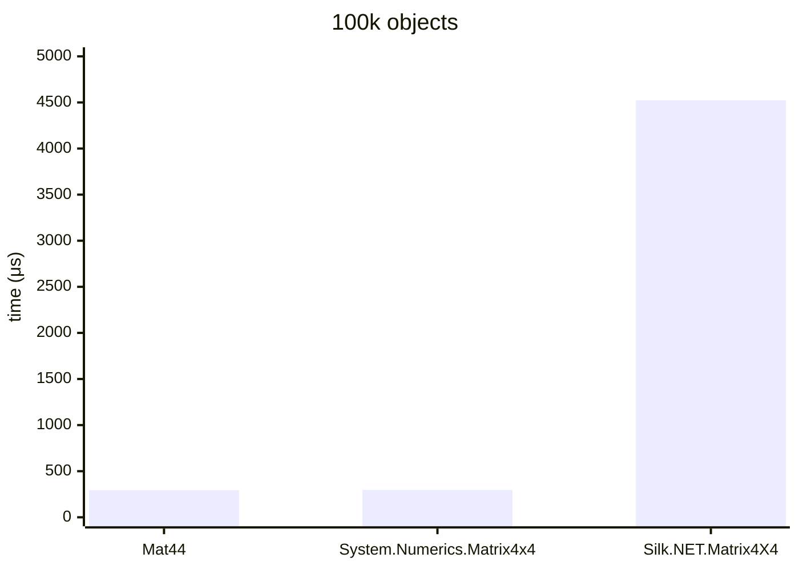
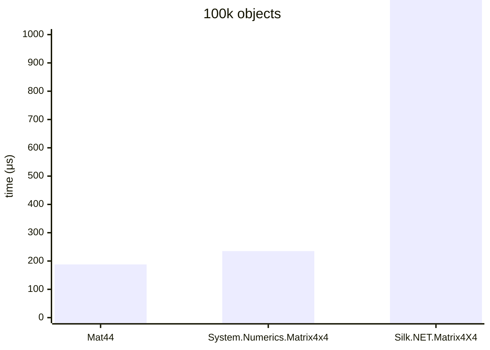
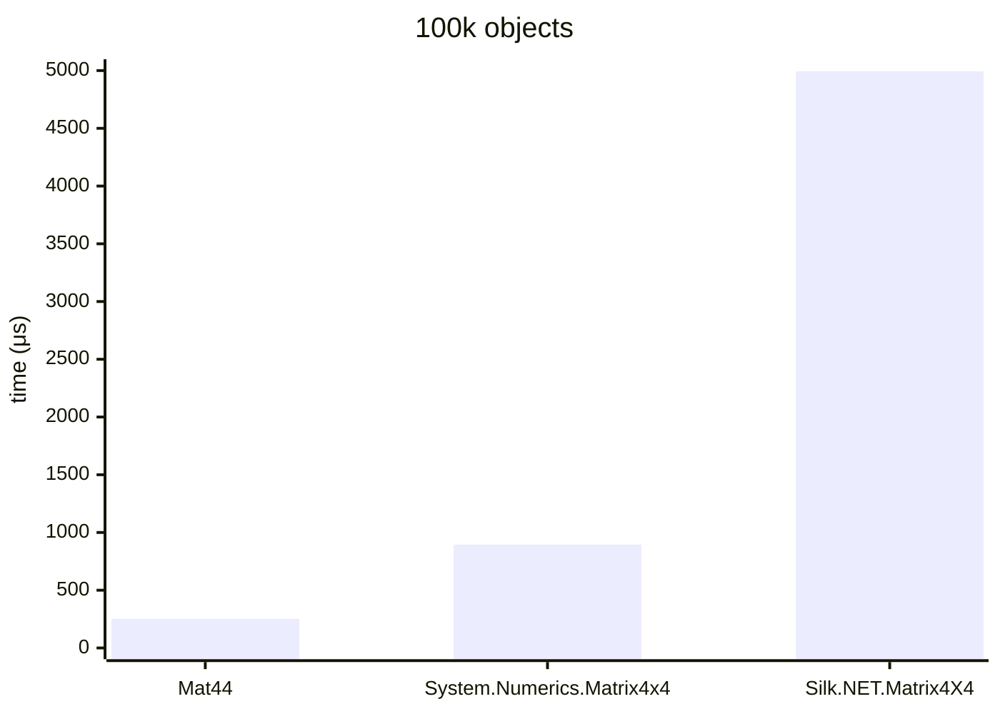

## .NET 11.0.0 (11.0.0, 11.0.26.53018), X64 RyuJIT x86-64-v4 (Job: Job-IHFIKV(Runtime=.NET 11.0))

```
BenchmarkDotNet v0.16.0-preview.2, Windows 11 (10.0.26300.9974)
AMD Ryzen 9 7900X 4.69GHz, 1 CPU, 24 logical and 12 physical cores
```

## Multiply



### Mat44&lt;float&gt;

<details>
<summary>asm</summary>

```assembly
; System.Numerics.Bench.BaseStressMat44`1[[System.Single, System.Private.CoreLib]].Multiply()
       sub       rsp,28
       xor       eax,eax
M00_L00:
       mov       rdx,[rcx+10]
       mov       r8,[rcx+8]
       mov       r10,r8
       mov       r9d,[r10+8]
       cmp       eax,r9d
       jae       near ptr M00_L01
       mov       r11,rax
       shl       r11,6
       lea       r10,[r10+r11+10]
       vmovups   xmm0,[r10]
       vmovups   xmm1,[r10+10]
       vmovups   xmm2,[r10+20]
       vmovups   xmm3,[r10+30]
       lea       r10d,[rax+1]
       cmp       r10d,r9d
       jae       near ptr M00_L01
       mov       r9d,r10d
       shl       r9,6
       lea       r8,[r8+r9+10]
       vmovups   xmm4,[r8]
       vmovups   xmm5,[r8+10]
       vmovups   xmm16,[r8+20]
       vmovups   xmm17,[r8+30]
       vmovaps   xmm18,xmm0
       vbroadcastss xmm18,xmm18
       vmovshdup xmm19,xmm0
       vpermilpd xmm20,xmm19,1
       vbroadcastss xmm20,xmm20
       vunpckhps xmm0,xmm0,xmm0
       vbroadcastss xmm0,xmm0
       vbroadcastss xmm19,xmm19
       vmulps    xmm18,xmm18,xmm4
       vfmadd231ps xmm18,xmm19,xmm5
       vfmadd213ps xmm0,xmm16,xmm18
       vfmadd231ps xmm0,xmm20,xmm17
       vmovaps   xmm18,xmm1
       vbroadcastss xmm18,xmm18
       vmovshdup xmm19,xmm1
       vpermilpd xmm20,xmm19,1
       vbroadcastss xmm20,xmm20
       vunpckhps xmm1,xmm1,xmm1
       vbroadcastss xmm1,xmm1
       vbroadcastss xmm19,xmm19
       vmulps    xmm18,xmm18,xmm4
       vfmadd231ps xmm18,xmm19,xmm5
       vfmadd213ps xmm1,xmm16,xmm18
       vfmadd231ps xmm1,xmm20,xmm17
       vmovaps   xmm18,xmm2
       vbroadcastss xmm18,xmm18
       vmovshdup xmm19,xmm2
       vpermilpd xmm20,xmm19,1
       vbroadcastss xmm20,xmm20
       vunpckhps xmm2,xmm2,xmm2
       vbroadcastss xmm2,xmm2
       vbroadcastss xmm19,xmm19
       vmulps    xmm18,xmm18,xmm4
       vfmadd231ps xmm18,xmm19,xmm5
       vfmadd213ps xmm2,xmm16,xmm18
       vfmadd231ps xmm2,xmm20,xmm17
       vmovaps   xmm18,xmm3
       vbroadcastss xmm18,xmm18
       vmovshdup xmm19,xmm3
       vpermilpd xmm20,xmm19,1
       vbroadcastss xmm20,xmm20
       vunpckhps xmm3,xmm3,xmm3
       vbroadcastss xmm3,xmm3
       vbroadcastss xmm19,xmm19
       vmulps    xmm4,xmm18,xmm4
       vfmadd213ps xmm5,xmm19,xmm4
       vfmadd213ps xmm3,xmm16,xmm5
       vfmadd213ps xmm17,xmm20,xmm3
       cmp       eax,[rdx+8]
       jae       short M00_L01
       lea       rax,[rdx+r11+10]
       vmovups   [rax],xmm0
       vmovups   [rax+10],xmm1
       vmovups   [rax+20],xmm2
       vmovups   [rax+30],xmm17
       mov       eax,r10d
       cmp       eax,1869F
       jl        near ptr M00_L00
       add       rsp,28
       ret
M00_L01:
       call      Internal.Runtime.CompilerHelpers.ThrowHelpers.ThrowIndexOutOfRangeException()
       int       3
; Total bytes of code 451
```
</details>

### System.Numerics.Matrix4x4

<details>
<summary>asm</summary>

```assembly
; System.Numerics.Bench.StressMatrix4x4.Multiply()
       sub       rsp,28
       xor       eax,eax
M00_L00:
       mov       rdx,[rcx+10]
       mov       r8,[rcx+8]
       mov       r10,r8
       mov       r9d,[r10+8]
       cmp       eax,r9d
       jae       near ptr 00000000000038DB
       mov       r11,rax
       shl       r11,6
       lea       r10,[r10+r11+10]
       vmovups   xmm0,[r10]
       vmovups   xmm1,[r10+10]
       vmovups   xmm2,[r10+20]
       vmovups   xmm3,[r10+30]
       lea       r10d,[rax+1]
       cmp       r10d,r9d
       jae       near ptr 00000000000038DB
       mov       r9d,r10d
       shl       r9,6
       lea       r8,[r8+r9+10]
       vmovups   xmm4,[r8]
       vmovups   xmm5,[r8+10]
       vmovups   xmm16,[r8+20]
       vmovups   xmm17,[r8+30]
       vunpckhps xmm18,xmm0,xmm0
       vbroadcastss xmm18,xmm18
       vmovshdup xmm19,xmm0
       vbroadcastss xmm19,xmm19
       vmovaps   xmm20,xmm0
       vbroadcastss xmm20,xmm20
       vmulps    xmm20,xmm20,xmm4
       vfmadd213ps xmm19,xmm5,xmm20
       vfmadd213ps xmm18,xmm16,xmm19
       vshufps   xmm0,xmm0,xmm0,0FF
       vbroadcastss xmm0,xmm0
       vfmadd213ps xmm0,xmm17,xmm18
       vunpckhps xmm18,xmm1,xmm1
       vbroadcastss xmm18,xmm18
       vmovshdup xmm19,xmm1
       vbroadcastss xmm19,xmm19
       vmovaps   xmm20,xmm1
       vbroadcastss xmm20,xmm20
       vmulps    xmm20,xmm20,xmm4
       vfmadd213ps xmm19,xmm5,xmm20
       vfmadd213ps xmm18,xmm16,xmm19
       vshufps   xmm1,xmm1,xmm1,0FF
       vbroadcastss xmm1,xmm1
       vfmadd213ps xmm1,xmm17,xmm18
       vunpckhps xmm18,xmm2,xmm2
       vbroadcastss xmm18,xmm18
       vmovshdup xmm19,xmm2
       vbroadcastss xmm19,xmm19
       vmovaps   xmm20,xmm2
       vbroadcastss xmm20,xmm20
       vmulps    xmm20,xmm20,xmm4
       vfmadd213ps xmm19,xmm5,xmm20
       vfmadd213ps xmm18,xmm16,xmm19
       vshufps   xmm2,xmm2,xmm2,0FF
       vbroadcastss xmm2,xmm2
       vfmadd213ps xmm2,xmm17,xmm18
       vunpckhps xmm18,xmm3,xmm3
       vbroadcastss xmm18,xmm18
       vmovshdup xmm19,xmm3
       vbroadcastss xmm19,xmm19
       vmovaps   xmm20,xmm3
       vbroadcastss xmm20,xmm20
       vmulps    xmm4,xmm20,xmm4
       vfmadd213ps xmm5,xmm19,xmm4
       vfmadd213ps xmm16,xmm18,xmm5
       vshufps   xmm3,xmm3,xmm3,0FF
       vbroadcastss xmm3,xmm3
       vfmadd213ps xmm3,xmm17,xmm16
       cmp       eax,[rdx+8]
       jae       short 00000000000038DB
       lea       rax,[rdx+r11+10]
       vmovups   [rax],xmm0
       vmovups   [rax+10],xmm1
       vmovups   [rax+20],xmm2
       vmovups   [rax+30],xmm3
       mov       eax,r10d
       cmp       eax,1869F
       jl        near ptr 0000000000003726
       add       rsp,28
       ret
M00_L01:
       call      0000000000001620
       int       3
; Total bytes of code 449
```
</details>

### Silk.NET.Matrix4X4&lt;float&gt;

<details>
<summary>asm</summary>

```assembly
; System.Numerics.Bench.BaseStressMatrix4X4`1[[System.Single, System.Private.CoreLib]].Multiply()
       push      r14
       push      rdi
       push      rsi
       push      rbp
       push      rbx
       sub       rsp,2C0
       vmovaps   [rsp+2B0],xmm6
       vmovaps   [rsp+2A0],xmm7
       vmovaps   [rsp+290],xmm8
       vmovaps   [rsp+280],xmm9
       vmovaps   [rsp+270],xmm10
       vmovaps   [rsp+260],xmm11
       vmovaps   [rsp+250],xmm12
       vmovaps   [rsp+240],xmm13
       vmovaps   [rsp+230],xmm14
       vmovaps   [rsp+220],xmm15
       mov       rbx,rcx
       xor       esi,esi
M00_L00:
       mov       rdi,[rbx+10]
       mov       rdx,[rbx+8]
       mov       r8,rdx
       mov       ecx,[r8+8]
       cmp       esi,ecx
       jae       near ptr 0000000000005C39
       mov       rbp,rsi
       shl       rbp,6
       lea       r8,[r8+rbp+10]
       vmovss    xmm0,dword ptr [r8]
       vmovss    xmm1,dword ptr [r8+4]
       vmovss    xmm2,dword ptr [r8+8]
       vmovss    xmm3,dword ptr [r8+0C]
       vmovss    xmm4,dword ptr [r8+10]
       vmovss    xmm5,dword ptr [r8+14]
       vmovss    xmm16,dword ptr [r8+18]
       vmovss    xmm6,dword ptr [r8+1C]
       vmovss    xmm7,dword ptr [r8+20]
       vmovss    xmm8,dword ptr [r8+24]
       vmovss    dword ptr [rsp+74],xmm8
       vmovss    xmm9,dword ptr [r8+28]
       vmovss    dword ptr [rsp+70],xmm9
       vmovss    xmm10,dword ptr [r8+2C]
       vmovss    dword ptr [rsp+6C],xmm10
       vmovss    xmm11,dword ptr [r8+30]
       vmovss    dword ptr [rsp+68],xmm11
       vmovss    xmm12,dword ptr [r8+34]
       vmovss    dword ptr [rsp+64],xmm12
       vmovss    xmm13,dword ptr [r8+38]
       vmovss    dword ptr [rsp+60],xmm13
       vmovss    xmm14,dword ptr [r8+3C]
       lea       r14d,[rsi+1]
       cmp       r14d,ecx
       jae       near ptr 0000000000005C39
       mov       r8d,r14d
       shl       r8,6
       lea       rdx,[rdx+r8+10]
       vmovss    xmm15,dword ptr [rdx+30]
       vmovss    xmm17,dword ptr [rdx+34]
       vmovss    dword ptr [rsp+5C],xmm17
       vmovss    xmm18,dword ptr [rdx+38]
       vmovss    dword ptr [rsp+58],xmm18
       vmovss    xmm19,dword ptr [rdx+3C]
       vmovss    dword ptr [rsp+54],xmm19
       vmovdqu32 zmm20,[rdx]
       vmovdqu32 [rsp+1E0],zmm20
       vmovss    xmm20,dword ptr [rsp+1E0]
       vmovaps   xmm21,xmm20
       vmovss    xmm22,dword ptr [rsp+1E4]
       vmovaps   xmm23,xmm22
       vmovss    xmm24,dword ptr [rsp+1E8]
       vmovaps   xmm25,xmm24
       vmovss    xmm26,dword ptr [rsp+1EC]
       vmovaps   xmm27,xmm26
       vmulss    xmm21,xmm21,xmm0
       vmulss    xmm23,xmm23,xmm0
       vmulss    xmm25,xmm25,xmm0
       vmulss    xmm0,xmm27,xmm0
       vmovss    xmm27,dword ptr [rsp+1F0]
       vmovaps   xmm28,xmm27
       vmovss    xmm29,dword ptr [rsp+1F4]
       vmovaps   xmm30,xmm29
       vmovss    xmm31,dword ptr [rsp+1F8]
       vmovaps   xmm13,xmm31
       vmovss    xmm12,dword ptr [rsp+1FC]
       vmovaps   xmm11,xmm12
       vmulss    xmm28,xmm28,xmm1
       vmulss    xmm30,xmm30,xmm1
       vmulss    xmm13,xmm13,xmm1
       vmulss    xmm1,xmm11,xmm1
       vaddss    xmm21,xmm21,xmm28
       vaddss    xmm23,xmm23,xmm30
       vaddss    xmm25,xmm25,xmm13
       vaddss    xmm0,xmm0,xmm1
       vmovss    xmm1,dword ptr [rsp+200]
       vmovaps   xmm28,xmm1
       vmovss    xmm30,dword ptr [rsp+204]
       vmovaps   xmm11,xmm30
       vmovss    xmm13,dword ptr [rsp+208]
       vmovaps   xmm10,xmm13
       vmovss    xmm9,dword ptr [rsp+20C]
       vmovaps   xmm8,xmm9
       vmulss    xmm28,xmm28,xmm2
       vmulss    xmm11,xmm11,xmm2
       vmulss    xmm10,xmm10,xmm2
       vmulss    xmm2,xmm8,xmm2
       vaddss    xmm21,xmm21,xmm28
       vaddss    xmm23,xmm23,xmm11
       vaddss    xmm25,xmm25,xmm10
       vaddss    xmm0,xmm0,xmm2
       vmulss    xmm2,xmm15,xmm3
       vmulss    xmm28,xmm17,xmm3
       vmulss    xmm8,xmm18,xmm3
       vmulss    xmm3,xmm19,xmm3
       vaddss    xmm10,xmm21,xmm2
       vaddss    xmm11,xmm23,xmm28
       vaddss    xmm8,xmm25,xmm8
       vaddss    xmm0,xmm0,xmm3
       vmovss    dword ptr [rsp+9C],xmm0
       vmulss    xmm2,xmm20,xmm4
       vmulss    xmm3,xmm22,xmm4
       vmulss    xmm20,xmm24,xmm4
       vmulss    xmm4,xmm26,xmm4
       vmulss    xmm21,xmm27,xmm5
       vmulss    xmm22,xmm29,xmm5
       vmulss    xmm23,xmm31,xmm5
       vmulss    xmm5,xmm12,xmm5
       vaddss    xmm2,xmm21,xmm2
       vaddss    xmm3,xmm22,xmm3
       vaddss    xmm20,xmm20,xmm23
       vaddss    xmm4,xmm4,xmm5
       vmulss    xmm1,xmm16,xmm1
       vmulss    xmm5,xmm30,xmm16
       vmulss    xmm21,xmm13,xmm16
       vmulss    xmm16,xmm9,xmm16
       vmovss    dword ptr [rsp+40],xmm2
       vmovss    dword ptr [rsp+44],xmm3
       vmovss    dword ptr [rsp+48],xmm20
       vmovss    dword ptr [rsp+4C],xmm4
       vmovss    dword ptr [rsp+30],xmm1
       vmovss    dword ptr [rsp+34],xmm5
       vmovss    dword ptr [rsp+38],xmm21
       vmovss    dword ptr [rsp+3C],xmm16
       lea       rdx,[rsp+40]
       lea       r8,[rsp+30]
       lea       rcx,[rsp+1D0]
       call      qword ptr [5488]; Silk.NET.Maths.Vector4D`1[[System.Single, System.Private.CoreLib]].op_Addition(Silk.NET.Maths.Vector4D`1<Single>, Silk.NET.Maths.Vector4D`1<Single>)
       vmovaps   xmm0,xmm15
       vmovaps   xmm1,xmm6
       call      qword ptr [56B0]; Silk.NET.Maths.Scalar.Multiply[[System.Single, System.Private.CoreLib]](Single, Single)
       vmovaps   xmm9,xmm0
       vmovss    xmm0,dword ptr [rsp+5C]
       vmovaps   xmm1,xmm6
       call      qword ptr [56B0]; Silk.NET.Maths.Scalar.Multiply[[System.Single, System.Private.CoreLib]](Single, Single)
       vmovaps   xmm12,xmm0
       vmovss    xmm0,dword ptr [rsp+58]
       vmovaps   xmm1,xmm6
       call      qword ptr [56B0]; Silk.NET.Maths.Scalar.Multiply[[System.Single, System.Private.CoreLib]](Single, Single)
       vmovaps   xmm13,xmm0
       vxorps    xmm0,xmm0,xmm0
       vmovups   [rsp+88],xmm0
       vmovss    xmm0,dword ptr [rsp+54]
       vmovaps   xmm1,xmm6
       call      qword ptr [56B0]; Silk.NET.Maths.Scalar.Multiply[[System.Single, System.Private.CoreLib]](Single, Single)
       vmovss    dword ptr [rsp+20],xmm0
       lea       rcx,[rsp+88]
       vmovaps   xmm1,xmm9
       vmovaps   xmm2,xmm12
       vmovaps   xmm3,xmm13
       call      qword ptr [0C480]; Silk.NET.Maths.Vector4D`1[[System.Single, System.Private.CoreLib]]..ctor(Single, Single, Single, Single)
       vmovups   xmm0,[rsp+88]
       vmovups   [rsp+40],xmm0
       lea       r8,[rsp+40]
       lea       rdx,[rsp+1D0]
       lea       rcx,[rsp+1C0]
       call      qword ptr [5488]; Silk.NET.Maths.Vector4D`1[[System.Single, System.Private.CoreLib]].op_Addition(Silk.NET.Maths.Vector4D`1<Single>, Silk.NET.Maths.Vector4D`1<Single>)
       vmovups   xmm2,[rsp+1E0]
       vmovups   [rsp+40],xmm2
       lea       rdx,[rsp+40]
       lea       rcx,[rsp+1B0]
       vmovaps   xmm2,xmm7
       call      qword ptr [0C8A0]; Silk.NET.Maths.Vector4D`1[[System.Single, System.Private.CoreLib]].op_Multiply(Silk.NET.Maths.Vector4D`1<Single>, Single)
       vmovups   xmm2,[rsp+1F0]
       vmovups   [rsp+40],xmm2
       lea       rdx,[rsp+40]
       lea       rcx,[rsp+1A0]
       vmovss    xmm2,dword ptr [rsp+74]
       call      qword ptr [0C8A0]; Silk.NET.Maths.Vector4D`1[[System.Single, System.Private.CoreLib]].op_Multiply(Silk.NET.Maths.Vector4D`1<Single>, Single)
       lea       rcx,[rsp+190]
       lea       rdx,[rsp+1B0]
       lea       r8,[rsp+1A0]
       call      qword ptr [5488]; Silk.NET.Maths.Vector4D`1[[System.Single, System.Private.CoreLib]].op_Addition(Silk.NET.Maths.Vector4D`1<Single>, Silk.NET.Maths.Vector4D`1<Single>)
       vmovups   xmm2,[rsp+200]
       vmovups   [rsp+40],xmm2
       lea       rdx,[rsp+40]
       lea       rcx,[rsp+180]
       vmovss    xmm2,dword ptr [rsp+70]
       call      qword ptr [0C8A0]; Silk.NET.Maths.Vector4D`1[[System.Single, System.Private.CoreLib]].op_Multiply(Silk.NET.Maths.Vector4D`1<Single>, Single)
       lea       rcx,[rsp+170]
       lea       rdx,[rsp+190]
       lea       r8,[rsp+180]
       call      qword ptr [5488]; Silk.NET.Maths.Vector4D`1[[System.Single, System.Private.CoreLib]].op_Addition(Silk.NET.Maths.Vector4D`1<Single>, Silk.NET.Maths.Vector4D`1<Single>)
       vmovss    dword ptr [rsp+210],xmm15
       vmovss    xmm6,dword ptr [rsp+5C]
       vmovss    dword ptr [rsp+214],xmm6
       vmovss    xmm7,dword ptr [rsp+58]
       vmovss    dword ptr [rsp+218],xmm7
       vmovss    xmm9,dword ptr [rsp+54]
       vmovss    dword ptr [rsp+21C],xmm9
       vmovups   xmm2,[rsp+210]
       vmovups   [rsp+40],xmm2
       lea       rdx,[rsp+40]
       lea       rcx,[rsp+160]
       vmovss    xmm2,dword ptr [rsp+6C]
       call      qword ptr [0C8A0]; Silk.NET.Maths.Vector4D`1[[System.Single, System.Private.CoreLib]].op_Multiply(Silk.NET.Maths.Vector4D`1<Single>, Single)
       lea       rcx,[rsp+150]
       lea       rdx,[rsp+170]
       lea       r8,[rsp+160]
       call      qword ptr [5488]; Silk.NET.Maths.Vector4D`1[[System.Single, System.Private.CoreLib]].op_Addition(Silk.NET.Maths.Vector4D`1<Single>, Silk.NET.Maths.Vector4D`1<Single>)
       vmovups   xmm2,[rsp+1E0]
       vmovups   [rsp+40],xmm2
       lea       rdx,[rsp+40]
       lea       rcx,[rsp+140]
       vmovss    xmm2,dword ptr [rsp+68]
       call      qword ptr [0C8A0]; Silk.NET.Maths.Vector4D`1[[System.Single, System.Private.CoreLib]].op_Multiply(Silk.NET.Maths.Vector4D`1<Single>, Single)
       vmovups   xmm2,[rsp+1F0]
       vmovups   [rsp+40],xmm2
       lea       rdx,[rsp+40]
       lea       rcx,[rsp+130]
       vmovss    xmm2,dword ptr [rsp+64]
       call      qword ptr [0C8A0]; Silk.NET.Maths.Vector4D`1[[System.Single, System.Private.CoreLib]].op_Multiply(Silk.NET.Maths.Vector4D`1<Single>, Single)
       lea       rcx,[rsp+120]
       lea       rdx,[rsp+140]
       lea       r8,[rsp+130]
       call      qword ptr [5488]; Silk.NET.Maths.Vector4D`1[[System.Single, System.Private.CoreLib]].op_Addition(Silk.NET.Maths.Vector4D`1<Single>, Silk.NET.Maths.Vector4D`1<Single>)
       lea       rcx,[rsp+110]
       lea       rdx,[rsp+200]
       vmovss    xmm2,dword ptr [rsp+60]
       call      qword ptr [0C8A0]; Silk.NET.Maths.Vector4D`1[[System.Single, System.Private.CoreLib]].op_Multiply(Silk.NET.Maths.Vector4D`1<Single>, Single)
       lea       rcx,[rsp+100]
       lea       rdx,[rsp+120]
       lea       r8,[rsp+110]
       call      qword ptr [5488]; Silk.NET.Maths.Vector4D`1[[System.Single, System.Private.CoreLib]].op_Addition(Silk.NET.Maths.Vector4D`1<Single>, Silk.NET.Maths.Vector4D`1<Single>)
       vmovaps   xmm0,xmm15
       vmovaps   xmm1,xmm14
       call      qword ptr [56B0]; Silk.NET.Maths.Scalar.Multiply[[System.Single, System.Private.CoreLib]](Single, Single)
       vmovaps   xmm12,xmm0
       vmovaps   xmm0,xmm6
       vmovaps   xmm1,xmm14
       call      qword ptr [56B0]; Silk.NET.Maths.Scalar.Multiply[[System.Single, System.Private.CoreLib]](Single, Single)
       vmovaps   xmm6,xmm0
       vmovaps   xmm0,xmm7
       vmovaps   xmm1,xmm14
       call      qword ptr [56B0]; Silk.NET.Maths.Scalar.Multiply[[System.Single, System.Private.CoreLib]](Single, Single)
       vmovaps   xmm7,xmm0
       vxorps    xmm0,xmm0,xmm0
       vmovups   [rsp+78],xmm0
       vmovaps   xmm0,xmm9
       vmovaps   xmm1,xmm14
       call      qword ptr [56B0]; Silk.NET.Maths.Scalar.Multiply[[System.Single, System.Private.CoreLib]](Single, Single)
       vmovss    dword ptr [rsp+20],xmm0
       lea       rcx,[rsp+78]
       vmovaps   xmm1,xmm12
       vmovaps   xmm2,xmm6
       vmovaps   xmm3,xmm7
       call      qword ptr [0C480]; Silk.NET.Maths.Vector4D`1[[System.Single, System.Private.CoreLib]]..ctor(Single, Single, Single, Single)
       vmovups   xmm0,[rsp+78]
       vmovups   [rsp+0F0],xmm0
       vxorps    ymm0,ymm0,ymm0
       vmovdqu32 [rsp+0B0],zmm0
       lea       rcx,[rsp+0A0]
       lea       rdx,[rsp+100]
       lea       r8,[rsp+0F0]
       call      qword ptr [5488]; Silk.NET.Maths.Vector4D`1[[System.Single, System.Private.CoreLib]].op_Addition(Silk.NET.Maths.Vector4D`1<Single>, Silk.NET.Maths.Vector4D`1<Single>)
       vmovss    dword ptr [rsp+40],xmm10
       vmovss    dword ptr [rsp+44],xmm11
       vmovss    dword ptr [rsp+48],xmm8
       vmovss    xmm6,dword ptr [rsp+9C]
       vmovss    dword ptr [rsp+4C],xmm6
       lea       rdx,[rsp+0A0]
       mov       [rsp+20],rdx
       lea       rdx,[rsp+40]
       lea       rcx,[rsp+0B0]
       lea       r8,[rsp+1C0]
       lea       r9,[rsp+150]
       call      qword ptr [55F0]; Silk.NET.Maths.Matrix4X4`1[[System.Single, System.Private.CoreLib]]..ctor(Silk.NET.Maths.Vector4D`1<Single>, Silk.NET.Maths.Vector4D`1<Single>, Silk.NET.Maths.Vector4D`1<Single>, Silk.NET.Maths.Vector4D`1<Single>)
       cmp       esi,[rdi+8]
       jae       near ptr 0000000000005C39
       vmovdqu32 zmm0,[rsp+0B0]
       vmovdqu32 [rdi+rbp+10],zmm0
       mov       esi,r14d
       cmp       esi,1869F
       jl        near ptr 0000000000005542
       vzeroupper
       vmovaps   xmm6,[rsp+2B0]
       vmovaps   xmm7,[rsp+2A0]
       vmovaps   xmm8,[rsp+290]
       vmovaps   xmm9,[rsp+280]
       vmovaps   xmm10,[rsp+270]
       vmovaps   xmm11,[rsp+260]
       vmovaps   xmm12,[rsp+250]
       vmovaps   xmm13,[rsp+240]
       vmovaps   xmm14,[rsp+230]
       vmovaps   xmm15,[rsp+220]
       add       rsp,2C0
       pop       rbx
       pop       rbp
       pop       rsi
       pop       rdi
       pop       r14
       ret
M00_L01:
       call      0000000000001620
       int       3
; Total bytes of code 1887

; Silk.NET.Maths.Vector4D`1[[System.Single, System.Private.CoreLib]].op_Addition(Silk.NET.Maths.Vector4D`1<Single>, Silk.NET.Maths.Vector4D`1<Single>)
       vmovss    xmm0,dword ptr [rdx]
       vaddss    xmm0,xmm0,dword ptr [r8]
       vmovss    xmm1,dword ptr [rdx+4]
       vaddss    xmm1,xmm1,dword ptr [r8+4]
       vmovss    xmm2,dword ptr [rdx+8]
       vaddss    xmm2,xmm2,dword ptr [r8+8]
       vmovss    xmm3,dword ptr [rdx+0C]
       vaddss    xmm3,xmm3,dword ptr [r8+0C]
       vmovss    dword ptr [rcx],xmm0
       vmovss    dword ptr [rcx+4],xmm1
       vmovss    dword ptr [rcx+8],xmm2
       vmovss    dword ptr [rcx+0C],xmm3
       mov       rax,rcx
       ret
; Total bytes of code 65

; Silk.NET.Maths.Scalar.Multiply[[System.Single, System.Private.CoreLib]](Single, Single)
       vmulss    xmm0,xmm0,xmm1
       ret
; Total bytes of code 5

; Silk.NET.Maths.Vector4D`1[[System.Single, System.Private.CoreLib]]..ctor(Single, Single, Single, Single)
       vmovss    dword ptr [rcx],xmm1
       vmovss    dword ptr [rcx+4],xmm2
       vmovss    dword ptr [rcx+8],xmm3
       vmovss    xmm0,dword ptr [rsp+28]
       vmovss    dword ptr [rcx+0C],xmm0
       ret
; Total bytes of code 26

; Silk.NET.Maths.Vector4D`1[[System.Single, System.Private.CoreLib]].op_Multiply(Silk.NET.Maths.Vector4D`1<Single>, Single)
       vmulss    xmm0,xmm2,dword ptr [rdx]
       vmulss    xmm1,xmm2,dword ptr [rdx+4]
       vmulss    xmm3,xmm2,dword ptr [rdx+8]
       vmulss    xmm2,xmm2,dword ptr [rdx+0C]
       vmovss    dword ptr [rcx],xmm0
       vmovss    dword ptr [rcx+4],xmm1
       vmovss    dword ptr [rcx+8],xmm3
       vmovss    dword ptr [rcx+0C],xmm2
       mov       rax,rcx
       ret
; Total bytes of code 42

; Silk.NET.Maths.Matrix4X4`1[[System.Single, System.Private.CoreLib]]..ctor(Silk.NET.Maths.Vector4D`1<Single>, Silk.NET.Maths.Vector4D`1<Single>, Silk.NET.Maths.Vector4D`1<Single>, Silk.NET.Maths.Vector4D`1<Single>)
       mov       rax,[rsp+28]
       vmovups   xmm0,[rdx]
       vmovups   [rcx],xmm0
       vmovups   xmm0,[r8]
       vmovups   [rcx+10],xmm0
       vmovups   xmm0,[r9]
       vmovups   [rcx+20],xmm0
       vmovups   xmm0,[rax]
       vmovups   [rcx+30],xmm0
       ret
; Total bytes of code 43
```
</details></br>

## Rotation (from quaternion)



### Mat44&lt;float&gt;

<details>
<summary>asm</summary>

```assembly
; System.Numerics.Bench.StressMat44WithQuat`1[[System.Single, System.Private.CoreLib]].Rotation()
       sub       rsp,68
       xor       eax,eax
       mov       [rsp+28],rax
       vxorps    xmm4,xmm4,xmm4
       vmovdqu   ymmword ptr [rsp+30],ymm4
       vmovdqa   xmmword ptr [rsp+50],xmm4
       mov       [rsp+60],rax
       xor       eax,eax
       mov       rdx,1B9242C8650
M00_L00:
       mov       r8,[rcx+10]
       mov       r10,[rcx+18]
       cmp       eax,[r10+8]
       jae       near ptr M00_L01
       mov       r9d,eax
       mov       r11,r9
       shl       r11,4
       vmovups   xmm0,[r10+r11+10]
       vpshufd   xmm1,xmm0,0D2
       vpshufd   xmm2,xmm0,0C9
       vmulps    xmm2,xmm2,xmm0
       vpshufd   xmm3,xmm0,0FF
       vmulps    xmm1,xmm3,xmm1
       vmulps    xmm0,xmm0,xmm0
       vaddps    xmm3,xmm2,xmm1
       vsubps    xmm1,xmm2,xmm1
       vaddps    xmm2,xmm3,xmm3
       vaddps    xmm1,xmm1,xmm1
       vpshufd   xmm3,xmm0,0C9
       vaddps    xmm0,xmm3,xmm0
       vaddps    xmm0,xmm0,xmm0
       vbroadcastss xmm3,dword ptr [7FFE95607E1C]
       vsubps    xmm0,xmm3,xmm0
       vmovshdup xmm3,xmm0
       vinsertps xmm3,xmm1,xmm3,0
       vmovaps   xmm4,xmm2
       vinsertps xmm3,xmm3,xmm4,10
       vunpckhps xmm4,xmm0,xmm0
       vinsertps xmm4,xmm1,xmm4,10
       vmovshdup xmm5,xmm2
       vinsertps xmm4,xmm4,xmm5,20
       vunpckhps xmm2,xmm2,xmm2
       vinsertps xmm1,xmm1,xmm2,0
       vinsertps xmm0,xmm1,xmm0,20
       vmovups   xmm1,[rdx]
       vmovups   [rsp+58],xmm1
       vmovups   xmm1,[rsp+58]
       cmp       eax,[r8+8]
       jae       short M00_L01
       shl       r9,6
       lea       r8,[r8+r9+10]
       vmovups   [r8],xmm3
       vmovups   [r8+10],xmm4
       vmovups   [r8+20],xmm0
       vmovups   [r8+30],xmm1
       inc       eax
       cmp       eax,186A0
       jl        near ptr M00_L00
       add       rsp,68
       ret
M00_L01:
       call      Internal.Runtime.CompilerHelpers.ThrowHelpers.ThrowIndexOutOfRangeException()
       int       3
; Total bytes of code 282
```
</details>

### System.Numerics.Matrix4x4

<details>
<summary>asm</summary>

```assembly
; System.Numerics.Bench.StressMatrix4x4.Rotation()
       sub       rsp,28
       xor       eax,eax
       vmovss    xmm0,dword ptr [43A0]
       vmovss    xmm1,dword ptr [43A4]
       vmovups   xmm2,[43B0]
M00_L00:
       mov       rdx,[rcx+10]
       mov       r8,[rcx+18]
       cmp       eax,[r8+8]
       jae       near ptr 000000000000439A
       mov       r10d,eax
       mov       r9,r10
       shl       r9,4
       vmovups   xmm3,[r8+r9+10]
       vmovaps   xmm4,xmm3
       vmulss    xmm5,xmm4,xmm4
       vmovshdup xmm16,xmm3
       vmulss    xmm17,xmm16,xmm16
       vunpckhps xmm18,xmm3,xmm3
       vmulss    xmm19,xmm18,xmm18
       vmulss    xmm20,xmm16,xmm4
       vshufps   xmm3,xmm3,xmm3,0FF
       vmulss    xmm21,xmm18,xmm3
       vmulss    xmm22,xmm18,xmm4
       vmulss    xmm23,xmm16,xmm3
       vmulss    xmm16,xmm16,xmm18
       vmulss    xmm3,xmm4,xmm3
       vaddss    xmm4,xmm17,xmm19
       vmulss    xmm4,xmm4,xmm0
       vsubss    xmm4,xmm1,xmm4
       vaddss    xmm18,xmm20,xmm21
       vmulss    xmm18,xmm18,xmm0
       vinsertps xmm4,xmm4,xmm18,10
       vsubss    xmm18,xmm22,xmm23
       vmulss    xmm18,xmm18,xmm0
       vinsertps xmm4,xmm4,xmm18,28
       vsubss    xmm18,xmm20,xmm21
       vmulss    xmm18,xmm18,xmm0
       vaddss    xmm19,xmm19,xmm5
       vmulss    xmm19,xmm19,xmm0
       vsubss    xmm19,xmm1,xmm19
       vinsertps xmm18,xmm18,xmm19,10
       vaddss    xmm19,xmm16,xmm3
       vmulss    xmm19,xmm19,xmm0
       vinsertps xmm18,xmm18,xmm19,28
       vaddss    xmm19,xmm22,xmm23
       vmulss    xmm19,xmm19,xmm0
       vsubss    xmm3,xmm16,xmm3
       vmulss    xmm3,xmm3,xmm0
       vinsertps xmm3,xmm19,xmm3,10
       vaddss    xmm5,xmm17,xmm5
       vmulss    xmm5,xmm5,xmm0
       vsubss    xmm5,xmm1,xmm5
       vinsertps xmm3,xmm3,xmm5,28
       cmp       eax,[rdx+8]
       jae       short 000000000000439A
       shl       r10,6
       lea       rdx,[rdx+r10+10]
       vmovups   [rdx],xmm4
       vmovups   [rdx+10],xmm18
       vmovups   [rdx+20],xmm3
       vmovups   [rdx+30],xmm2
       inc       eax
       cmp       eax,186A0
       jl        near ptr 000000000000425E
       add       rsp,28
       ret
M00_L01:
       call      0000000000001620
       int       3
; Total bytes of code 352
```
</details>

### Silk.NET.Matrix4X4&lt;float&gt;

<details>
<summary>asm</summary>

```assembly
; System.Numerics.Bench.StressMatrix4X4WithQuaternion`1[[System.Single, System.Private.CoreLib]].Rotation()
       push      rdi
       push      rsi
       push      rbx
       sub       rsp,70
       mov       rbx,rcx
       xor       esi,esi
M00_L00:
       mov       rdi,[rbx+10]
       mov       rdx,[rbx+28]
       cmp       esi,[rdx+8]
       jae       short 0000000000005D73
       mov       rcx,rsi
       shl       rcx,4
       vmovups   xmm0,[rdx+rcx+10]
       vmovups   [rsp+20],xmm0
       lea       rdx,[rsp+20]
       lea       rcx,[rsp+30]
       call      qword ptr [5608]; Silk.NET.Maths.Matrix4X4.CreateFromQuaternion[[System.Single, System.Private.CoreLib]](Silk.NET.Maths.Quaternion`1<Single>)
       cmp       esi,[rdi+8]
       jae       short 0000000000005D73
       mov       rax,rsi
       shl       rax,6
       vmovdqu32 zmm0,[rsp+30]
       vmovdqu32 [rdi+rax+10],zmm0
       inc       esi
       cmp       esi,186A0
       jl        short 0000000000005D0C
       vzeroupper
       add       rsp,70
       pop       rbx
       pop       rsi
       pop       rdi
       ret
M00_L01:
       call      0000000000001620
       int       3
; Total bytes of code 121

; Silk.NET.Maths.Matrix4X4.CreateFromQuaternion[[System.Single, System.Private.CoreLib]](Silk.NET.Maths.Quaternion`1<Single>)
       sub       rsp,48
       vmovss    xmm0,dword ptr [rdx]
       vmovss    xmm1,dword ptr [rdx+4]
       vmovss    xmm2,dword ptr [rdx+8]
       vmovss    xmm3,dword ptr [rdx+0C]
       mov       rax,147A42E3450
       vmovdqu32 zmm4,[rax]
       vmovdqu32 [rsp+8],zmm4
       vmulss    xmm4,xmm0,xmm0
       vmulss    xmm5,xmm1,xmm1
       vmulss    xmm16,xmm2,xmm2
       vmulss    xmm17,xmm0,xmm1
       vmulss    xmm18,xmm2,xmm3
       vmulss    xmm19,xmm2,xmm0
       vmulss    xmm20,xmm1,xmm3
       vmulss    xmm1,xmm1,xmm2
       vmulss    xmm0,xmm0,xmm3
       vmovdqu32 zmm2,[rsp+8]
       vmovdqu32 [rcx],zmm2
       vaddss    xmm2,xmm16,xmm5
       vmovss    xmm3,dword ptr [2940]
       vmulss    xmm2,xmm2,xmm3
       vmovss    xmm21,dword ptr [2944]
       vsubss    xmm2,xmm21,xmm2
       vmovss    dword ptr [rcx],xmm2
       vaddss    xmm2,xmm17,xmm18
       vmulss    xmm2,xmm2,xmm3
       vmovss    dword ptr [rcx+4],xmm2
       vsubss    xmm2,xmm19,xmm20
       vmulss    xmm2,xmm2,xmm3
       vmovss    dword ptr [rcx+8],xmm2
       vsubss    xmm2,xmm17,xmm18
       vmulss    xmm2,xmm2,xmm3
       vmovss    dword ptr [rcx+10],xmm2
       vaddss    xmm2,xmm16,xmm4
       vmulss    xmm2,xmm2,xmm3
       vsubss    xmm2,xmm21,xmm2
       vmovss    dword ptr [rcx+14],xmm2
       vaddss    xmm2,xmm1,xmm0
       vmulss    xmm2,xmm2,xmm3
       vmovss    dword ptr [rcx+18],xmm2
       vaddss    xmm2,xmm19,xmm20
       vmulss    xmm2,xmm2,xmm3
       vmovss    dword ptr [rcx+20],xmm2
       vsubss    xmm0,xmm1,xmm0
       vmulss    xmm0,xmm0,xmm3
       vmovss    dword ptr [rcx+24],xmm0
       vaddss    xmm0,xmm5,xmm4
       vmulss    xmm0,xmm0,xmm3
       vsubss    xmm0,xmm21,xmm0
       vmovss    dword ptr [rcx+28],xmm0
       mov       rax,rcx
       vzeroupper
       add       rsp,48
       ret
; Total bytes of code 288
```
</details></br>

## Affine (from quaternion, scale and translation vectors)



### Mat44&lt;float&gt;

<details>
<summary>asm</summary>

```assembly
; System.Numerics.Bench.StressMat44WithQuat`1[[System.Single, System.Private.CoreLib]].Affine()
       sub       rsp,28
       xor       eax,eax
       vmovss    xmm0,dword ptr [7FFE95618374]
M00_L00:
       mov       rdx,[rcx+10]
       mov       r8,[rcx+18]
       cmp       eax,[r8+8]
       jae       near ptr M00_L01
       mov       r10d,eax
       mov       r9,r10
       shl       r9,4
       vmovups   xmm1,[r8+r9+10]
       mov       r8,[rcx+20]
       cmp       eax,[r8+8]
       jae       near ptr M00_L01
       lea       r9,[r10+r10*2]
       lea       r8,[r8+r9*4+10]
       vmovss    xmm2,dword ptr [r8]
       vmovss    xmm3,dword ptr [r8+4]
       vmovss    xmm4,dword ptr [r8+8]
       mov       r8,[rcx+28]
       cmp       eax,[r8+8]
       jae       near ptr M00_L01
       lea       r8,[r8+r9*4+10]
       vmovss    xmm5,dword ptr [r8]
       vmovss    xmm16,dword ptr [r8+4]
       vmovss    xmm17,dword ptr [r8+8]
       vpshufd   xmm18,xmm1,0D2
       vpshufd   xmm19,xmm1,0C9
       vmulps    xmm19,xmm19,xmm1
       vpshufd   xmm20,xmm1,0FF
       vmulps    xmm18,xmm20,xmm18
       vmulps    xmm1,xmm1,xmm1
       vaddps    xmm20,xmm19,xmm18
       vsubps    xmm18,xmm19,xmm18
       vaddps    xmm19,xmm20,xmm20
       vaddps    xmm18,xmm18,xmm18
       vpshufd   xmm20,xmm1,0C9
       vaddps    xmm1,xmm20,xmm1
       vaddps    xmm1,xmm1,xmm1
       vbroadcastss xmm20,dword ptr [7FFE95618374]
       vsubps    xmm1,xmm20,xmm1
       vmovshdup xmm20,xmm1
       vinsertps xmm20,xmm18,xmm20,0
       vmovaps   xmm21,xmm19
       vinsertps xmm20,xmm20,xmm21,10
       vunpckhps xmm21,xmm1,xmm1
       vinsertps xmm21,xmm18,xmm21,10
       vmovshdup xmm22,xmm19
       vinsertps xmm21,xmm21,xmm22,20
       vunpckhps xmm19,xmm19,xmm19
       vinsertps xmm18,xmm18,xmm19,0
       vinsertps xmm1,xmm18,xmm1,20
       vbroadcastss xmm2,xmm2
       vmulps    xmm20,xmm20,xmm2
       vbroadcastss xmm2,xmm3
       vmulps    xmm21,xmm21,xmm2
       vbroadcastss xmm2,xmm4
       vmulps    xmm1,xmm2,xmm1
       cmp       eax,[rdx+8]
       jae       short M00_L01
       shl       r10,6
       lea       rdx,[rdx+r10+10]
       vmovups   [rdx],xmm20
       vmovups   [rdx+10],xmm21
       vmovups   [rdx+20],xmm1
       vmovss    dword ptr [rdx+30],xmm5
       vmovss    dword ptr [rdx+34],xmm16
       vmovss    dword ptr [rdx+38],xmm17
       vmovss    dword ptr [rdx+3C],xmm0
       inc       eax
       cmp       eax,186A0
       jl        near ptr M00_L00
       add       rsp,28
       ret
M00_L01:
       call      Internal.Runtime.CompilerHelpers.ThrowHelpers.ThrowIndexOutOfRangeException()
       int       3
; Total bytes of code 404
```
</details>

### System.Numerics.Matrix4x4

<details>
<summary>asm</summary>

```assembly
; System.Numerics.Bench.StressMatrix4x4.Affine()
       sub       rsp,28
       xor       eax,eax
       vmovss    xmm0,dword ptr [41D8]
       vmovss    xmm1,dword ptr [41DC]
       vmovups   xmm2,[41E0]
       vbroadcastss xmm3,dword ptr [41DC]
       vmovups   xmm4,[41F0]
       vmovsd    xmm5,qword ptr [4200]
       vmovss    xmm16,dword ptr [41DC]
M00_L00:
       mov       rdx,[rcx+10]
       mov       r8,[rcx+18]
       cmp       eax,[r8+8]
       jae       near ptr 00000000000041D0
       mov       r10d,eax
       mov       r9,r10
       shl       r9,4
       vmovups   xmm17,[r8+r9+10]
       vmovaps   xmm18,xmm17
       vmulss    xmm19,xmm18,xmm18
       vmovshdup xmm20,xmm17
       vmulss    xmm21,xmm20,xmm20
       vunpckhps xmm22,xmm17,xmm17
       vmulss    xmm23,xmm22,xmm22
       vmulss    xmm24,xmm18,xmm20
       vshufps   xmm17,xmm17,xmm17,0FF
       vmulss    xmm25,xmm22,xmm17
       vmulss    xmm26,xmm18,xmm22
       vmulss    xmm27,xmm20,xmm17
       vmulss    xmm20,xmm20,xmm22
       vmulss    xmm17,xmm18,xmm17
       vaddss    xmm18,xmm21,xmm23
       vmulss    xmm18,xmm18,xmm0
       vsubss    xmm18,xmm1,xmm18
       vaddss    xmm22,xmm24,xmm25
       vmulss    xmm22,xmm22,xmm0
       vinsertps xmm18,xmm18,xmm22,10
       vsubss    xmm22,xmm26,xmm27
       vmulss    xmm22,xmm22,xmm0
       vinsertps xmm18,xmm18,xmm22,28
       vsubss    xmm22,xmm24,xmm25
       vmulss    xmm22,xmm22,xmm0
       vaddss    xmm23,xmm23,xmm19
       vmulss    xmm23,xmm23,xmm0
       vsubss    xmm23,xmm1,xmm23
       vinsertps xmm22,xmm22,xmm23,10
       vaddss    xmm23,xmm20,xmm17
       vmulss    xmm23,xmm23,xmm0
       vinsertps xmm22,xmm22,xmm23,28
       vaddss    xmm23,xmm26,xmm27
       vmulss    xmm23,xmm23,xmm0
       vsubss    xmm17,xmm20,xmm17
       vmulss    xmm17,xmm17,xmm0
       vinsertps xmm17,xmm23,xmm17,10
       vaddss    xmm19,xmm21,xmm19
       vmulss    xmm19,xmm19,xmm0
       vsubss    xmm19,xmm1,xmm19
       vinsertps xmm17,xmm17,xmm19,28
       mov       r8,[rcx+20]
       cmp       eax,[r8+8]
       jae       near ptr 00000000000041D0
       lea       r9,[r10+r10*2]
       vmovsd    xmm19,qword ptr [r8+r9*4+10]
       vinsertps xmm19,xmm19,dword ptr [r8+r9*4+18],28
       vmovaps   xmm20,xmm19
       vinsertps xmm20,xmm20,xmm20,3E
       vmovshdup xmm21,xmm19
       vinsertps xmm21,xmm21,xmm21,1D
       vunpckhps xmm19,xmm19,xmm19
       vinsertps xmm19,xmm19,xmm19,2B
       vunpckhps xmm23,xmm18,xmm18
       vbroadcastss xmm23,xmm23
       vmovshdup xmm24,xmm18
       vbroadcastss xmm24,xmm24
       vmovaps   xmm25,xmm18
       vbroadcastss xmm25,xmm25
       vmulps    xmm25,xmm25,xmm20
       vfmadd213ps xmm24,xmm21,xmm25
       vfmadd213ps xmm23,xmm19,xmm24
       vshufps   xmm18,xmm18,xmm18,0FF
       vbroadcastss xmm18,xmm18
       vfmadd213ps xmm18,xmm2,xmm23
       vunpckhps xmm23,xmm22,xmm22
       vbroadcastss xmm23,xmm23
       vmovshdup xmm24,xmm22
       vbroadcastss xmm24,xmm24
       vmovaps   xmm25,xmm22
       vbroadcastss xmm25,xmm25
       vmulps    xmm25,xmm25,xmm20
       vfmadd213ps xmm24,xmm21,xmm25
       vfmadd213ps xmm23,xmm19,xmm24
       vshufps   xmm22,xmm22,xmm22,0FF
       vbroadcastss xmm22,xmm22
       vfmadd213ps xmm22,xmm2,xmm23
       vunpckhps xmm23,xmm17,xmm17
       vbroadcastss xmm23,xmm23
       vmovshdup xmm24,xmm17
       vbroadcastss xmm24,xmm24
       vmovaps   xmm25,xmm17
       vbroadcastss xmm25,xmm25
       vmulps    xmm25,xmm25,xmm20
       vfmadd213ps xmm24,xmm21,xmm25
       vfmadd213ps xmm23,xmm19,xmm24
       vshufps   xmm17,xmm17,xmm17,0FF
       vbroadcastss xmm17,xmm17
       vfmadd213ps xmm17,xmm2,xmm23
       vxorps    xmm23,xmm23,xmm23
       vxorps    xmm24,xmm24,xmm24
       vxorps    xmm25,xmm25,xmm25
       vmulps    xmm20,xmm25,xmm20
       vfmadd213ps xmm21,xmm24,xmm20
       vfmadd213ps xmm19,xmm23,xmm21
       vfmadd231ps xmm19,xmm3,xmm2
       mov       r8,[rcx+28]
       cmp       eax,[r8+8]
       jae       near ptr 00000000000041D0
       vmovsd    xmm20,qword ptr [r8+r9*4+10]
       vinsertps xmm20,xmm20,dword ptr [r8+r9*4+18],28
       vinsertps xmm20,xmm20,xmm1,30
       vunpckhps xmm21,xmm18,xmm18
       vbroadcastss xmm21,xmm21
       vmovshdup xmm23,xmm18
       vbroadcastss xmm23,xmm23
       vmovaps   xmm24,xmm18
       vbroadcastss xmm24,xmm24
       vmulps    xmm24,xmm24,xmm16
       vfmadd213ps xmm23,xmm5,xmm24
       vfmadd213ps xmm21,xmm4,xmm23
       vshufps   xmm18,xmm18,xmm18,0FF
       vbroadcastss xmm18,xmm18
       vfmadd213ps xmm18,xmm20,xmm21
       vunpckhps xmm21,xmm22,xmm22
       vbroadcastss xmm21,xmm21
       vmovshdup xmm23,xmm22
       vbroadcastss xmm23,xmm23
       vmovaps   xmm24,xmm22
       vbroadcastss xmm24,xmm24
       vmulps    xmm24,xmm24,xmm16
       vfmadd213ps xmm23,xmm5,xmm24
       vfmadd213ps xmm21,xmm4,xmm23
       vshufps   xmm22,xmm22,xmm22,0FF
       vbroadcastss xmm22,xmm22
       vfmadd231ps xmm21,xmm22,xmm20
       vunpckhps xmm22,xmm17,xmm17
       vbroadcastss xmm22,xmm22
       vmovshdup xmm23,xmm17
       vbroadcastss xmm23,xmm23
       vmovaps   xmm24,xmm17
       vbroadcastss xmm24,xmm24
       vmulps    xmm24,xmm24,xmm16
       vfmadd213ps xmm23,xmm5,xmm24
       vfmadd213ps xmm22,xmm4,xmm23
       vshufps   xmm17,xmm17,xmm17,0FF
       vbroadcastss xmm17,xmm17
       vfmadd213ps xmm17,xmm20,xmm22
       vunpckhps xmm22,xmm19,xmm19
       vbroadcastss xmm22,xmm22
       vmovshdup xmm23,xmm19
       vbroadcastss xmm23,xmm23
       vmovaps   xmm24,xmm19
       vbroadcastss xmm24,xmm24
       vmulps    xmm24,xmm24,xmm16
       vfmadd213ps xmm23,xmm5,xmm24
       vfmadd213ps xmm22,xmm4,xmm23
       vshufps   xmm19,xmm19,xmm19,0FF
       vbroadcastss xmm19,xmm19
       vfmadd213ps xmm19,xmm20,xmm22
       cmp       eax,[rdx+8]
       jae       short 00000000000041D0
       shl       r10,6
       lea       rdx,[rdx+r10+10]
       vmovups   [rdx],xmm18
       vmovups   [rdx+10],xmm21
       vmovups   [rdx+20],xmm17
       vmovups   [rdx+30],xmm19
       inc       eax
       cmp       eax,186A0
       jl        near ptr 0000000000003DE1
       add       rsp,28
       ret
M00_L01:
       call      0000000000001620
       int       3
; Total bytes of code 1078
```
</details>

### Silk.NET.Matrix4X4&lt;float&gt;

<details>
<summary>asm</summary>

```assembly
; System.Numerics.Bench.StressMatrix4X4WithQuaternion`1[[System.Single, System.Private.CoreLib]].Affine()
       push      rdi
       push      rsi
       push      rbp
       push      rbx
       sub       rsp,318
       vmovaps   [rsp+300],xmm6
       vmovaps   [rsp+2F0],xmm7
       vmovaps   [rsp+2E0],xmm8
       vmovaps   [rsp+2D0],xmm9
       vmovaps   [rsp+2C0],xmm10
       vmovaps   [rsp+2B0],xmm11
       vmovaps   [rsp+2A0],xmm12
       vmovaps   [rsp+290],xmm13
       vmovaps   [rsp+280],xmm14
       vmovaps   [rsp+270],xmm15
       vxorps    xmm4,xmm4,xmm4
       vmovdqu32 [rsp+1B0],zmm4
       mov       rbx,rcx
       xor       esi,esi
M00_L00:
       mov       rdi,[rbx+10]
       mov       r8,[rbx+18]
       cmp       esi,[r8+8]
       jae       near ptr 0000000000008F9C
       lea       rbp,[rsi+rsi*2]
       lea       r8,[r8+rbp*4+10]
       vmovss    xmm0,dword ptr [r8]
       vmovss    xmm1,dword ptr [r8+4]
       vmovss    xmm2,dword ptr [r8+8]
       mov       r8,238A43E3340
       vmovdqu32 zmm3,[r8]
       vmovdqu32 [rsp+1B0],zmm3
       vmovss    dword ptr [rsp+1B0],xmm0
       vmovss    dword ptr [rsp+1C4],xmm1
       vmovss    dword ptr [rsp+1D8],xmm2
       mov       r8,[rbx+28]
       cmp       esi,[r8+8]
       jae       near ptr 0000000000008F9C
       mov       rdx,rsi
       shl       rdx,4
       vmovups   xmm0,[r8+rdx+10]
       vmovups   [rsp+40],xmm0
       lea       r8,[rsp+40]
       lea       rdx,[rsp+1B0]
       lea       rcx,[rsp+230]
       call      qword ptr [5458]; Silk.NET.Maths.Matrix4X4.Transform[[System.Single, System.Private.CoreLib]](Silk.NET.Maths.Matrix4X4`1<Single>, Silk.NET.Maths.Quaternion`1<Single>)
       mov       rax,[rbx+20]
       cmp       esi,[rax+8]
       jae       near ptr 0000000000008F9C
       lea       rax,[rax+rbp*4+10]
       vmovss    xmm6,dword ptr [rax]
       vmovss    xmm7,dword ptr [rax+4]
       vmovss    xmm8,dword ptr [rax+8]
       vmovups   ymm0,[8FC0]
       vmovups   [rsp+200],ymm0
       vmovss    xmm0,dword ptr [rsp+230]
       vmovss    xmm1,dword ptr [rsp+234]
       vmovss    xmm2,dword ptr [rsp+238]
       vmovss    xmm3,dword ptr [rsp+23C]
       vmovss    xmm4,dword ptr [rsp+240]
       vmovss    xmm5,dword ptr [rsp+244]
       vmovss    xmm16,dword ptr [rsp+248]
       vmovss    xmm17,dword ptr [rsp+24C]
       vmovss    xmm9,dword ptr [rsp+250]
       vmovss    xmm10,dword ptr [rsp+254]
       vmovss    xmm11,dword ptr [rsp+258]
       vmovss    xmm12,dword ptr [rsp+25C]
       vmovss    xmm13,dword ptr [rsp+260]
       vmovss    xmm14,dword ptr [rsp+264]
       vmovss    xmm15,dword ptr [rsp+268]
       vmovss    xmm18,dword ptr [rsp+26C]
       vmovss    dword ptr [rsp+54],xmm18
       vxorps    xmm19,xmm19,xmm19
       vmulss    xmm19,xmm19,xmm0
       vmovaps   xmm20,xmm19
       vmovss    xmm21,dword ptr [rsp+200]
       vmovss    xmm22,dword ptr [rsp+204]
       vmovss    xmm23,dword ptr [rsp+208]
       vmovss    xmm24,dword ptr [rsp+20C]
       vmulss    xmm21,xmm21,xmm1
       vmulss    xmm22,xmm22,xmm1
       vmulss    xmm23,xmm23,xmm1
       vmulss    xmm1,xmm24,xmm1
       vaddss    xmm0,xmm21,xmm0
       vaddss    xmm20,xmm20,xmm22
       vaddss    xmm21,xmm19,xmm23
       vaddss    xmm1,xmm19,xmm1
       vmovss    xmm19,dword ptr [rsp+210]
       vmovss    xmm22,dword ptr [rsp+214]
       vmovss    xmm23,dword ptr [rsp+218]
       vmovss    xmm24,dword ptr [rsp+21C]
       vmulss    xmm19,xmm19,xmm2
       vmulss    xmm22,xmm22,xmm2
       vmulss    xmm23,xmm23,xmm2
       vmulss    xmm2,xmm24,xmm2
       vaddss    xmm0,xmm19,xmm0
       vaddss    xmm19,xmm20,xmm22
       vaddss    xmm20,xmm21,xmm23
       vaddss    xmm1,xmm1,xmm2
       vmulss    xmm2,xmm6,xmm3
       vmulss    xmm21,xmm7,xmm3
       vmulss    xmm22,xmm8,xmm3
       vaddss    xmm0,xmm0,xmm2
       vmovss    dword ptr [rsp+9C],xmm0
       vaddss    xmm0,xmm19,xmm21
       vmovss    dword ptr [rsp+98],xmm0
       vaddss    xmm0,xmm20,xmm22
       vmovss    dword ptr [rsp+94],xmm0
       vaddss    xmm0,xmm1,xmm3
       vmovss    dword ptr [rsp+90],xmm0
       vxorps    xmm0,xmm0,xmm0
       vmulss    xmm0,xmm4,xmm0
       vmovaps   xmm1,xmm0
       vmovss    xmm21,dword ptr [rsp+200]
       vmovss    xmm22,dword ptr [rsp+204]
       vmovss    xmm23,dword ptr [rsp+208]
       vmovss    xmm24,dword ptr [rsp+20C]
       vmulss    xmm21,xmm21,xmm5
       vmulss    xmm22,xmm22,xmm5
       vmulss    xmm23,xmm23,xmm5
       vmulss    xmm5,xmm24,xmm5
       vaddss    xmm4,xmm21,xmm4
       vaddss    xmm1,xmm22,xmm1
       vaddss    xmm21,xmm23,xmm0
       vaddss    xmm0,xmm0,xmm5
       vmovss    xmm5,dword ptr [rsp+210]
       vmovss    xmm22,dword ptr [rsp+214]
       vmovss    xmm23,dword ptr [rsp+218]
       vmovss    xmm24,dword ptr [rsp+21C]
       vmulss    xmm5,xmm16,xmm5
       vmulss    xmm22,xmm22,xmm16
       vmulss    xmm23,xmm23,xmm16
       vmulss    xmm16,xmm24,xmm16
       vaddss    xmm4,xmm4,xmm5
       vaddss    xmm1,xmm22,xmm1
       vaddss    xmm5,xmm21,xmm23
       vaddss    xmm0,xmm16,xmm0
       vmulss    xmm16,xmm17,xmm6
       vmulss    xmm21,xmm17,xmm7
       vmulss    xmm22,xmm8,xmm17
       vaddss    xmm4,xmm16,xmm4
       vmovss    dword ptr [rsp+8C],xmm4
       vaddss    xmm1,xmm21,xmm1
       vmovss    dword ptr [rsp+88],xmm1
       vaddss    xmm1,xmm22,xmm5
       vmovss    dword ptr [rsp+84],xmm1
       vaddss    xmm0,xmm17,xmm0
       vmovss    dword ptr [rsp+80],xmm0
       vxorps    xmm0,xmm0,xmm0
       vmulss    xmm0,xmm9,xmm0
       vmovss    dword ptr [rsp+7C],xmm0
       vxorps    xmm0,xmm0,xmm0
       vmovaps   xmm1,xmm9
       call      qword ptr [5AE8]; Silk.NET.Maths.Scalar.Multiply[[System.Single, System.Private.CoreLib]](Single, Single)
       vmovss    dword ptr [rsp+78],xmm0
       vxorps    xmm0,xmm0,xmm0
       vmovups   [rsp+68],xmm0
       vxorps    xmm0,xmm0,xmm0
       vmovaps   xmm1,xmm9
       call      qword ptr [5AE8]; Silk.NET.Maths.Scalar.Multiply[[System.Single, System.Private.CoreLib]](Single, Single)
       vmovss    dword ptr [rsp+20],xmm0
       lea       rcx,[rsp+68]
       vmovaps   xmm1,xmm9
       vmovss    xmm2,dword ptr [rsp+7C]
       vmovss    xmm3,dword ptr [rsp+78]
       call      qword ptr [5A58]; Silk.NET.Maths.Vector4D`1[[System.Single, System.Private.CoreLib]]..ctor(Single, Single, Single, Single)
       vmovups   xmm2,[rsp+68]
       vmovups   [rsp+1A0],xmm2
       vmovups   xmm2,[rsp+200]
       vmovups   [rsp+30],xmm2
       lea       rdx,[rsp+30]
       lea       rcx,[rsp+190]
       vmovaps   xmm2,xmm10
       call      qword ptr [0CF48]; Silk.NET.Maths.Vector4D`1[[System.Single, System.Private.CoreLib]].op_Multiply(Silk.NET.Maths.Vector4D`1<Single>, Single)
       lea       rcx,[rsp+180]
       lea       rdx,[rsp+1A0]
       lea       r8,[rsp+190]
       call      qword ptr [60B8]; Silk.NET.Maths.Vector4D`1[[System.Single, System.Private.CoreLib]].op_Addition(Silk.NET.Maths.Vector4D`1<Single>, Silk.NET.Maths.Vector4D`1<Single>)
       vmovups   xmm2,[rsp+210]
       vmovups   [rsp+30],xmm2
       lea       rdx,[rsp+30]
       lea       rcx,[rsp+170]
       vmovaps   xmm2,xmm11
       call      qword ptr [0CF48]; Silk.NET.Maths.Vector4D`1[[System.Single, System.Private.CoreLib]].op_Multiply(Silk.NET.Maths.Vector4D`1<Single>, Single)
       lea       rcx,[rsp+160]
       lea       rdx,[rsp+180]
       lea       r8,[rsp+170]
       call      qword ptr [60B8]; Silk.NET.Maths.Vector4D`1[[System.Single, System.Private.CoreLib]].op_Addition(Silk.NET.Maths.Vector4D`1<Single>, Silk.NET.Maths.Vector4D`1<Single>)
       vmovaps   xmm0,xmm6
       vmovaps   xmm1,xmm12
       call      qword ptr [5AE8]; Silk.NET.Maths.Scalar.Multiply[[System.Single, System.Private.CoreLib]](Single, Single)
       vmovaps   xmm9,xmm0
       vmovaps   xmm0,xmm7
       vmovaps   xmm1,xmm12
       call      qword ptr [5AE8]; Silk.NET.Maths.Scalar.Multiply[[System.Single, System.Private.CoreLib]](Single, Single)
       vmovaps   xmm10,xmm0
       vmovaps   xmm0,xmm8
       vmovaps   xmm1,xmm12
       call      qword ptr [5AE8]; Silk.NET.Maths.Scalar.Multiply[[System.Single, System.Private.CoreLib]](Single, Single)
       vmovaps   xmm11,xmm0
       vxorps    xmm0,xmm0,xmm0
       vmovups   [rsp+58],xmm0
       vmovss    xmm0,dword ptr [8FE0]
       vmovaps   xmm1,xmm12
       call      qword ptr [5AE8]; Silk.NET.Maths.Scalar.Multiply[[System.Single, System.Private.CoreLib]](Single, Single)
       vmovss    dword ptr [rsp+20],xmm0
       lea       rcx,[rsp+58]
       vmovaps   xmm1,xmm9
       vmovaps   xmm2,xmm10
       vmovaps   xmm3,xmm11
       call      qword ptr [5A58]; Silk.NET.Maths.Vector4D`1[[System.Single, System.Private.CoreLib]]..ctor(Single, Single, Single, Single)
       vmovups   xmm0,[rsp+58]
       vmovups   [rsp+30],xmm0
       lea       r8,[rsp+30]
       lea       rdx,[rsp+160]
       lea       rcx,[rsp+150]
       call      qword ptr [60B8]; Silk.NET.Maths.Vector4D`1[[System.Single, System.Private.CoreLib]].op_Addition(Silk.NET.Maths.Vector4D`1<Single>, Silk.NET.Maths.Vector4D`1<Single>)
       mov       qword ptr [rsp+1F0],3F800000
       xor       edx,edx
       mov       [rsp+1F8],rdx
       vmovups   xmm2,[rsp+1F0]
       vmovups   [rsp+30],xmm2
       lea       rdx,[rsp+30]
       lea       rcx,[rsp+140]
       vmovaps   xmm2,xmm13
       call      qword ptr [0CF48]; Silk.NET.Maths.Vector4D`1[[System.Single, System.Private.CoreLib]].op_Multiply(Silk.NET.Maths.Vector4D`1<Single>, Single)
       vmovups   xmm2,[rsp+200]
       vmovups   [rsp+30],xmm2
       lea       rdx,[rsp+30]
       lea       rcx,[rsp+130]
       vmovaps   xmm2,xmm14
       call      qword ptr [0CF48]; Silk.NET.Maths.Vector4D`1[[System.Single, System.Private.CoreLib]].op_Multiply(Silk.NET.Maths.Vector4D`1<Single>, Single)
       lea       rcx,[rsp+120]
       lea       rdx,[rsp+140]
       lea       r8,[rsp+130]
       call      qword ptr [60B8]; Silk.NET.Maths.Vector4D`1[[System.Single, System.Private.CoreLib]].op_Addition(Silk.NET.Maths.Vector4D`1<Single>, Silk.NET.Maths.Vector4D`1<Single>)
       lea       rcx,[rsp+110]
       lea       rdx,[rsp+210]
       vmovaps   xmm2,xmm15
       call      qword ptr [0CF48]; Silk.NET.Maths.Vector4D`1[[System.Single, System.Private.CoreLib]].op_Multiply(Silk.NET.Maths.Vector4D`1<Single>, Single)
       lea       rcx,[rsp+100]
       lea       rdx,[rsp+120]
       lea       r8,[rsp+110]
       call      qword ptr [60B8]; Silk.NET.Maths.Vector4D`1[[System.Single, System.Private.CoreLib]].op_Addition(Silk.NET.Maths.Vector4D`1<Single>, Silk.NET.Maths.Vector4D`1<Single>)
       vmovss    dword ptr [rsp+220],xmm6
       vmovss    dword ptr [rsp+224],xmm7
       vmovss    dword ptr [rsp+228],xmm8
       mov       dword ptr [rsp+22C],3F800000
       lea       rcx,[rsp+0F0]
       lea       rdx,[rsp+220]
       vmovss    xmm2,dword ptr [rsp+54]
       call      qword ptr [0CF48]; Silk.NET.Maths.Vector4D`1[[System.Single, System.Private.CoreLib]].op_Multiply(Silk.NET.Maths.Vector4D`1<Single>, Single)
       vxorps    ymm0,ymm0,ymm0
       vmovups   [rsp+0D0],ymm0
       lea       rcx,[rsp+0A0]
       lea       rdx,[rsp+100]
       lea       r8,[rsp+0F0]
       call      qword ptr [60B8]; Silk.NET.Maths.Vector4D`1[[System.Single, System.Private.CoreLib]].op_Addition(Silk.NET.Maths.Vector4D`1<Single>, Silk.NET.Maths.Vector4D`1<Single>)
       vmovups   xmm0,[rsp+150]
       vmovups   [rsp+0D0],xmm0
       vmovups   xmm0,[rsp+0A0]
       vmovups   [rsp+0E0],xmm0
       cmp       esi,[rdi+8]
       jae       near ptr 0000000000008F9C
       mov       rax,rsi
       shl       rax,6
       lea       rax,[rdi+rax+10]
       vmovss    xmm6,dword ptr [rsp+9C]
       vmovss    dword ptr [rax],xmm6
       vmovss    xmm6,dword ptr [rsp+98]
       vmovss    dword ptr [rax+4],xmm6
       vmovss    xmm6,dword ptr [rsp+94]
       vmovss    dword ptr [rax+8],xmm6
       vmovss    xmm6,dword ptr [rsp+90]
       vmovss    dword ptr [rax+0C],xmm6
       vmovss    xmm6,dword ptr [rsp+8C]
       vmovss    dword ptr [rax+10],xmm6
       vmovss    xmm6,dword ptr [rsp+88]
       vmovss    dword ptr [rax+14],xmm6
       vmovss    xmm6,dword ptr [rsp+84]
       vmovss    dword ptr [rax+18],xmm6
       vmovss    xmm6,dword ptr [rsp+80]
       vmovss    dword ptr [rax+1C],xmm6
       vmovups   ymm0,[rsp+0D0]
       vmovups   [rax+20],ymm0
       inc       esi
       cmp       esi,186A0
       jl        near ptr 000000000000884F
       vzeroupper
       vmovaps   xmm6,[rsp+300]
       vmovaps   xmm7,[rsp+2F0]
       vmovaps   xmm8,[rsp+2E0]
       vmovaps   xmm9,[rsp+2D0]
       vmovaps   xmm10,[rsp+2C0]
       vmovaps   xmm11,[rsp+2B0]
       vmovaps   xmm12,[rsp+2A0]
       vmovaps   xmm13,[rsp+290]
       vmovaps   xmm14,[rsp+280]
       vmovaps   xmm15,[rsp+270]
       add       rsp,318
       pop       rbx
       pop       rbp
       pop       rsi
       pop       rdi
       ret
M00_L01:
       call      0000000000001620
       int       3
; Total bytes of code 1986

; Silk.NET.Maths.Matrix4X4.Transform[[System.Single, System.Private.CoreLib]](Silk.NET.Maths.Matrix4X4`1<Single>, Silk.NET.Maths.Quaternion`1<Single>)
       sub       rsp,18
       vmovaps   [rsp],xmm6
       vmovss    xmm0,dword ptr [r8]
       vmovss    xmm1,dword ptr [r8+4]
       vmovss    xmm2,dword ptr [r8+8]
       vmovss    xmm3,dword ptr [r8+0C]
       vaddss    xmm4,xmm0,xmm0
       vaddss    xmm5,xmm1,xmm1
       vaddss    xmm16,xmm2,xmm2
       vmulss    xmm17,xmm3,xmm4
       vmulss    xmm18,xmm3,xmm5
       vmulss    xmm3,xmm16,xmm3
       vmulss    xmm4,xmm0,xmm4
       vmulss    xmm19,xmm0,xmm5
       vmulss    xmm0,xmm16,xmm0
       vmulss    xmm5,xmm1,xmm5
       vmulss    xmm1,xmm16,xmm1
       vmulss    xmm2,xmm16,xmm2
       vmovss    xmm16,dword ptr [2A04]
       vsubss    xmm20,xmm16,xmm5
       vsubss    xmm20,xmm20,xmm2
       vsubss    xmm21,xmm19,xmm3
       vaddss    xmm22,xmm18,xmm0
       vaddss    xmm3,xmm19,xmm3
       vsubss    xmm4,xmm16,xmm4
       vsubss    xmm2,xmm4,xmm2
       vsubss    xmm16,xmm1,xmm17
       vsubss    xmm0,xmm0,xmm18
       vaddss    xmm1,xmm17,xmm1
       vsubss    xmm4,xmm4,xmm5
       vmovss    xmm5,dword ptr [rdx]
       vmulss    xmm17,xmm20,xmm5
       vmulss    xmm18,xmm3,xmm5
       vmulss    xmm5,xmm0,xmm5
       vmovss    xmm19,dword ptr [rdx+4]
       vmulss    xmm23,xmm21,xmm19
       vmulss    xmm24,xmm19,xmm2
       vmulss    xmm19,xmm19,xmm1
       vaddss    xmm17,xmm17,xmm23
       vaddss    xmm18,xmm18,xmm24
       vaddss    xmm5,xmm19,xmm5
       vmovss    xmm19,dword ptr [rdx+8]
       vmulss    xmm23,xmm22,xmm19
       vmulss    xmm24,xmm16,xmm19
       vmulss    xmm19,xmm19,xmm4
       vaddss    xmm17,xmm17,xmm23
       vaddss    xmm18,xmm18,xmm24
       vaddss    xmm5,xmm19,xmm5
       vmovss    xmm19,dword ptr [rdx+0C]
       vmovss    xmm23,dword ptr [rdx+10]
       vmulss    xmm24,xmm20,xmm23
       vmulss    xmm25,xmm23,xmm3
       vmulss    xmm23,xmm23,xmm0
       vmovss    xmm26,dword ptr [rdx+14]
       vmulss    xmm27,xmm21,xmm26
       vmulss    xmm28,xmm26,xmm2
       vmulss    xmm26,xmm26,xmm1
       vaddss    xmm24,xmm24,xmm27
       vaddss    xmm25,xmm25,xmm28
       vaddss    xmm23,xmm23,xmm26
       vmovss    xmm26,dword ptr [rdx+18]
       vmulss    xmm27,xmm22,xmm26
       vmulss    xmm28,xmm16,xmm26
       vmulss    xmm26,xmm26,xmm4
       vaddss    xmm24,xmm24,xmm27
       vaddss    xmm25,xmm25,xmm28
       vaddss    xmm23,xmm23,xmm26
       vmovss    xmm26,dword ptr [rdx+1C]
       vmovss    xmm27,dword ptr [rdx+20]
       vmulss    xmm28,xmm20,xmm27
       vmulss    xmm29,xmm27,xmm3
       vmulss    xmm27,xmm27,xmm0
       vmovss    xmm30,dword ptr [rdx+24]
       vmulss    xmm31,xmm21,xmm30
       vmulss    xmm6,xmm30,xmm2
       vmulss    xmm30,xmm30,xmm1
       vaddss    xmm28,xmm28,xmm31
       vaddss    xmm29,xmm29,xmm6
       vaddss    xmm27,xmm27,xmm30
       vmovss    xmm30,dword ptr [rdx+28]
       vmulss    xmm31,xmm22,xmm30
       vmulss    xmm6,xmm16,xmm30
       vmulss    xmm30,xmm30,xmm4
       vaddss    xmm28,xmm28,xmm31
       vaddss    xmm29,xmm29,xmm6
       vaddss    xmm27,xmm27,xmm30
       vmovss    xmm30,dword ptr [rdx+2C]
       vmovss    xmm31,dword ptr [rdx+30]
       vmulss    xmm20,xmm20,xmm31
       vmulss    xmm3,xmm31,xmm3
       vmulss    xmm0,xmm31,xmm0
       vmovss    xmm31,dword ptr [rdx+34]
       vmulss    xmm21,xmm21,xmm31
       vmulss    xmm2,xmm31,xmm2
       vmulss    xmm1,xmm31,xmm1
       vaddss    xmm20,xmm20,xmm21
       vaddss    xmm2,xmm3,xmm2
       vaddss    xmm0,xmm0,xmm1
       vmovss    xmm1,dword ptr [rdx+38]
       vmulss    xmm3,xmm22,xmm1
       vmulss    xmm16,xmm16,xmm1
       vmulss    xmm1,xmm4,xmm1
       vaddss    xmm3,xmm20,xmm3
       vaddss    xmm2,xmm16,xmm2
       vaddss    xmm0,xmm0,xmm1
       vmovss    xmm1,dword ptr [rdx+3C]
       vmovss    dword ptr [rcx],xmm17
       vmovss    dword ptr [rcx+4],xmm18
       vmovss    dword ptr [rcx+8],xmm5
       vmovss    dword ptr [rcx+0C],xmm19
       vmovss    dword ptr [rcx+10],xmm24
       vmovss    dword ptr [rcx+14],xmm25
       vmovss    dword ptr [rcx+18],xmm23
       vmovss    dword ptr [rcx+1C],xmm26
       vmovss    dword ptr [rcx+20],xmm28
       vmovss    dword ptr [rcx+24],xmm29
       vmovss    dword ptr [rcx+28],xmm27
       vmovss    dword ptr [rcx+2C],xmm30
       vmovss    dword ptr [rcx+30],xmm3
       vmovss    dword ptr [rcx+34],xmm2
       vmovss    dword ptr [rcx+38],xmm0
       vmovss    dword ptr [rcx+3C],xmm1
       mov       rax,rcx
       vmovaps   xmm6,[rsp]
       add       rsp,18
       ret
; Total bytes of code 737

; Silk.NET.Maths.Scalar.Multiply[[System.Single, System.Private.CoreLib]](Single, Single)
       vmulss    xmm0,xmm0,xmm1
       ret
; Total bytes of code 5

; Silk.NET.Maths.Vector4D`1[[System.Single, System.Private.CoreLib]]..ctor(Single, Single, Single, Single)
       vmovss    dword ptr [rcx],xmm1
       vmovss    dword ptr [rcx+4],xmm2
       vmovss    dword ptr [rcx+8],xmm3
       vmovss    xmm0,dword ptr [rsp+28]
       vmovss    dword ptr [rcx+0C],xmm0
       ret
; Total bytes of code 26

; Silk.NET.Maths.Vector4D`1[[System.Single, System.Private.CoreLib]].op_Multiply(Silk.NET.Maths.Vector4D`1<Single>, Single)
       vmulss    xmm0,xmm2,dword ptr [rdx]
       vmulss    xmm1,xmm2,dword ptr [rdx+4]
       vmulss    xmm3,xmm2,dword ptr [rdx+8]
       vmulss    xmm2,xmm2,dword ptr [rdx+0C]
       vmovss    dword ptr [rcx],xmm0
       vmovss    dword ptr [rcx+4],xmm1
       vmovss    dword ptr [rcx+8],xmm3
       vmovss    dword ptr [rcx+0C],xmm2
       mov       rax,rcx
       ret
; Total bytes of code 42

; Silk.NET.Maths.Vector4D`1[[System.Single, System.Private.CoreLib]].op_Addition(Silk.NET.Maths.Vector4D`1<Single>, Silk.NET.Maths.Vector4D`1<Single>)
       vmovss    xmm0,dword ptr [rdx]
       vaddss    xmm0,xmm0,dword ptr [r8]
       vmovss    xmm1,dword ptr [rdx+4]
       vaddss    xmm1,xmm1,dword ptr [r8+4]
       vmovss    xmm2,dword ptr [rdx+8]
       vaddss    xmm2,xmm2,dword ptr [r8+8]
       vmovss    xmm3,dword ptr [rdx+0C]
       vaddss    xmm3,xmm3,dword ptr [r8+0C]
       vmovss    dword ptr [rcx],xmm0
       vmovss    dword ptr [rcx+4],xmm1
       vmovss    dword ptr [rcx+8],xmm2
       vmovss    dword ptr [rcx+0C],xmm3
       mov       rax,rcx
       ret
; Total bytes of code 65
```
</details>
