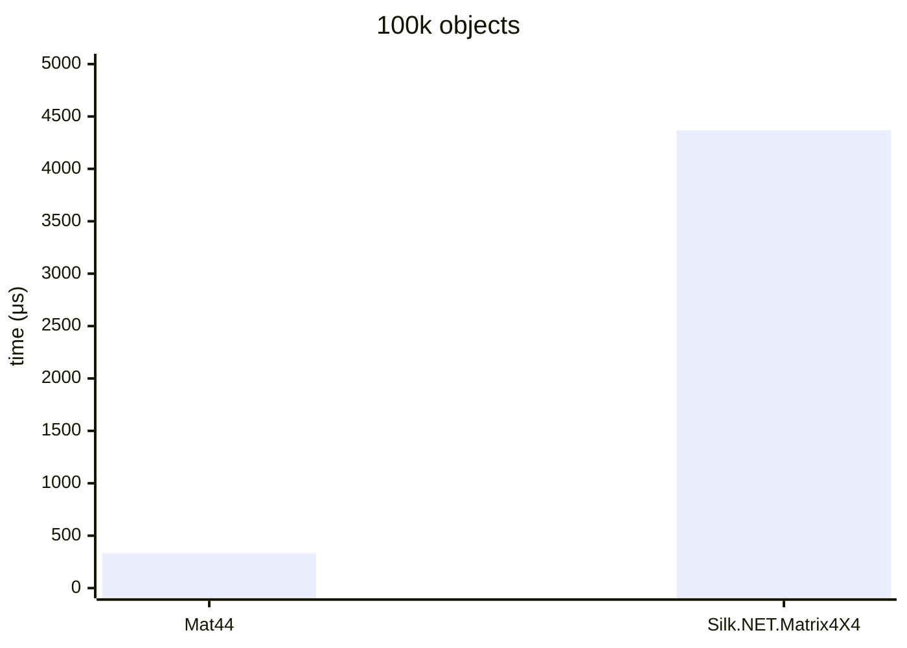
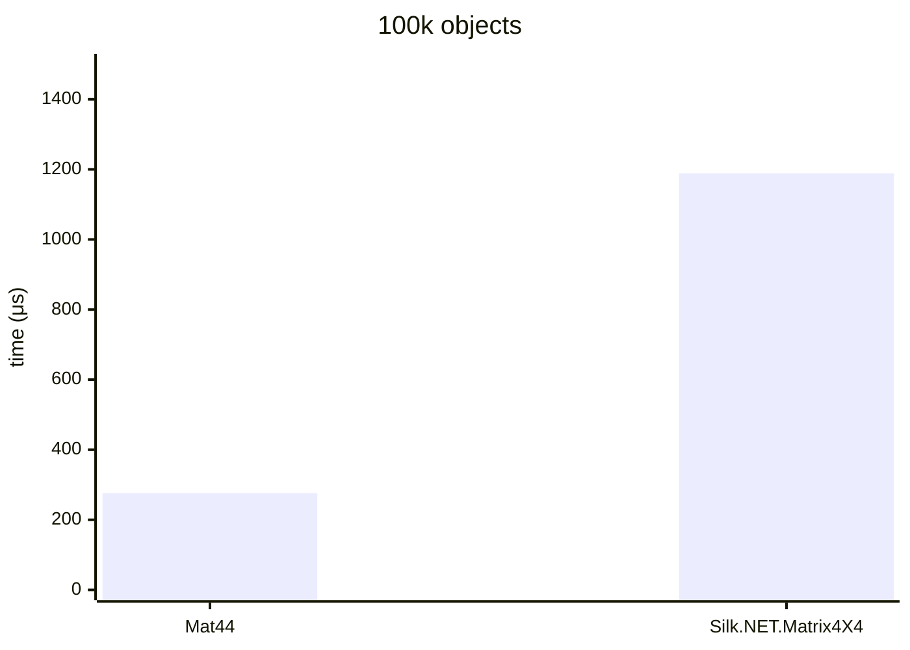
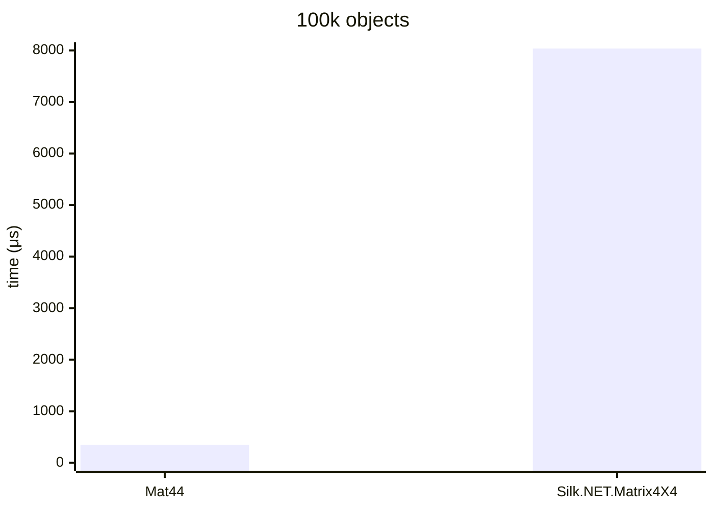
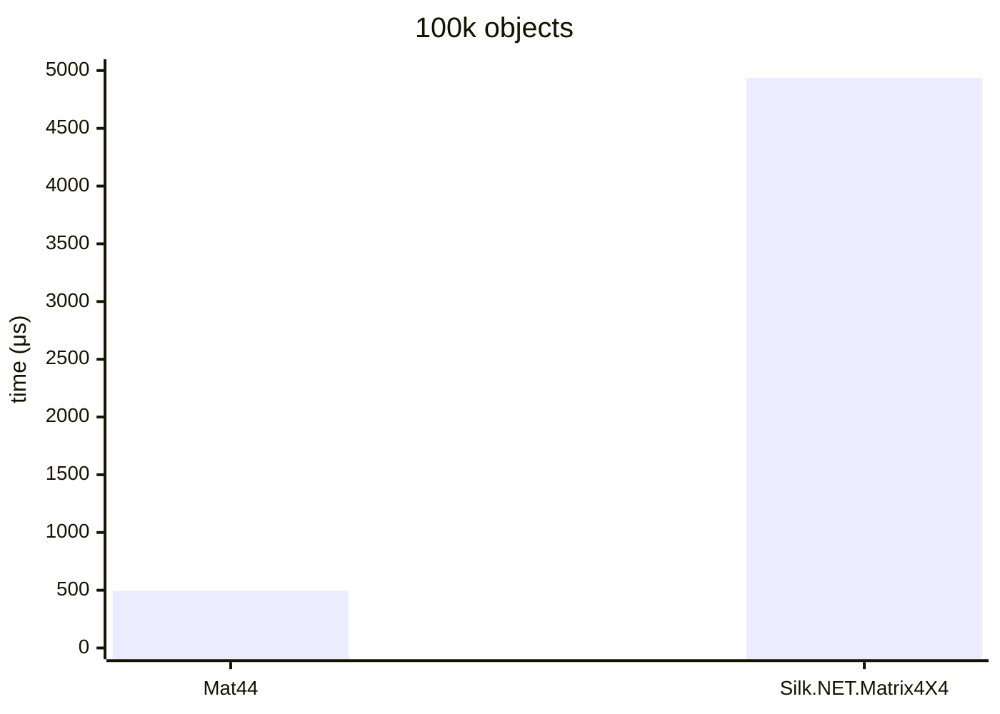

## .NET 11.0.0 (11.0.0, 11.0.26.53018), X64 RyuJIT x86-64-v4 (Job: Job-IHFIKV(Runtime=.NET 11.0))

```
BenchmarkDotNet v0.16.0-preview.2, Windows 11 (10.0.26300.9974)
AMD Ryzen 9 7900X 4.69GHz, 1 CPU, 24 logical and 12 physical cores
```

## Multiply



### Mat44&lt;double&gt;

<details>
<summary>asm</summary>

```assembly
; System.Numerics.Bench.BaseStressMat44`1[[System.Double, System.Private.CoreLib]].Multiply()
       sub       rsp,28
       xor       eax,eax
M00_L00:
       mov       rdx,[rcx+10]
       mov       r8,[rcx+8]
       mov       r10,r8
       mov       r9d,[r10+8]
       cmp       eax,r9d
       jae       near ptr M00_L01
       mov       r11,rax
       shl       r11,7
       lea       r10,[r10+r11+10]
       vmovups   ymm0,[r10]
       vmovups   ymm1,[r10+20]
       vmovups   ymm2,[r10+40]
       vmovups   ymm3,[r10+60]
       lea       r10d,[rax+1]
       cmp       r10d,r9d
       jae       near ptr M00_L01
       mov       r9d,r10d
       shl       r9,7
       lea       r8,[r8+r9+10]
       vmovups   ymm4,[r8]
       vmovups   ymm5,[r8+20]
       vmovups   ymm16,[r8+40]
       vmovups   ymm17,[r8+60]
       vmovaps   xmm18,xmm0
       vmovaps   xmm19,xmm18
       vbroadcastsd ymm19,xmm19
       vpermilpd xmm18,xmm18,1
       vperm2f128 ymm0,ymm0,ymm0,1
       vpermilpd xmm20,xmm0,1
       vbroadcastsd ymm20,xmm20
       vbroadcastsd ymm0,xmm0
       vbroadcastsd ymm18,xmm18
       vmulpd    ymm19,ymm19,ymm4
       vfmadd213pd ymm18,ymm5,ymm19
       vfmadd213pd ymm0,ymm16,ymm18
       vfmadd231pd ymm0,ymm20,ymm17
       vmovaps   xmm18,xmm1
       vmovaps   xmm19,xmm18
       vbroadcastsd ymm19,xmm19
       vpermilpd xmm18,xmm18,1
       vperm2f128 ymm1,ymm1,ymm1,1
       vpermilpd xmm20,xmm1,1
       vbroadcastsd ymm20,xmm20
       vbroadcastsd ymm1,xmm1
       vbroadcastsd ymm18,xmm18
       vmulpd    ymm19,ymm19,ymm4
       vfmadd213pd ymm18,ymm5,ymm19
       vfmadd213pd ymm1,ymm16,ymm18
       vfmadd231pd ymm1,ymm20,ymm17
       vmovaps   xmm18,xmm2
       vmovaps   xmm19,xmm18
       vbroadcastsd ymm19,xmm19
       vpermilpd xmm18,xmm18,1
       vperm2f128 ymm2,ymm2,ymm2,1
       vpermilpd xmm20,xmm2,1
       vbroadcastsd ymm20,xmm20
       vbroadcastsd ymm2,xmm2
       vbroadcastsd ymm18,xmm18
       vmulpd    ymm19,ymm19,ymm4
       vfmadd213pd ymm18,ymm5,ymm19
       vfmadd213pd ymm2,ymm16,ymm18
       vfmadd231pd ymm2,ymm20,ymm17
       vmovaps   xmm18,xmm3
       vmovaps   xmm19,xmm18
       vbroadcastsd ymm19,xmm19
       vpermilpd xmm18,xmm18,1
       vperm2f128 ymm3,ymm3,ymm3,1
       vpermilpd xmm20,xmm3,1
       vbroadcastsd ymm20,xmm20
       vbroadcastsd ymm3,xmm3
       vbroadcastsd ymm18,xmm18
       vmulpd    ymm4,ymm19,ymm4
       vfmadd213pd ymm5,ymm18,ymm4
       vfmadd213pd ymm3,ymm16,ymm5
       vfmadd213pd ymm17,ymm20,ymm3
       cmp       eax,[rdx+8]
       jae       short M00_L01
       lea       rax,[rdx+r11+10]
       vmovups   [rax],ymm0
       vmovups   [rax+20],ymm1
       vmovups   [rax+40],ymm2
       vmovups   [rax+60],ymm17
       mov       eax,r10d
       cmp       eax,1869F
       jl        near ptr M00_L00
       vzeroupper
       add       rsp,28
       ret
M00_L01:
       call      Internal.Runtime.CompilerHelpers.ThrowHelpers.ThrowIndexOutOfRangeException()
       int       3
; Total bytes of code 490
```
</details>

### Silk.NET.Matrix4X4&lt;double&gt;

<details>
<summary>asm</summary>

```assembly
; System.Numerics.Bench.BaseStressMatrix4X4`1[[System.Double, System.Private.CoreLib]].Multiply()
       push      r14
       push      rdi
       push      rsi
       push      rbp
       push      rbx
       sub       rsp,470
       vmovaps   [rsp+460],xmm6
       vmovaps   [rsp+450],xmm7
       vmovaps   [rsp+440],xmm8
       vmovaps   [rsp+430],xmm9
       vmovaps   [rsp+420],xmm10
       vmovaps   [rsp+410],xmm11
       vmovaps   [rsp+400],xmm12
       vmovaps   [rsp+3F0],xmm13
       vmovaps   [rsp+3E0],xmm14
       vmovaps   [rsp+3D0],xmm15
       mov       rbx,rcx
       xor       esi,esi
M00_L00:
       mov       rdi,[rbx+10]
       mov       rdx,[rbx+8]
       mov       r8,rdx
       mov       ecx,[r8+8]
       cmp       esi,ecx
       jae       near ptr 0000000000005EA0
       mov       rbp,rsi
       shl       rbp,7
       lea       r8,[r8+rbp+10]
       vmovsd    xmm0,qword ptr [r8]
       vmovsd    xmm1,qword ptr [r8+8]
       vmovsd    xmm2,qword ptr [r8+10]
       vmovsd    xmm3,qword ptr [r8+18]
       vmovsd    xmm4,qword ptr [r8+20]
       vmovsd    xmm5,qword ptr [r8+28]
       vmovsd    xmm16,qword ptr [r8+30]
       vmovsd    xmm6,qword ptr [r8+38]
       vmovsd    xmm7,qword ptr [r8+40]
       vmovsd    xmm8,qword ptr [r8+48]
       vmovsd    xmm9,qword ptr [r8+50]
       vmovsd    xmm10,qword ptr [r8+58]
       vmovsd    xmm11,qword ptr [r8+60]
       vmovsd    qword ptr [rsp+98],xmm11
       vmovsd    xmm12,qword ptr [r8+68]
       vmovsd    qword ptr [rsp+90],xmm12
       vmovsd    xmm13,qword ptr [r8+70]
       vmovsd    xmm14,qword ptr [r8+78]
       vmovsd    qword ptr [rsp+88],xmm14
       lea       r14d,[rsi+1]
       cmp       r14d,ecx
       jae       near ptr 0000000000005EA0
       mov       r8d,r14d
       shl       r8,7
       lea       rdx,[rdx+r8+10]
       vmovsd    xmm15,qword ptr [rdx+40]
       vmovsd    xmm17,qword ptr [rdx+48]
       vmovsd    qword ptr [rsp+80],xmm17
       vmovsd    xmm18,qword ptr [rdx+50]
       vmovsd    qword ptr [rsp+78],xmm18
       vmovsd    xmm19,qword ptr [rdx+58]
       vmovsd    qword ptr [rsp+70],xmm19
       vmovdqu32 zmm20,[rdx]
       vmovdqu32 [rsp+350],zmm20
       vmovdqu32 zmm20,[rdx+40]
       vmovdqu32 [rsp+390],zmm20
       vmovsd    xmm20,qword ptr [rsp+350]
       vmovaps   xmm21,xmm20
       vmovsd    xmm22,qword ptr [rsp+358]
       vmovaps   xmm23,xmm22
       vmovsd    xmm24,qword ptr [rsp+360]
       vmovaps   xmm25,xmm24
       vmovsd    xmm26,qword ptr [rsp+368]
       vmovaps   xmm27,xmm26
       vmulsd    xmm21,xmm21,xmm0
       vmulsd    xmm23,xmm23,xmm0
       vmulsd    xmm25,xmm25,xmm0
       vmulsd    xmm0,xmm27,xmm0
       vmovsd    xmm27,qword ptr [rsp+370]
       vmovaps   xmm28,xmm27
       vmovsd    xmm29,qword ptr [rsp+378]
       vmovaps   xmm30,xmm29
       vmovsd    xmm31,qword ptr [rsp+380]
       vmovaps   xmm14,xmm31
       vmovsd    xmm12,qword ptr [rsp+388]
       vmovaps   xmm11,xmm12
       vmulsd    xmm28,xmm28,xmm1
       vmulsd    xmm30,xmm30,xmm1
       vmulsd    xmm14,xmm14,xmm1
       vmulsd    xmm1,xmm11,xmm1
       vaddsd    xmm21,xmm21,xmm28
       vaddsd    xmm23,xmm23,xmm30
       vaddsd    xmm25,xmm25,xmm14
       vaddsd    xmm0,xmm0,xmm1
       vmulsd    xmm1,xmm15,xmm2
       vmulsd    xmm28,xmm17,xmm2
       vmulsd    xmm30,xmm18,xmm2
       vmulsd    xmm2,xmm19,xmm2
       vaddsd    xmm1,xmm21,xmm1
       vaddsd    xmm21,xmm23,xmm28
       vaddsd    xmm23,xmm25,xmm30
       vaddsd    xmm0,xmm0,xmm2
       vmovsd    xmm2,qword ptr [rsp+3B0]
       vmovsd    xmm25,qword ptr [rsp+3B8]
       vmovsd    xmm28,qword ptr [rsp+3C0]
       vmovsd    xmm30,qword ptr [rsp+3C8]
       vmulsd    xmm2,xmm2,xmm3
       vmulsd    xmm25,xmm25,xmm3
       vmulsd    xmm28,xmm28,xmm3
       vmulsd    xmm3,xmm30,xmm3
       vaddsd    xmm11,xmm1,xmm2
       vaddsd    xmm14,xmm21,xmm25
       vaddsd    xmm1,xmm23,xmm28
       vmovsd    qword ptr [rsp+0C8],xmm1
       vaddsd    xmm0,xmm0,xmm3
       vmovsd    qword ptr [rsp+0C0],xmm0
       vmulsd    xmm2,xmm20,xmm4
       vmulsd    xmm3,xmm22,xmm4
       vmulsd    xmm20,xmm24,xmm4
       vmulsd    xmm4,xmm26,xmm4
       vmulsd    xmm21,xmm27,xmm5
       vmulsd    xmm22,xmm29,xmm5
       vmulsd    xmm23,xmm31,xmm5
       vmulsd    xmm5,xmm12,xmm5
       vaddsd    xmm2,xmm21,xmm2
       vaddsd    xmm3,xmm22,xmm3
       vaddsd    xmm20,xmm20,xmm23
       vaddsd    xmm4,xmm4,xmm5
       vmulsd    xmm5,xmm15,xmm16
       vmulsd    xmm21,xmm17,xmm16
       vmulsd    xmm22,xmm18,xmm16
       vmulsd    xmm16,xmm19,xmm16
       vmovsd    qword ptr [rsp+50],xmm2
       vmovsd    qword ptr [rsp+58],xmm3
       vmovsd    qword ptr [rsp+60],xmm20
       vmovsd    qword ptr [rsp+68],xmm4
       vmovsd    qword ptr [rsp+30],xmm5
       vmovsd    qword ptr [rsp+38],xmm21
       vmovsd    qword ptr [rsp+40],xmm22
       vmovsd    qword ptr [rsp+48],xmm16
       lea       rdx,[rsp+50]
       lea       r8,[rsp+30]
       lea       rcx,[rsp+330]
       call      qword ptr [54D0]; Silk.NET.Maths.Vector4D`1[[System.Double, System.Private.CoreLib]].op_Addition(Silk.NET.Maths.Vector4D`1<Double>, Silk.NET.Maths.Vector4D`1<Double>)
       vmovdqu   ymm2,ymmword ptr [rsp+3B0]
       vmovdqu   ymmword ptr [rsp+50],ymm2
       lea       rdx,[rsp+50]
       lea       rcx,[rsp+310]
       vmovaps   xmm2,xmm6
       call      qword ptr [0C810]; Silk.NET.Maths.Vector4D`1[[System.Double, System.Private.CoreLib]].op_Multiply(Silk.NET.Maths.Vector4D`1<Double>, Double)
       lea       rcx,[rsp+2F0]
       lea       rdx,[rsp+330]
       lea       r8,[rsp+310]
       call      qword ptr [54D0]; Silk.NET.Maths.Vector4D`1[[System.Double, System.Private.CoreLib]].op_Addition(Silk.NET.Maths.Vector4D`1<Double>, Silk.NET.Maths.Vector4D`1<Double>)
       vmovdqu   ymm2,ymmword ptr [rsp+350]
       vmovdqu   ymmword ptr [rsp+50],ymm2
       lea       rdx,[rsp+50]
       lea       rcx,[rsp+2D0]
       vmovaps   xmm2,xmm7
       call      qword ptr [0C810]; Silk.NET.Maths.Vector4D`1[[System.Double, System.Private.CoreLib]].op_Multiply(Silk.NET.Maths.Vector4D`1<Double>, Double)
       vmovdqu   ymm2,ymmword ptr [rsp+370]
       vmovdqu   ymmword ptr [rsp+50],ymm2
       lea       rdx,[rsp+50]
       lea       rcx,[rsp+2B0]
       vmovaps   xmm2,xmm8
       call      qword ptr [0C810]; Silk.NET.Maths.Vector4D`1[[System.Double, System.Private.CoreLib]].op_Multiply(Silk.NET.Maths.Vector4D`1<Double>, Double)
       lea       rcx,[rsp+290]
       lea       rdx,[rsp+2D0]
       lea       r8,[rsp+2B0]
       call      qword ptr [54D0]; Silk.NET.Maths.Vector4D`1[[System.Double, System.Private.CoreLib]].op_Addition(Silk.NET.Maths.Vector4D`1<Double>, Silk.NET.Maths.Vector4D`1<Double>)
       vmovsd    qword ptr [rsp+390],xmm15
       vmovsd    xmm6,qword ptr [rsp+80]
       vmovsd    qword ptr [rsp+398],xmm6
       vmovsd    xmm7,qword ptr [rsp+78]
       vmovsd    qword ptr [rsp+3A0],xmm7
       vmovsd    xmm8,qword ptr [rsp+70]
       vmovsd    qword ptr [rsp+3A8],xmm8
       vmovdqu   ymm2,ymmword ptr [rsp+390]
       vmovdqu   ymmword ptr [rsp+50],ymm2
       lea       rdx,[rsp+50]
       lea       rcx,[rsp+270]
       vmovaps   xmm2,xmm9
       call      qword ptr [0C810]; Silk.NET.Maths.Vector4D`1[[System.Double, System.Private.CoreLib]].op_Multiply(Silk.NET.Maths.Vector4D`1<Double>, Double)
       lea       rcx,[rsp+250]
       lea       rdx,[rsp+290]
       lea       r8,[rsp+270]
       call      qword ptr [54D0]; Silk.NET.Maths.Vector4D`1[[System.Double, System.Private.CoreLib]].op_Addition(Silk.NET.Maths.Vector4D`1<Double>, Silk.NET.Maths.Vector4D`1<Double>)
       vmovdqu   ymm2,ymmword ptr [rsp+3B0]
       vmovdqu   ymmword ptr [rsp+50],ymm2
       lea       rdx,[rsp+50]
       lea       rcx,[rsp+230]
       vmovaps   xmm2,xmm10
       call      qword ptr [0C810]; Silk.NET.Maths.Vector4D`1[[System.Double, System.Private.CoreLib]].op_Multiply(Silk.NET.Maths.Vector4D`1<Double>, Double)
       lea       rcx,[rsp+210]
       lea       rdx,[rsp+250]
       lea       r8,[rsp+230]
       call      qword ptr [54D0]; Silk.NET.Maths.Vector4D`1[[System.Double, System.Private.CoreLib]].op_Addition(Silk.NET.Maths.Vector4D`1<Double>, Silk.NET.Maths.Vector4D`1<Double>)
       vmovdqu   ymm2,ymmword ptr [rsp+350]
       vmovdqu   ymmword ptr [rsp+50],ymm2
       lea       rdx,[rsp+50]
       lea       rcx,[rsp+1F0]
       vmovsd    xmm2,qword ptr [rsp+98]
       call      qword ptr [0C810]; Silk.NET.Maths.Vector4D`1[[System.Double, System.Private.CoreLib]].op_Multiply(Silk.NET.Maths.Vector4D`1<Double>, Double)
       vmovdqu   ymm2,ymmword ptr [rsp+370]
       vmovdqu   ymmword ptr [rsp+50],ymm2
       lea       rdx,[rsp+50]
       lea       rcx,[rsp+1D0]
       vmovsd    xmm2,qword ptr [rsp+90]
       call      qword ptr [0C810]; Silk.NET.Maths.Vector4D`1[[System.Double, System.Private.CoreLib]].op_Multiply(Silk.NET.Maths.Vector4D`1<Double>, Double)
       lea       rcx,[rsp+1B0]
       lea       rdx,[rsp+1F0]
       lea       r8,[rsp+1D0]
       call      qword ptr [54D0]; Silk.NET.Maths.Vector4D`1[[System.Double, System.Private.CoreLib]].op_Addition(Silk.NET.Maths.Vector4D`1<Double>, Silk.NET.Maths.Vector4D`1<Double>)
       vmovaps   xmm0,xmm15
       vmovaps   xmm1,xmm13
       call      qword ptr [5650]; Silk.NET.Maths.Scalar.Multiply[[System.Double, System.Private.CoreLib]](Double, Double)
       vmovaps   xmm9,xmm0
       vmovaps   xmm0,xmm6
       vmovaps   xmm1,xmm13
       call      qword ptr [5650]; Silk.NET.Maths.Scalar.Multiply[[System.Double, System.Private.CoreLib]](Double, Double)
       vmovaps   xmm6,xmm0
       vmovaps   xmm0,xmm7
       vmovaps   xmm1,xmm13
       call      qword ptr [5650]; Silk.NET.Maths.Scalar.Multiply[[System.Double, System.Private.CoreLib]](Double, Double)
       vmovaps   xmm7,xmm0
       vxorps    ymm0,ymm0,ymm0
       vmovdqu32 [rsp+0A0],ymm0
       vmovaps   xmm0,xmm8
       vmovaps   xmm1,xmm13
       call      qword ptr [5650]; Silk.NET.Maths.Scalar.Multiply[[System.Double, System.Private.CoreLib]](Double, Double)
       vmovsd    qword ptr [rsp+20],xmm0
       lea       rcx,[rsp+0A0]
       vmovaps   xmm1,xmm9
       vmovaps   xmm2,xmm6
       vmovaps   xmm3,xmm7
       call      qword ptr [0C228]; Silk.NET.Maths.Vector4D`1[[System.Double, System.Private.CoreLib]]..ctor(Double, Double, Double, Double)
       vmovdqu32 ymm0,[rsp+0A0]
       vmovdqu   ymmword ptr [rsp+50],ymm0
       lea       r8,[rsp+50]
       lea       rdx,[rsp+1B0]
       lea       rcx,[rsp+190]
       call      qword ptr [54D0]; Silk.NET.Maths.Vector4D`1[[System.Double, System.Private.CoreLib]].op_Addition(Silk.NET.Maths.Vector4D`1<Double>, Silk.NET.Maths.Vector4D`1<Double>)
       lea       rcx,[rsp+170]
       lea       rdx,[rsp+3B0]
       vmovsd    xmm2,qword ptr [rsp+88]
       call      qword ptr [0C810]; Silk.NET.Maths.Vector4D`1[[System.Double, System.Private.CoreLib]].op_Multiply(Silk.NET.Maths.Vector4D`1<Double>, Double)
       vxorps    ymm0,ymm0,ymm0
       vmovdqu32 [rsp+0F0],zmm0
       vmovdqu32 [rsp+130],zmm0
       lea       rcx,[rsp+0D0]
       lea       rdx,[rsp+190]
       lea       r8,[rsp+170]
       call      qword ptr [54D0]; Silk.NET.Maths.Vector4D`1[[System.Double, System.Private.CoreLib]].op_Addition(Silk.NET.Maths.Vector4D`1<Double>, Silk.NET.Maths.Vector4D`1<Double>)
       vmovsd    qword ptr [rsp+50],xmm11
       vmovsd    qword ptr [rsp+58],xmm14
       vmovsd    xmm6,qword ptr [rsp+0C8]
       vmovsd    qword ptr [rsp+60],xmm6
       vmovsd    xmm6,qword ptr [rsp+0C0]
       vmovsd    qword ptr [rsp+68],xmm6
       lea       rdx,[rsp+0D0]
       mov       [rsp+20],rdx
       lea       rdx,[rsp+50]
       lea       rcx,[rsp+0F0]
       lea       r8,[rsp+2F0]
       lea       r9,[rsp+210]
       call      qword ptr [5638]; Silk.NET.Maths.Matrix4X4`1[[System.Double, System.Private.CoreLib]]..ctor(Silk.NET.Maths.Vector4D`1<Double>, Silk.NET.Maths.Vector4D`1<Double>, Silk.NET.Maths.Vector4D`1<Double>, Silk.NET.Maths.Vector4D`1<Double>)
       cmp       esi,[rdi+8]
       jae       near ptr 0000000000005EA0
       vmovdqu32 zmm0,[rsp+0F0]
       vmovdqu32 [rdi+rbp+10],zmm0
       vmovdqu32 zmm0,[rsp+130]
       vmovdqu32 [rdi+rbp+50],zmm0
       mov       esi,r14d
       cmp       esi,1869F
       jl        near ptr 00000000000057E2
       vzeroupper
       vmovaps   xmm6,[rsp+460]
       vmovaps   xmm7,[rsp+450]
       vmovaps   xmm8,[rsp+440]
       vmovaps   xmm9,[rsp+430]
       vmovaps   xmm10,[rsp+420]
       vmovaps   xmm11,[rsp+410]
       vmovaps   xmm12,[rsp+400]
       vmovaps   xmm13,[rsp+3F0]
       vmovaps   xmm14,[rsp+3E0]
       vmovaps   xmm15,[rsp+3D0]
       add       rsp,470
       pop       rbx
       pop       rbp
       pop       rsi
       pop       rdi
       pop       r14
       ret
M00_L01:
       call      0000000000001620
       int       3
; Total bytes of code 1830

; Silk.NET.Maths.Vector4D`1[[System.Double, System.Private.CoreLib]].op_Addition(Silk.NET.Maths.Vector4D`1<Double>, Silk.NET.Maths.Vector4D`1<Double>)
       vmovsd    xmm0,qword ptr [rdx]
       vaddsd    xmm0,xmm0,qword ptr [r8]
       vmovsd    xmm1,qword ptr [rdx+8]
       vaddsd    xmm1,xmm1,qword ptr [r8+8]
       vmovsd    xmm2,qword ptr [rdx+10]
       vaddsd    xmm2,xmm2,qword ptr [r8+10]
       vmovsd    xmm3,qword ptr [rdx+18]
       vaddsd    xmm3,xmm3,qword ptr [r8+18]
       vmovsd    qword ptr [rcx],xmm0
       vmovsd    qword ptr [rcx+8],xmm1
       vmovsd    qword ptr [rcx+10],xmm2
       vmovsd    qword ptr [rcx+18],xmm3
       mov       rax,rcx
       ret
; Total bytes of code 65

; Silk.NET.Maths.Vector4D`1[[System.Double, System.Private.CoreLib]].op_Multiply(Silk.NET.Maths.Vector4D`1<Double>, Double)
       vmulsd    xmm0,xmm2,qword ptr [rdx]
       vmulsd    xmm1,xmm2,qword ptr [rdx+8]
       vmulsd    xmm3,xmm2,qword ptr [rdx+10]
       vmulsd    xmm2,xmm2,qword ptr [rdx+18]
       vmovsd    qword ptr [rcx],xmm0
       vmovsd    qword ptr [rcx+8],xmm1
       vmovsd    qword ptr [rcx+10],xmm3
       vmovsd    qword ptr [rcx+18],xmm2
       mov       rax,rcx
       ret
; Total bytes of code 42

; Silk.NET.Maths.Scalar.Multiply[[System.Double, System.Private.CoreLib]](Double, Double)
       vmulsd    xmm0,xmm0,xmm1
       ret
; Total bytes of code 5

; Silk.NET.Maths.Vector4D`1[[System.Double, System.Private.CoreLib]]..ctor(Double, Double, Double, Double)
       vmovsd    qword ptr [rcx],xmm1
       vmovsd    qword ptr [rcx+8],xmm2
       vmovsd    qword ptr [rcx+10],xmm3
       vmovsd    xmm0,qword ptr [rsp+28]
       vmovsd    qword ptr [rcx+18],xmm0
       ret
; Total bytes of code 26

; Silk.NET.Maths.Matrix4X4`1[[System.Double, System.Private.CoreLib]]..ctor(Silk.NET.Maths.Vector4D`1<Double>, Silk.NET.Maths.Vector4D`1<Double>, Silk.NET.Maths.Vector4D`1<Double>, Silk.NET.Maths.Vector4D`1<Double>)
       mov       rax,[rsp+28]
       vmovdqu   ymm0,ymmword ptr [rdx]
       vmovdqu   ymmword ptr [rcx],ymm0
       vmovdqu   ymm0,ymmword ptr [r8]
       vmovdqu   ymmword ptr [rcx+20],ymm0
       vmovdqu   ymm0,ymmword ptr [r9]
       vmovdqu   ymmword ptr [rcx+40],ymm0
       vmovdqu   ymm0,ymmword ptr [rax]
       vmovdqu   ymmword ptr [rcx+60],ymm0
       vzeroupper
       ret
; Total bytes of code 46
```
</details></br>

## Rotation (from quaternion)



### Mat44&lt;double&gt;

<details>
<summary>asm</summary>

```assembly
; System.Numerics.Bench.StressMat44WithQuat`1[[System.Double, System.Private.CoreLib]].Rotation()
       sub       rsp,0A8
       xor       eax,eax
       mov       [rsp+28],rax
       vxorps    xmm4,xmm4,xmm4
       vmovdqu32 [rsp+30],zmm4
       vmovdqu32 [rsp+60],zmm4
       mov       [rsp+0A0],rax
       xor       eax,eax
       mov       rdx,19AA42C8748
M00_L00:
       mov       r8,[rcx+10]
       mov       r10,[rcx+18]
       cmp       eax,[r10+8]
       jae       near ptr M00_L01
       mov       r9d,eax
       mov       r11,r9
       shl       r11,5
       vmovups   ymm0,[r10+r11+10]
       vpermq    ymm1,ymm0,0D2
       vpermq    ymm2,ymm0,0C9
       vmulpd    ymm2,ymm2,ymm0
       vpermq    ymm3,ymm0,0FF
       vmulpd    ymm1,ymm3,ymm1
       vmulpd    ymm0,ymm0,ymm0
       vaddpd    ymm3,ymm2,ymm1
       vsubpd    ymm1,ymm2,ymm1
       vaddpd    ymm2,ymm3,ymm3
       vaddpd    ymm1,ymm1,ymm1
       vpermq    ymm3,ymm0,0C9
       vaddpd    ymm0,ymm3,ymm0
       vaddpd    ymm0,ymm0,ymm0
       vbroadcastsd ymm3,qword ptr [7FFE955F8340]
       vsubpd    ymm0,ymm3,ymm0
       vmovaps   xmm3,xmm0
       vmovaps   xmm4,xmm1
       vunpckhpd xmm3,xmm3,xmm3
       vmovsd    xmm3,xmm4,xmm3
       vinsertf128 ymm3,ymm1,xmm3,0
       vmovaps   xmm4,xmm3
       vmovaps   ymm5,ymm2
       vunpcklpd xmm4,xmm4,xmm5
       vinsertf128 ymm3,ymm3,xmm4,0
       vextractf128 xmm4,ymm0,1
       vmovaps   xmm5,xmm1
       vunpcklpd xmm4,xmm5,xmm4
       vinsertf128 ymm4,ymm1,xmm4,0
       vmovaps   xmm5,xmm2
       vextractf32x4 xmm16,ymm4,1
       vunpckhpd xmm5,xmm5,xmm5
       vmovsd    xmm5,xmm16,xmm5
       vinsertf128 ymm4,ymm4,xmm5,1
       vextractf128 xmm2,ymm2,1
       vmovaps   xmm5,xmm1
       vmovsd    xmm2,xmm5,xmm2
       vinsertf128 ymm1,ymm1,xmm2,0
       vextractf128 xmm2,ymm1,1
       vmovsd    xmm0,xmm2,xmm0
       vinsertf128 ymm0,ymm1,xmm0,1
       vmovdqu   ymm1,ymmword ptr [rdx]
       vmovdqu   ymmword ptr [rsp+88],ymm1
       vmovups   ymm1,[rsp+88]
       cmp       eax,[r8+8]
       jae       short M00_L01
       shl       r9,7
       lea       r8,[r8+r9+10]
       vmovups   [r8],ymm3
       vmovups   [r8+20],ymm4
       vmovups   [r8+40],ymm0
       vmovups   [r8+60],ymm1
       inc       eax
       cmp       eax,186A0
       jl        near ptr M00_L00
       vzeroupper
       add       rsp,0A8
       ret
M00_L01:
       call      Internal.Runtime.CompilerHelpers.ThrowHelpers.ThrowIndexOutOfRangeException()
       int       3
; Total bytes of code 381
```
</details>

### Silk.NET.Matrix4X4&lt;double&gt;

<details>
<summary>asm</summary>

```assembly
; System.Numerics.Bench.StressMatrix4X4WithQuaternion`1[[System.Double, System.Private.CoreLib]].Rotation()
       push      rdi
       push      rsi
       push      rbx
       sub       rsp,0C0
       mov       rbx,rcx
       xor       esi,esi
M00_L00:
       mov       rdi,[rbx+10]
       mov       rdx,[rbx+28]
       cmp       esi,[rdx+8]
       jae       short 0000000000004DA9
       mov       rcx,rsi
       shl       rcx,5
       vmovdqu   ymm0,ymmword ptr [rdx+rcx+10]
       vmovdqu   ymmword ptr [rsp+20],ymm0
       lea       rdx,[rsp+20]
       lea       rcx,[rsp+40]
       call      qword ptr [5470]; Silk.NET.Maths.Matrix4X4.CreateFromQuaternion[[System.Double, System.Private.CoreLib]](Silk.NET.Maths.Quaternion`1<Double>)
       cmp       esi,[rdi+8]
       jae       short 0000000000004DA9
       mov       rax,rsi
       shl       rax,7
       vmovdqu32 zmm0,[rsp+40]
       vmovdqu32 [rdi+rax+10],zmm0
       vmovdqu32 zmm0,[rsp+80]
       vmovdqu32 [rdi+rax+50],zmm0
       inc       esi
       cmp       esi,186A0
       jl        short 0000000000004D2F
       vzeroupper
       add       rsp,0C0
       pop       rbx
       pop       rsi
       pop       rdi
       ret
M00_L01:
       call      0000000000001620
       int       3
; Total bytes of code 143

; Silk.NET.Maths.Matrix4X4.CreateFromQuaternion[[System.Double, System.Private.CoreLib]](Silk.NET.Maths.Quaternion`1<Double>)
       sub       rsp,88
       vmovsd    xmm0,qword ptr [rdx]
       vmovsd    xmm1,qword ptr [rdx+8]
       vmovsd    xmm2,qword ptr [rdx+10]
       vmovsd    xmm3,qword ptr [rdx+18]
       mov       rax,276A42E3448
       vmovdqu32 zmm4,[rax]
       vmovdqu32 [rsp+8],zmm4
       vmovdqu32 zmm4,[rax+40]
       vmovdqu32 [rsp+48],zmm4
       vmulsd    xmm4,xmm0,xmm0
       vmulsd    xmm5,xmm1,xmm1
       vmulsd    xmm16,xmm2,xmm2
       vmulsd    xmm17,xmm0,xmm1
       vmulsd    xmm18,xmm2,xmm3
       vmulsd    xmm19,xmm2,xmm0
       vmulsd    xmm20,xmm1,xmm3
       vmulsd    xmm1,xmm1,xmm2
       vmulsd    xmm0,xmm0,xmm3
       vmovdqu32 zmm2,[rsp+8]
       vmovdqu32 [rcx],zmm2
       vmovdqu32 zmm2,[rsp+48]
       vmovdqu32 [rcx+40],zmm2
       vaddsd    xmm2,xmm16,xmm5
       vmovsd    xmm3,qword ptr [1E70]
       vmulsd    xmm2,xmm2,xmm3
       vmovsd    xmm21,qword ptr [1E78]
       vsubsd    xmm2,xmm21,xmm2
       vmovsd    qword ptr [rcx],xmm2
       vaddsd    xmm2,xmm17,xmm18
       vmulsd    xmm2,xmm2,xmm3
       vmovsd    qword ptr [rcx+8],xmm2
       vsubsd    xmm2,xmm19,xmm20
       vmulsd    xmm2,xmm2,xmm3
       vmovsd    qword ptr [rcx+10],xmm2
       vsubsd    xmm2,xmm17,xmm18
       vmulsd    xmm2,xmm2,xmm3
       vmovsd    qword ptr [rcx+20],xmm2
       vaddsd    xmm2,xmm16,xmm4
       vmulsd    xmm2,xmm2,xmm3
       vsubsd    xmm2,xmm21,xmm2
       vmovsd    qword ptr [rcx+28],xmm2
       vaddsd    xmm2,xmm1,xmm0
       vmulsd    xmm2,xmm2,xmm3
       vmovsd    qword ptr [rcx+30],xmm2
       vaddsd    xmm2,xmm19,xmm20
       vmulsd    xmm2,xmm2,xmm3
       vmovsd    qword ptr [rcx+40],xmm2
       vsubsd    xmm0,xmm1,xmm0
       vmulsd    xmm0,xmm0,xmm3
       vmovsd    qword ptr [rcx+48],xmm0
       vaddsd    xmm0,xmm5,xmm4
       vmulsd    xmm0,xmm0,xmm3
       vsubsd    xmm0,xmm21,xmm0
       vmovsd    qword ptr [rcx+50],xmm0
       mov       rax,rcx
       vzeroupper
       add       rsp,88
       ret
; Total bytes of code 330
```
</details></br>

## Affine (from quaternion, scale and translation vectors)



### Mat44&lt;double&gt;

<details>
<summary>asm</summary>

```assembly
; System.Numerics.Bench.StressMat44WithQuat`1[[System.Double, System.Private.CoreLib]].Affine()
       sub       rsp,28
       xor       eax,eax
       vmovsd    xmm0,qword ptr [7FFE95618D10]
M00_L00:
       mov       rdx,[rcx+10]
       mov       r8,[rcx+18]
       cmp       eax,[r8+8]
       jae       near ptr M00_L01
       mov       r10d,eax
       mov       r9,r10
       shl       r9,5
       vmovups   ymm1,[r8+r9+10]
       mov       r8,[rcx+20]
       cmp       eax,[r8+8]
       jae       near ptr M00_L01
       lea       r9,[r10+r10*2]
       lea       r8,[r8+r9*8+10]
       vmovsd    xmm2,qword ptr [r8]
       vmovsd    xmm3,qword ptr [r8+8]
       vmovsd    xmm4,qword ptr [r8+10]
       mov       r8,[rcx+28]
       cmp       eax,[r8+8]
       jae       near ptr M00_L01
       lea       r8,[r8+r9*8+10]
       vmovsd    xmm5,qword ptr [r8]
       vmovsd    xmm16,qword ptr [r8+8]
       vmovsd    xmm17,qword ptr [r8+10]
       vpermq    ymm18,ymm1,0D2
       vpermq    ymm19,ymm1,0C9
       vmulpd    ymm19,ymm19,ymm1
       vpermq    ymm20,ymm1,0FF
       vmulpd    ymm18,ymm20,ymm18
       vmulpd    ymm1,ymm1,ymm1
       vaddpd    ymm20,ymm19,ymm18
       vsubpd    ymm18,ymm19,ymm18
       vaddpd    ymm19,ymm20,ymm20
       vaddpd    ymm18,ymm18,ymm18
       vpermq    ymm20,ymm1,0C9
       vaddpd    ymm1,ymm20,ymm1
       vaddpd    ymm1,ymm1,ymm1
       vbroadcastsd ymm20,qword ptr [7FFE95618D10]
       vsubpd    ymm1,ymm20,ymm1
       vmovaps   xmm20,xmm1
       vmovaps   xmm21,xmm18
       vunpckhpd xmm20,xmm20,xmm20
       vmovsd    xmm20,xmm21,xmm20
       vinsertf32x4 ymm20,ymm18,xmm20,0
       vmovaps   xmm21,xmm20
       vmovaps   ymm22,ymm19
       vunpcklpd xmm21,xmm21,xmm22
       vinsertf32x4 ymm20,ymm20,xmm21,0
       vextractf32x4 xmm21,ymm1,1
       vmovaps   xmm22,xmm18
       vunpcklpd xmm21,xmm22,xmm21
       vinsertf32x4 ymm21,ymm18,xmm21,0
       vmovaps   xmm22,xmm19
       vextractf32x4 xmm23,ymm21,1
       vunpckhpd xmm22,xmm22,xmm22
       vmovsd    xmm22,xmm23,xmm22
       vinsertf32x4 ymm21,ymm21,xmm22,1
       vextractf32x4 xmm19,ymm19,1
       vmovaps   xmm22,xmm18
       vmovsd    xmm19,xmm22,xmm19
       vinsertf32x4 ymm18,ymm18,xmm19,0
       vextractf32x4 xmm19,ymm18,1
       vmovsd    xmm1,xmm19,xmm1
       vinsertf32x4 ymm1,ymm18,xmm1,1
       vbroadcastsd ymm2,xmm2
       vmulpd    ymm20,ymm20,ymm2
       vbroadcastsd ymm2,xmm3
       vmulpd    ymm21,ymm21,ymm2
       vbroadcastsd ymm2,xmm4
       vmulpd    ymm1,ymm2,ymm1
       cmp       eax,[rdx+8]
       jae       short M00_L01
       shl       r10,7
       lea       rdx,[rdx+r10+10]
       vmovups   [rdx],ymm20
       vmovups   [rdx+20],ymm21
       vmovups   [rdx+40],ymm1
       vmovsd    qword ptr [rdx+60],xmm5
       vmovsd    qword ptr [rdx+68],xmm16
       vmovsd    qword ptr [rdx+70],xmm17
       vmovsd    qword ptr [rdx+78],xmm0
       inc       eax
       cmp       eax,186A0
       jl        near ptr M00_L00
       vzeroupper
       add       rsp,28
       ret
M00_L01:
       call      Internal.Runtime.CompilerHelpers.ThrowHelpers.ThrowIndexOutOfRangeException()
       int       3
; Total bytes of code 495
```
</details>

### Silk.NET.Matrix4X4&lt;double&gt;

<details>
<summary>asm</summary>

```assembly
; System.Numerics.Bench.StressMatrix4X4WithQuaternion`1[[System.Double, System.Private.CoreLib]].Affine()
       push      rdi
       push      rsi
       push      rbp
       push      rbx
       sub       rsp,4D8
       vmovaps   [rsp+4C0],xmm6
       vmovaps   [rsp+4B0],xmm7
       vmovaps   [rsp+4A0],xmm8
       vmovaps   [rsp+490],xmm9
       vmovaps   [rsp+480],xmm10
       vmovaps   [rsp+470],xmm11
       vmovaps   [rsp+460],xmm12
       vmovaps   [rsp+450],xmm13
       vmovaps   [rsp+440],xmm14
       vmovaps   [rsp+430],xmm15
       mov       rbx,rcx
       vmovsd    xmm6,qword ptr [0A068]
       xor       esi,esi
M00_L00:
       mov       rdi,[rbx+10]
       mov       rax,[rbx+18]
       cmp       esi,[rax+8]
       jae       near ptr 000000000000A05E
       lea       rbp,[rsi+rsi*2]
       lea       rax,[rax+rbp*8+10]
       vmovsd    xmm0,qword ptr [rax]
       vmovsd    xmm1,qword ptr [rax+8]
       vmovsd    xmm7,qword ptr [rax+10]
       mov       rax,[rbx+28]
       cmp       esi,[rax+8]
       jae       near ptr 000000000000A05E
       mov       rcx,rsi
       shl       rcx,5
       lea       rax,[rax+rcx+10]
       vmovsd    xmm2,qword ptr [rax]
       vmovsd    xmm3,qword ptr [rax+8]
       vmovsd    xmm4,qword ptr [rax+10]
       vmovsd    xmm5,qword ptr [rax+18]
       vaddsd    xmm16,xmm2,xmm2
       vaddsd    xmm17,xmm3,xmm3
       vaddsd    xmm18,xmm4,xmm4
       vmulsd    xmm19,xmm16,xmm5
       vmulsd    xmm20,xmm17,xmm5
       vmulsd    xmm5,xmm18,xmm5
       vmulsd    xmm16,xmm16,xmm2
       vmulsd    xmm21,xmm17,xmm2
       vmulsd    xmm2,xmm18,xmm2
       vmulsd    xmm17,xmm17,xmm3
       vmulsd    xmm3,xmm18,xmm3
       vmulsd    xmm4,xmm18,xmm4
       vsubsd    xmm18,xmm6,xmm17
       vsubsd    xmm8,xmm18,xmm4
       vsubsd    xmm9,xmm21,xmm5
       vaddsd    xmm10,xmm20,xmm2
       vaddsd    xmm11,xmm21,xmm5
       vsubsd    xmm5,xmm6,xmm16
       vsubsd    xmm12,xmm5,xmm4
       vsubsd    xmm13,xmm3,xmm19
       vsubsd    xmm14,xmm2,xmm20
       vaddsd    xmm15,xmm19,xmm3
       vsubsd    xmm2,xmm5,xmm17
       vmovsd    qword ptr [rsp+2A8],xmm2
       vmulsd    xmm3,xmm8,xmm0
       vmulsd    xmm4,xmm11,xmm0
       vmulsd    xmm0,xmm14,xmm0
       vxorps    xmm5,xmm5,xmm5
       vmulsd    xmm5,xmm9,xmm5
       vmovaps   xmm16,xmm5
       vxorps    xmm17,xmm17,xmm17
       vmulsd    xmm17,xmm12,xmm17
       vmovaps   xmm18,xmm17
       vxorps    xmm19,xmm19,xmm19
       vmulsd    xmm19,xmm15,xmm19
       vmovaps   xmm20,xmm19
       vaddsd    xmm3,xmm16,xmm3
       vaddsd    xmm4,xmm18,xmm4
       vaddsd    xmm0,xmm20,xmm0
       vxorps    xmm16,xmm16,xmm16
       vmulsd    xmm16,xmm10,xmm16
       vmovaps   xmm18,xmm16
       vxorps    xmm20,xmm20,xmm20
       vmulsd    xmm20,xmm13,xmm20
       vmovaps   xmm21,xmm20
       vxorps    xmm22,xmm22,xmm22
       vmulsd    xmm22,xmm22,xmm2
       vmovaps   xmm23,xmm22
       vaddsd    xmm3,xmm18,xmm3
       vmovsd    qword ptr [rsp+130],xmm3
       vaddsd    xmm4,xmm21,xmm4
       vmovsd    qword ptr [rsp+128],xmm4
       vaddsd    xmm0,xmm23,xmm0
       vmovsd    qword ptr [rsp+120],xmm0
       vxorps    xmm0,xmm0,xmm0
       vmulsd    xmm0,xmm8,xmm0
       vmovaps   xmm21,xmm0
       vxorps    xmm23,xmm23,xmm23
       vmulsd    xmm23,xmm11,xmm23
       vmovaps   xmm24,xmm23
       vxorps    xmm25,xmm25,xmm25
       vmulsd    xmm25,xmm14,xmm25
       vmovaps   xmm26,xmm25
       vmulsd    xmm27,xmm9,xmm1
       vmulsd    xmm28,xmm12,xmm1
       vmulsd    xmm1,xmm15,xmm1
       vaddsd    xmm21,xmm21,xmm27
       vaddsd    xmm24,xmm24,xmm28
       vaddsd    xmm1,xmm26,xmm1
       vaddsd    xmm16,xmm21,xmm16
       vmovsd    qword ptr [rsp+118],xmm16
       vaddsd    xmm20,xmm24,xmm20
       vmovsd    qword ptr [rsp+110],xmm20
       vaddsd    xmm1,xmm22,xmm1
       vmovsd    qword ptr [rsp+108],xmm1
       vmovsd    qword ptr [rsp+100],xmm25
       vmovsd    qword ptr [rsp+0F8],xmm19
       vaddsd    xmm0,xmm0,xmm5
       vmovsd    qword ptr [rsp+0F0],xmm0
       vmovaps   xmm0,xmm23
       vmovaps   xmm1,xmm17
       call      qword ptr [5F20]; Silk.NET.Maths.Scalar.Add[[System.Double, System.Private.CoreLib]](Double, Double)
       vmovsd    qword ptr [rsp+0E8],xmm0
       vxorps    xmm0,xmm0,xmm0
       vmovdqu32 [rsp+0D0],xmm0
       vmovdqu   xmmword ptr [rsp+0D8],xmm0
       vmovsd    xmm0,qword ptr [rsp+100]
       vmovsd    xmm1,qword ptr [rsp+0F8]
       call      qword ptr [5F20]; Silk.NET.Maths.Scalar.Add[[System.Double, System.Private.CoreLib]](Double, Double)
       vmovaps   xmm3,xmm0
       lea       rcx,[rsp+0D0]
       vmovsd    xmm1,qword ptr [rsp+0F0]
       vmovsd    xmm2,qword ptr [rsp+0E8]
       call      qword ptr [0E8B0]; Silk.NET.Maths.Vector3D`1[[System.Double, System.Private.CoreLib]]..ctor(Double, Double, Double)
       vmovsd    xmm2,qword ptr [rsp+0D0]
       vmovsd    qword ptr [rsp+0B0],xmm2
       vmovsd    xmm2,qword ptr [rsp+0D8]
       vmovsd    qword ptr [rsp+0A8],xmm2
       vmovsd    xmm2,qword ptr [rsp+0E0]
       vmovsd    qword ptr [rsp+0A0],xmm2
       vmovsd    qword ptr [rsp+88],xmm10
       vmovsd    qword ptr [rsp+90],xmm13
       vmovsd    xmm4,qword ptr [rsp+2A8]
       vmovsd    qword ptr [rsp+98],xmm4
       lea       rdx,[rsp+88]
       lea       rcx,[rsp+290]
       vmovaps   xmm2,xmm7
       call      qword ptr [0D1A0]; Silk.NET.Maths.Vector3D`1[[System.Double, System.Private.CoreLib]].op_Multiply(Silk.NET.Maths.Vector3D`1<Double>, Double)
       vmovsd    xmm7,qword ptr [rsp+0B0]
       vmovsd    qword ptr [rsp+88],xmm7
       vmovsd    xmm7,qword ptr [rsp+0A8]
       vmovsd    qword ptr [rsp+90],xmm7
       vmovsd    xmm7,qword ptr [rsp+0A0]
       vmovsd    qword ptr [rsp+98],xmm7
       lea       rdx,[rsp+88]
       lea       rcx,[rsp+278]
       lea       r8,[rsp+290]
       call      qword ptr [60D0]; Silk.NET.Maths.Vector3D`1[[System.Double, System.Private.CoreLib]].op_Addition(Silk.NET.Maths.Vector3D`1<Double>, Silk.NET.Maths.Vector3D`1<Double>)
       vxorps    ymm2,ymm2,ymm2
       vmovdqu   ymmword ptr [rsp+258],ymm2
       lea       rcx,[rsp+258]
       lea       rdx,[rsp+278]
       vxorps    xmm2,xmm2,xmm2
       call      qword ptr [6118]; Silk.NET.Maths.Vector4D`1[[System.Double, System.Private.CoreLib]]..ctor(Silk.NET.Maths.Vector3D`1<Double>, Double)
       vmovdqu   ymm0,ymmword ptr [rsp+258]
       vmovdqu   ymmword ptr [rsp+238],ymm0
       vmovaps   xmm0,xmm8
       vxorps    xmm1,xmm1,xmm1
       call      qword ptr [5F50]; Silk.NET.Maths.Scalar.Multiply[[System.Double, System.Private.CoreLib]](Double, Double)
       vmovaps   xmm7,xmm0
       vmovaps   xmm0,xmm11
       vxorps    xmm1,xmm1,xmm1
       call      qword ptr [5F50]; Silk.NET.Maths.Scalar.Multiply[[System.Double, System.Private.CoreLib]](Double, Double)
       vmovaps   xmm8,xmm0
       vxorps    xmm0,xmm0,xmm0
       vmovdqu   xmmword ptr [rsp+0B8],xmm0
       vmovdqu32 [rsp+0C0],xmm0
       vmovaps   xmm0,xmm14
       vxorps    xmm1,xmm1,xmm1
       call      qword ptr [5F50]; Silk.NET.Maths.Scalar.Multiply[[System.Double, System.Private.CoreLib]](Double, Double)
       vmovaps   xmm3,xmm0
       lea       rcx,[rsp+0B8]
       vmovaps   xmm1,xmm7
       vmovaps   xmm2,xmm8
       call      qword ptr [0E8B0]; Silk.NET.Maths.Vector3D`1[[System.Double, System.Private.CoreLib]]..ctor(Double, Double, Double)
       vmovsd    xmm7,qword ptr [rsp+0B8]
       vmovsd    xmm8,qword ptr [rsp+0C0]
       vmovsd    xmm11,qword ptr [rsp+0C8]
       vmovsd    qword ptr [rsp+88],xmm9
       vmovsd    qword ptr [rsp+90],xmm12
       vmovsd    qword ptr [rsp+98],xmm15
       lea       rdx,[rsp+88]
       lea       rcx,[rsp+220]
       vxorps    xmm2,xmm2,xmm2
       call      qword ptr [0D1A0]; Silk.NET.Maths.Vector3D`1[[System.Double, System.Private.CoreLib]].op_Multiply(Silk.NET.Maths.Vector3D`1<Double>, Double)
       vmovsd    qword ptr [rsp+88],xmm7
       vmovsd    qword ptr [rsp+90],xmm8
       vmovsd    qword ptr [rsp+98],xmm11
       lea       rdx,[rsp+88]
       lea       rcx,[rsp+208]
       lea       r8,[rsp+220]
       call      qword ptr [60D0]; Silk.NET.Maths.Vector3D`1[[System.Double, System.Private.CoreLib]].op_Addition(Silk.NET.Maths.Vector3D`1<Double>, Silk.NET.Maths.Vector3D`1<Double>)
       vmovsd    qword ptr [rsp+88],xmm10
       vmovsd    qword ptr [rsp+90],xmm13
       vmovsd    xmm7,qword ptr [rsp+2A8]
       vmovsd    qword ptr [rsp+98],xmm7
       lea       rdx,[rsp+88]
       lea       rcx,[rsp+1F0]
       vxorps    xmm2,xmm2,xmm2
       call      qword ptr [0D1A0]; Silk.NET.Maths.Vector3D`1[[System.Double, System.Private.CoreLib]].op_Multiply(Silk.NET.Maths.Vector3D`1<Double>, Double)
       lea       rcx,[rsp+1D8]
       lea       rdx,[rsp+208]
       lea       r8,[rsp+1F0]
       call      qword ptr [60D0]; Silk.NET.Maths.Vector3D`1[[System.Double, System.Private.CoreLib]].op_Addition(Silk.NET.Maths.Vector3D`1<Double>, Silk.NET.Maths.Vector3D`1<Double>)
       vxorps    ymm2,ymm2,ymm2
       vmovdqu   ymmword ptr [rsp+1B8],ymm2
       lea       rcx,[rsp+1B8]
       lea       rdx,[rsp+1D8]
       vmovsd    xmm2,qword ptr [0A068]
       call      qword ptr [6118]; Silk.NET.Maths.Vector4D`1[[System.Double, System.Private.CoreLib]]..ctor(Silk.NET.Maths.Vector3D`1<Double>, Double)
       vxorps    ymm0,ymm0,ymm0
       vmovdqu32 [rsp+138],zmm0
       vmovdqu32 [rsp+178],zmm0
       vmovsd    xmm7,qword ptr [rsp+130]
       vmovsd    qword ptr [rsp+68],xmm7
       vmovsd    xmm7,qword ptr [rsp+128]
       vmovsd    qword ptr [rsp+70],xmm7
       vmovsd    xmm7,qword ptr [rsp+120]
       vmovsd    qword ptr [rsp+78],xmm7
       xor       edx,edx
       mov       [rsp+80],rdx
       vmovsd    xmm7,qword ptr [rsp+118]
       vmovsd    qword ptr [rsp+48],xmm7
       vmovsd    xmm7,qword ptr [rsp+110]
       vmovsd    qword ptr [rsp+50],xmm7
       vmovsd    xmm7,qword ptr [rsp+108]
       vmovsd    qword ptr [rsp+58],xmm7
       mov       [rsp+60],rdx
       vmovdqu   ymm0,ymmword ptr [rsp+1B8]
       vmovdqu   ymmword ptr [rsp+28],ymm0
       lea       rdx,[rsp+68]
       lea       r8,[rsp+48]
       lea       r9,[rsp+28]
       mov       [rsp+20],r9
       lea       r9,[rsp+238]
       lea       rcx,[rsp+138]
       call      qword ptr [6250]; Silk.NET.Maths.Matrix4X4`1[[System.Double, System.Private.CoreLib]]..ctor(Silk.NET.Maths.Vector4D`1<Double>, Silk.NET.Maths.Vector4D`1<Double>, Silk.NET.Maths.Vector4D`1<Double>, Silk.NET.Maths.Vector4D`1<Double>)
       vmovdqu32 zmm0,[rsp+138]
       vmovdqu32 [rsp+3B0],zmm0
       vmovdqu32 zmm0,[rsp+178]
       vmovdqu32 [rsp+3F0],zmm0
       mov       rdx,[rbx+20]
       cmp       esi,[rdx+8]
       jae       near ptr 000000000000A05E
       vmovdqu   xmm0,xmmword ptr [rdx+rbp*8+10]
       vmovdqu   xmmword ptr [rsp+88],xmm0
       mov       rcx,[rdx+rbp*8+20]
       mov       [rsp+98],rcx
       lea       rdx,[rsp+88]
       lea       rcx,[rsp+330]
       call      qword ptr [5638]; Silk.NET.Maths.Matrix4X4.CreateTranslation[[System.Double, System.Private.CoreLib]](Silk.NET.Maths.Vector3D`1<Double>)
       lea       rcx,[rsp+2B0]
       lea       rdx,[rsp+3B0]
       lea       r8,[rsp+330]
       call      qword ptr [56F8]; Silk.NET.Maths.Matrix4X4`1[[System.Double, System.Private.CoreLib]].op_Multiply(Silk.NET.Maths.Matrix4X4`1<Double>, Silk.NET.Maths.Matrix4X4`1<Double>)
       cmp       esi,[rdi+8]
       jae       near ptr 000000000000A05E
       mov       rax,rsi
       shl       rax,7
       vmovdqu32 zmm0,[rsp+2B0]
       vmovdqu32 [rdi+rax+10],zmm0
       vmovdqu32 zmm0,[rsp+2F0]
       vmovdqu32 [rdi+rax+50],zmm0
       inc       esi
       cmp       esi,186A0
       jl        near ptr 0000000000009988
       vzeroupper
       vmovaps   xmm6,[rsp+4C0]
       vmovaps   xmm7,[rsp+4B0]
       vmovaps   xmm8,[rsp+4A0]
       vmovaps   xmm9,[rsp+490]
       vmovaps   xmm10,[rsp+480]
       vmovaps   xmm11,[rsp+470]
       vmovaps   xmm12,[rsp+460]
       vmovaps   xmm13,[rsp+450]
       vmovaps   xmm14,[rsp+440]
       vmovaps   xmm15,[rsp+430]
       add       rsp,4D8
       pop       rbx
       pop       rbp
       pop       rsi
       pop       rdi
       ret
M00_L01:
       call      0000000000001620
       int       3
; Total bytes of code 1860

; Silk.NET.Maths.Scalar.Add[[System.Double, System.Private.CoreLib]](Double, Double)
       vaddsd    xmm0,xmm0,xmm1
       ret
; Total bytes of code 5

; Silk.NET.Maths.Vector3D`1[[System.Double, System.Private.CoreLib]]..ctor(Double, Double, Double)
       vmovsd    qword ptr [rcx],xmm1
       vmovsd    qword ptr [rcx+8],xmm2
       vmovsd    qword ptr [rcx+10],xmm3
       ret
; Total bytes of code 15

; Silk.NET.Maths.Vector3D`1[[System.Double, System.Private.CoreLib]].op_Multiply(Silk.NET.Maths.Vector3D`1<Double>, Double)
       vmulsd    xmm0,xmm2,qword ptr [rdx]
       vmulsd    xmm1,xmm2,qword ptr [rdx+8]
       vmulsd    xmm2,xmm2,qword ptr [rdx+10]
       vmovsd    qword ptr [rcx],xmm0
       vmovsd    qword ptr [rcx+8],xmm1
       vmovsd    qword ptr [rcx+10],xmm2
       mov       rax,rcx
       ret
; Total bytes of code 32

; Silk.NET.Maths.Vector3D`1[[System.Double, System.Private.CoreLib]].op_Addition(Silk.NET.Maths.Vector3D`1<Double>, Silk.NET.Maths.Vector3D`1<Double>)
       vmovsd    xmm0,qword ptr [rdx]
       vaddsd    xmm0,xmm0,qword ptr [r8]
       vmovsd    xmm1,qword ptr [rdx+8]
       vaddsd    xmm1,xmm1,qword ptr [r8+8]
       vmovsd    xmm2,qword ptr [rdx+10]
       vaddsd    xmm2,xmm2,qword ptr [r8+10]
       vmovsd    qword ptr [rcx],xmm0
       vmovsd    qword ptr [rcx+8],xmm1
       vmovsd    qword ptr [rcx+10],xmm2
       mov       rax,rcx
       ret
; Total bytes of code 49

; Silk.NET.Maths.Vector4D`1[[System.Double, System.Private.CoreLib]]..ctor(Silk.NET.Maths.Vector3D`1<Double>, Double)
       vmovsd    xmm0,qword ptr [rdx]
       vmovsd    xmm1,qword ptr [rdx+8]
       vmovsd    xmm3,qword ptr [rdx+10]
       vmovsd    qword ptr [rcx],xmm0
       vmovsd    qword ptr [rcx+8],xmm1
       vmovsd    qword ptr [rcx+10],xmm3
       vmovsd    qword ptr [rcx+18],xmm2
       ret
; Total bytes of code 34

; Silk.NET.Maths.Scalar.Multiply[[System.Double, System.Private.CoreLib]](Double, Double)
       vmulsd    xmm0,xmm0,xmm1
       ret
; Total bytes of code 5

; Silk.NET.Maths.Matrix4X4`1[[System.Double, System.Private.CoreLib]]..ctor(Silk.NET.Maths.Vector4D`1<Double>, Silk.NET.Maths.Vector4D`1<Double>, Silk.NET.Maths.Vector4D`1<Double>, Silk.NET.Maths.Vector4D`1<Double>)
       mov       rax,[rsp+28]
       vmovdqu   ymm0,ymmword ptr [rdx]
       vmovdqu   ymmword ptr [rcx],ymm0
       vmovdqu   ymm0,ymmword ptr [r8]
       vmovdqu   ymmword ptr [rcx+20],ymm0
       vmovdqu   ymm0,ymmword ptr [r9]
       vmovdqu   ymmword ptr [rcx+40],ymm0
       vmovdqu   ymm0,ymmword ptr [rax]
       vmovdqu   ymmword ptr [rcx+60],ymm0
       vzeroupper
       ret
; Total bytes of code 46

; Silk.NET.Maths.Matrix4X4.CreateTranslation[[System.Double, System.Private.CoreLib]](Silk.NET.Maths.Vector3D`1<Double>)
       sub       rsp,88
       mov       rax,1F1A43E3558
       vmovdqu32 zmm0,[rax]
       vmovdqu32 [rsp+8],zmm0
       vmovdqu32 zmm0,[rax+40]
       vmovdqu32 [rsp+48],zmm0
       vmovdqu32 zmm0,[rsp+8]
       vmovdqu32 [rcx],zmm0
       vmovdqu32 zmm0,[rsp+48]
       vmovdqu32 [rcx+40],zmm0
       vmovsd    xmm0,qword ptr [rdx]
       vmovsd    qword ptr [rcx+60],xmm0
       vmovsd    xmm0,qword ptr [rdx+8]
       vmovsd    qword ptr [rcx+68],xmm0
       vmovsd    xmm0,qword ptr [rdx+10]
       vmovsd    qword ptr [rcx+70],xmm0
       mov       rax,rcx
       vzeroupper
       add       rsp,88
       ret
; Total bytes of code 130

; Silk.NET.Maths.Matrix4X4`1[[System.Double, System.Private.CoreLib]].op_Multiply(Silk.NET.Maths.Matrix4X4`1<Double>, Silk.NET.Maths.Matrix4X4`1<Double>)
       push      rsi
       push      rbx
       sub       rsp,388
       vmovaps   [rsp+370],xmm6
       vmovaps   [rsp+360],xmm7
       vmovaps   [rsp+350],xmm8
       vmovaps   [rsp+340],xmm9
       vmovaps   [rsp+330],xmm10
       vmovaps   [rsp+320],xmm11
       vmovaps   [rsp+310],xmm12
       vmovaps   [rsp+300],xmm13
       vmovaps   [rsp+2F0],xmm14
       vmovaps   [rsp+2E0],xmm15
       mov       rsi,rcx
       mov       rbx,rdx
       vmovsd    xmm1,qword ptr [rbx]
       vmovsd    xmm6,qword ptr [r8]
       vmovsd    xmm7,qword ptr [r8+8]
       vmovsd    xmm8,qword ptr [r8+10]
       vmovsd    xmm9,qword ptr [r8+18]
       vmulsd    xmm2,xmm6,xmm1
       vmulsd    xmm3,xmm7,xmm1
       vmulsd    xmm0,xmm8,xmm1
       vmulsd    xmm1,xmm9,xmm1
       vmovsd    xmm4,qword ptr [rbx+8]
       vmovsd    xmm10,qword ptr [r8+20]
       vmovsd    xmm11,qword ptr [r8+28]
       vmovsd    xmm12,qword ptr [r8+30]
       vmovsd    xmm13,qword ptr [r8+38]
       vmulsd    xmm5,xmm10,xmm4
       vmulsd    xmm16,xmm11,xmm4
       vmulsd    xmm17,xmm12,xmm4
       vmulsd    xmm4,xmm13,xmm4
       vaddsd    xmm2,xmm2,xmm5
       vaddsd    xmm3,xmm16,xmm3
       vaddsd    xmm0,xmm17,xmm0
       vaddsd    xmm1,xmm1,xmm4
       vmovsd    xmm4,qword ptr [rbx+10]
       vmovsd    xmm14,qword ptr [r8+40]
       vmovsd    xmm15,qword ptr [r8+48]
       vmovsd    xmm5,qword ptr [r8+50]
       vmovsd    qword ptr [rsp+58],xmm5
       vmovsd    xmm16,qword ptr [r8+58]
       vmovsd    qword ptr [rsp+50],xmm16
       vmulsd    xmm17,xmm14,xmm4
       vmulsd    xmm18,xmm15,xmm4
       vmulsd    xmm19,xmm5,xmm4
       vmulsd    xmm4,xmm16,xmm4
       vaddsd    xmm2,xmm17,xmm2
       vaddsd    xmm3,xmm18,xmm3
       vaddsd    xmm0,xmm19,xmm0
       vaddsd    xmm1,xmm1,xmm4
       vmovsd    xmm4,qword ptr [rbx+18]
       vmovsd    xmm17,qword ptr [r8+60]
       vmovsd    qword ptr [rsp+48],xmm17
       vmovsd    xmm18,qword ptr [r8+68]
       vmovsd    qword ptr [rsp+40],xmm18
       vmovsd    xmm19,qword ptr [r8+70]
       vmovsd    qword ptr [rsp+38],xmm19
       vmovsd    xmm20,qword ptr [r8+78]
       vmovsd    qword ptr [rsp+30],xmm20
       vmulsd    xmm21,xmm17,xmm4
       vmulsd    xmm22,xmm18,xmm4
       vmulsd    xmm23,xmm19,xmm4
       vmulsd    xmm4,xmm20,xmm4
       vaddsd    xmm2,xmm21,xmm2
       vaddsd    xmm3,xmm22,xmm3
       vaddsd    xmm0,xmm23,xmm0
       vaddsd    xmm1,xmm1,xmm4
       vmovsd    qword ptr [rsp+2C0],xmm2
       vmovsd    qword ptr [rsp+2C8],xmm3
       vmovsd    qword ptr [rsp+2D0],xmm0
       vmovsd    qword ptr [rsp+2D8],xmm1
       vmovsd    xmm1,qword ptr [rbx+20]
       vmulsd    xmm2,xmm6,xmm1
       vmulsd    xmm3,xmm7,xmm1
       vmulsd    xmm0,xmm8,xmm1
       vmulsd    xmm1,xmm9,xmm1
       vmovsd    xmm4,qword ptr [rbx+28]
       vmulsd    xmm21,xmm10,xmm4
       vmulsd    xmm22,xmm11,xmm4
       vmulsd    xmm23,xmm12,xmm4
       vmulsd    xmm4,xmm13,xmm4
       vaddsd    xmm2,xmm21,xmm2
       vaddsd    xmm3,xmm22,xmm3
       vaddsd    xmm0,xmm23,xmm0
       vaddsd    xmm1,xmm1,xmm4
       vmovsd    xmm4,qword ptr [rbx+30]
       vmulsd    xmm21,xmm14,xmm4
       vmulsd    xmm22,xmm15,xmm4
       vmulsd    xmm23,xmm5,xmm4
       vmulsd    xmm4,xmm16,xmm4
       vaddsd    xmm2,xmm21,xmm2
       vaddsd    xmm3,xmm22,xmm3
       vaddsd    xmm0,xmm23,xmm0
       vaddsd    xmm1,xmm1,xmm4
       vmovsd    xmm4,qword ptr [rbx+38]
       vmulsd    xmm21,xmm17,xmm4
       vmulsd    xmm22,xmm18,xmm4
       vmulsd    xmm23,xmm19,xmm4
       vmulsd    xmm4,xmm20,xmm4
       vaddsd    xmm2,xmm21,xmm2
       vaddsd    xmm3,xmm22,xmm3
       vaddsd    xmm0,xmm23,xmm0
       vaddsd    xmm1,xmm1,xmm4
       vmovsd    qword ptr [rsp+2A0],xmm2
       vmovsd    qword ptr [rsp+2A8],xmm3
       vmovsd    qword ptr [rsp+2B0],xmm0
       vmovsd    qword ptr [rsp+2B8],xmm1
       vmovsd    xmm1,qword ptr [rbx+40]
       vmulsd    xmm2,xmm6,xmm1
       vmulsd    xmm3,xmm7,xmm1
       vmulsd    xmm0,xmm8,xmm1
       vmulsd    xmm1,xmm9,xmm1
       vmovsd    xmm4,qword ptr [rbx+48]
       vmulsd    xmm21,xmm10,xmm4
       vmulsd    xmm22,xmm11,xmm4
       vmulsd    xmm23,xmm12,xmm4
       vmulsd    xmm4,xmm13,xmm4
       vaddsd    xmm2,xmm21,xmm2
       vaddsd    xmm3,xmm22,xmm3
       vaddsd    xmm0,xmm23,xmm0
       vaddsd    xmm1,xmm1,xmm4
       vmovsd    xmm4,qword ptr [rbx+50]
       vmulsd    xmm21,xmm14,xmm4
       vmulsd    xmm22,xmm15,xmm4
       vmulsd    xmm23,xmm5,xmm4
       vmulsd    xmm4,xmm16,xmm4
       vaddsd    xmm2,xmm21,xmm2
       vaddsd    xmm3,xmm22,xmm3
       vaddsd    xmm0,xmm23,xmm0
       vaddsd    xmm1,xmm1,xmm4
       vxorps    ymm4,ymm4,ymm4
       vmovdqu32 [rsp+180],ymm4
       vmovsd    qword ptr [rsp+20],xmm1
       lea       rcx,[rsp+180]
       vmovaps   xmm1,xmm2
       vmovaps   xmm2,xmm3
       vmovaps   xmm3,xmm0
       call      qword ptr [5EC0]; Silk.NET.Maths.Vector4D`1[[System.Double, System.Private.CoreLib]]..ctor(Double, Double, Double, Double)
       vmovsd    xmm1,qword ptr [rsp+180]
       vmovsd    qword ptr [rsp+78],xmm1
       vmovsd    xmm2,qword ptr [rsp+188]
       vmovsd    qword ptr [rsp+70],xmm2
       vmovsd    xmm3,qword ptr [rsp+190]
       vmovsd    qword ptr [rsp+68],xmm3
       vmovsd    xmm0,qword ptr [rsp+198]
       vmovsd    qword ptr [rsp+60],xmm0
       vmovsd    xmm4,qword ptr [rbx+58]
       vmulsd    xmm16,xmm4,qword ptr [rsp+48]
       vmulsd    xmm18,xmm4,qword ptr [rsp+40]
       vmulsd    xmm20,xmm4,qword ptr [rsp+38]
       vmulsd    xmm4,xmm4,qword ptr [rsp+30]
       vxorps    ymm22,ymm22,ymm22
       vmovdqu32 [rsp+160],ymm22
       vmovsd    qword ptr [rsp+20],xmm4
       lea       rcx,[rsp+160]
       vmovaps   xmm1,xmm16
       vmovaps   xmm2,xmm18
       vmovaps   xmm3,xmm20
       call      qword ptr [5EC0]; Silk.NET.Maths.Vector4D`1[[System.Double, System.Private.CoreLib]]..ctor(Double, Double, Double, Double)
       vmovsd    xmm1,qword ptr [rsp+160]
       vmovsd    xmm2,qword ptr [rsp+168]
       vmovsd    xmm3,qword ptr [rsp+170]
       vmovsd    xmm0,qword ptr [rsp+178]
       vmovsd    xmm4,qword ptr [rsp+78]
       vaddsd    xmm1,xmm4,xmm1
       vmovsd    xmm4,qword ptr [rsp+70]
       vaddsd    xmm2,xmm4,xmm2
       vmovsd    xmm4,qword ptr [rsp+68]
       vaddsd    xmm3,xmm4,xmm3
       vmovsd    xmm4,qword ptr [rsp+60]
       vaddsd    xmm0,xmm4,xmm0
       vxorps    ymm4,ymm4,ymm4
       vmovdqu32 [rsp+140],ymm4
       vmovsd    qword ptr [rsp+20],xmm0
       lea       rcx,[rsp+140]
       call      qword ptr [5EC0]; Silk.NET.Maths.Vector4D`1[[System.Double, System.Private.CoreLib]]..ctor(Double, Double, Double, Double)
       vmovdqu32 ymm1,[rsp+140]
       vmovdqu32 [rsp+280],ymm1
       vmovsd    xmm1,qword ptr [rbx+60]
       vmulsd    xmm2,xmm6,xmm1
       vmulsd    xmm3,xmm7,xmm1
       vmulsd    xmm0,xmm8,xmm1
       vmulsd    xmm1,xmm9,xmm1
       vxorps    ymm4,ymm4,ymm4
       vmovdqu32 [rsp+120],ymm4
       vmovsd    qword ptr [rsp+20],xmm1
       lea       rcx,[rsp+120]
       vmovaps   xmm1,xmm2
       vmovaps   xmm2,xmm3
       vmovaps   xmm3,xmm0
       call      qword ptr [5EC0]; Silk.NET.Maths.Vector4D`1[[System.Double, System.Private.CoreLib]]..ctor(Double, Double, Double, Double)
       vmovsd    xmm6,qword ptr [rsp+120]
       vmovsd    xmm7,qword ptr [rsp+128]
       vmovsd    xmm8,qword ptr [rsp+130]
       vmovsd    xmm9,qword ptr [rsp+138]
       vmovsd    xmm1,qword ptr [rbx+68]
       vmulsd    xmm2,xmm10,xmm1
       vmulsd    xmm3,xmm11,xmm1
       vmulsd    xmm0,xmm12,xmm1
       vmulsd    xmm1,xmm13,xmm1
       vxorps    ymm4,ymm4,ymm4
       vmovdqu32 [rsp+100],ymm4
       vmovsd    qword ptr [rsp+20],xmm1
       lea       rcx,[rsp+100]
       vmovaps   xmm1,xmm2
       vmovaps   xmm2,xmm3
       vmovaps   xmm3,xmm0
       call      qword ptr [5EC0]; Silk.NET.Maths.Vector4D`1[[System.Double, System.Private.CoreLib]]..ctor(Double, Double, Double, Double)
       vmovsd    xmm1,qword ptr [rsp+100]
       vmovsd    xmm2,qword ptr [rsp+108]
       vmovsd    xmm3,qword ptr [rsp+110]
       vmovsd    xmm0,qword ptr [rsp+118]
       vaddsd    xmm1,xmm6,xmm1
       vaddsd    xmm2,xmm7,xmm2
       vaddsd    xmm3,xmm8,xmm3
       vaddsd    xmm0,xmm9,xmm0
       vxorps    ymm4,ymm4,ymm4
       vmovdqu32 [rsp+0E0],ymm4
       vmovsd    qword ptr [rsp+20],xmm0
       lea       rcx,[rsp+0E0]
       call      qword ptr [5EC0]; Silk.NET.Maths.Vector4D`1[[System.Double, System.Private.CoreLib]]..ctor(Double, Double, Double, Double)
       vmovsd    xmm6,qword ptr [rsp+0E0]
       vmovsd    xmm7,qword ptr [rsp+0E8]
       vmovsd    xmm8,qword ptr [rsp+0F0]
       vmovsd    xmm9,qword ptr [rsp+0F8]
       vmovsd    xmm1,qword ptr [rbx+70]
       vmovsd    xmm10,qword ptr [rsp+58]
       vmovsd    xmm11,qword ptr [rsp+50]
       vmulsd    xmm2,xmm14,xmm1
       vmulsd    xmm3,xmm15,xmm1
       vmulsd    xmm0,xmm10,xmm1
       vmulsd    xmm1,xmm11,xmm1
       vxorps    ymm4,ymm4,ymm4
       vmovdqu32 [rsp+0C0],ymm4
       vmovsd    qword ptr [rsp+20],xmm1
       lea       rcx,[rsp+0C0]
       vmovaps   xmm1,xmm2
       vmovaps   xmm2,xmm3
       vmovaps   xmm3,xmm0
       call      qword ptr [5EC0]; Silk.NET.Maths.Vector4D`1[[System.Double, System.Private.CoreLib]]..ctor(Double, Double, Double, Double)
       vmovsd    xmm1,qword ptr [rsp+0C0]
       vmovsd    xmm2,qword ptr [rsp+0C8]
       vmovsd    xmm3,qword ptr [rsp+0D0]
       vmovsd    xmm0,qword ptr [rsp+0D8]
       vaddsd    xmm1,xmm6,xmm1
       vaddsd    xmm2,xmm7,xmm2
       vaddsd    xmm3,xmm8,xmm3
       vaddsd    xmm0,xmm9,xmm0
       vxorps    ymm4,ymm4,ymm4
       vmovdqu32 [rsp+0A0],ymm4
       vmovsd    qword ptr [rsp+20],xmm0
       lea       rcx,[rsp+0A0]
       call      qword ptr [5EC0]; Silk.NET.Maths.Vector4D`1[[System.Double, System.Private.CoreLib]]..ctor(Double, Double, Double, Double)
       vmovdqu32 ymm0,[rsp+0A0]
       vmovdqu32 [rsp+260],ymm0
       vmovsd    xmm6,qword ptr [rbx+78]
       vmovsd    xmm7,qword ptr [rsp+48]
       vmovaps   xmm0,xmm7
       vmovsd    xmm7,qword ptr [rsp+40]
       vmovsd    xmm8,qword ptr [rsp+38]
       vmovsd    xmm9,qword ptr [rsp+30]
       vmovaps   xmm1,xmm6
       call      qword ptr [5F50]; Silk.NET.Maths.Scalar.Multiply[[System.Double, System.Private.CoreLib]](Double, Double)
       vmovaps   xmm10,xmm0
       vmovaps   xmm0,xmm7
       vmovaps   xmm1,xmm6
       call      qword ptr [5F50]; Silk.NET.Maths.Scalar.Multiply[[System.Double, System.Private.CoreLib]](Double, Double)
       vmovaps   xmm7,xmm0
       vmovaps   xmm0,xmm8
       vmovaps   xmm1,xmm6
       call      qword ptr [5F50]; Silk.NET.Maths.Scalar.Multiply[[System.Double, System.Private.CoreLib]](Double, Double)
       vmovaps   xmm8,xmm0
       vxorps    ymm0,ymm0,ymm0
       vmovdqu32 [rsp+80],ymm0
       vmovaps   xmm0,xmm9
       vmovaps   xmm1,xmm6
       call      qword ptr [5F50]; Silk.NET.Maths.Scalar.Multiply[[System.Double, System.Private.CoreLib]](Double, Double)
       vmovsd    qword ptr [rsp+20],xmm0
       lea       rcx,[rsp+80]
       vmovaps   xmm1,xmm10
       vmovaps   xmm2,xmm7
       vmovaps   xmm3,xmm8
       call      qword ptr [5EC0]; Silk.NET.Maths.Vector4D`1[[System.Double, System.Private.CoreLib]]..ctor(Double, Double, Double, Double)
       vmovdqu32 ymm0,[rsp+80]
       vmovdqu32 [rsp+240],ymm0
       vxorps    ymm0,ymm0,ymm0
       vmovdqu32 [rsp+1C0],zmm0
       vmovdqu32 [rsp+200],zmm0
       lea       rcx,[rsp+1A0]
       lea       rdx,[rsp+260]
       lea       r8,[rsp+240]
       call      qword ptr [65B0]; Silk.NET.Maths.Vector4D`1[[System.Double, System.Private.CoreLib]].op_Addition(Silk.NET.Maths.Vector4D`1<Double>, Silk.NET.Maths.Vector4D`1<Double>)
       lea       rcx,[rsp+1A0]
       mov       [rsp+20],rcx
       lea       rcx,[rsp+1C0]
       lea       rdx,[rsp+2C0]
       lea       r8,[rsp+2A0]
       lea       r9,[rsp+280]
       call      qword ptr [6250]; Silk.NET.Maths.Matrix4X4`1[[System.Double, System.Private.CoreLib]]..ctor(Silk.NET.Maths.Vector4D`1<Double>, Silk.NET.Maths.Vector4D`1<Double>, Silk.NET.Maths.Vector4D`1<Double>, Silk.NET.Maths.Vector4D`1<Double>)
       vmovdqu32 zmm0,[rsp+1C0]
       vmovdqu32 [rsi],zmm0
       vmovdqu32 zmm0,[rsp+200]
       vmovdqu32 [rsi+40],zmm0
       mov       rax,rsi
       vzeroupper
       vmovaps   xmm6,[rsp+370]
       vmovaps   xmm7,[rsp+360]
       vmovaps   xmm8,[rsp+350]
       vmovaps   xmm9,[rsp+340]
       vmovaps   xmm10,[rsp+330]
       vmovaps   xmm11,[rsp+320]
       vmovaps   xmm12,[rsp+310]
       vmovaps   xmm13,[rsp+300]
       vmovaps   xmm14,[rsp+2F0]
       vmovaps   xmm15,[rsp+2E0]
       add       rsp,388
       pop       rbx
       pop       rsi
       ret
; Total bytes of code 1906
```
</details></br>

## Rotate (transform by quaternion)

> [!NOTE]
Calculations and results are different, see tests.



### Mat44&lt;double&gt;

<details>
<summary>asm</summary>

```assembly
; System.Numerics.Bench.StressMat44WithQuat`1[[System.Double, System.Private.CoreLib]].Transform()
       sub       rsp,28
       xor       eax,eax
M00_L00:
       mov       rdx,[rcx+10]
       mov       r8,[rcx+8]
       cmp       eax,[r8+8]
       jae       near ptr M00_L01
       mov       r10d,eax
       mov       r9,r10
       shl       r9,7
       lea       r8,[r8+r9+10]
       vmovups   ymm0,[r8]
       vmovups   ymm1,[r8+20]
       vmovups   ymm2,[r8+40]
       vmovups   ymm3,[r8+60]
       mov       r8,[rcx+18]
       cmp       eax,[r8+8]
       jae       near ptr M00_L01
       shl       r10,5
       vmovups   ymm4,[r8+r10+10]
       vpermq    ymm5,ymm4,0C9
       vpermq    ymm16,ymm4,0FF
       vpermq    ymm17,ymm4,0D2
       vmulpd    ymm18,ymm5,ymm5
       vmulpd    ymm5,ymm5,ymm4
       vmulpd    ymm16,ymm17,ymm16
       vaddpd    ymm4,ymm16,ymm5
       vsubpd    ymm17,ymm5,ymm16
       vpermq    ymm4,ymm4,0D2
       vpermq    ymm5,ymm18,0C9
       vaddpd    ymm18,ymm18,ymm5
       vaddpd    ymm4,ymm4,ymm4
       vaddpd    ymm17,ymm17,ymm17
       vaddpd    ymm18,ymm18,ymm18
       vbroadcastsd ymm16,qword ptr [7FFE95619300]
       vsubpd    ymm18,ymm16,ymm18
       vpermq    ymm5,ymm0,0D2
       vpermq    ymm16,ymm0,0C9
       vmulpd    ymm19,ymm18,ymm0
       vfmadd213pd ymm16,ymm17,ymm19
       vfmadd213pd ymm5,ymm4,ymm16
       vpermq    ymm16,ymm1,0D2
       vpermq    ymm19,ymm1,0C9
       vmulpd    ymm20,ymm18,ymm1
       vfmadd213pd ymm19,ymm17,ymm20
       vfmadd213pd ymm16,ymm4,ymm19
       vpermq    ymm19,ymm2,0D2
       vpermq    ymm20,ymm2,0C9
       vmulpd    ymm18,ymm18,ymm2
       vfmadd231pd ymm18,ymm17,ymm20
       vfmadd231pd ymm18,ymm4,ymm19
       vextractf128 xmm0,ymm0,1
       vextractf32x4 xmm19,ymm5,1
       vunpckhpd xmm0,xmm0,xmm0
       vunpcklpd xmm0,xmm19,xmm0
       vinsertf128 ymm0,ymm5,xmm0,1
       vextractf128 xmm1,ymm1,1
       vextractf32x4 xmm5,ymm16,1
       vunpckhpd xmm1,xmm1,xmm1
       vunpcklpd xmm1,xmm5,xmm1
       vinsertf32x4 ymm1,ymm16,xmm1,1
       vextractf128 xmm2,ymm2,1
       vextractf32x4 xmm5,ymm18,1
       vunpckhpd xmm2,xmm2,xmm2
       vunpcklpd xmm2,xmm5,xmm2
       vinsertf32x4 ymm2,ymm18,xmm2,1
       vpermq    ymm5,ymm3,0D2
       vpermq    ymm16,ymm3,0C9
       vmulpd    ymm18,ymm18,ymm3
       vfmadd231pd ymm18,ymm17,ymm16
       vfmadd213pd ymm4,ymm5,ymm18
       vextractf128 xmm3,ymm3,1
       vextractf128 xmm5,ymm4,1
       vunpckhpd xmm3,xmm3,xmm3
       vunpcklpd xmm3,xmm5,xmm3
       vinsertf128 ymm3,ymm4,xmm3,1
       cmp       eax,[rdx+8]
       jae       short M00_L01
       lea       rdx,[rdx+r9+10]
       vmovups   [rdx],ymm0
       vmovups   [rdx+20],ymm1
       vmovups   [rdx+40],ymm2
       vmovups   [rdx+60],ymm3
       inc       eax
       cmp       eax,186A0
       jl        near ptr M00_L00
       vzeroupper
       add       rsp,28
       ret
M00_L01:
       call      Internal.Runtime.CompilerHelpers.ThrowHelpers.ThrowIndexOutOfRangeException()
       int       3
; Total bytes of code 479
```
</details>

### Silk.NET.Matrix4X4&lt;double&gt;

<details>
<summary>asm</summary>

```assembly
; System.Numerics.Bench.StressMatrix4X4WithQuaternion`1[[System.Double, System.Private.CoreLib]].Transform()
       push      rdi
       push      rsi
       push      rbp
       push      rbx
       sub       rsp,448
       vmovaps   [rsp+430],xmm6
       vmovaps   [rsp+420],xmm7
       vmovaps   [rsp+410],xmm8
       vmovaps   [rsp+400],xmm9
       vmovaps   [rsp+3F0],xmm10
       vmovaps   [rsp+3E0],xmm11
       vmovaps   [rsp+3D0],xmm12
       vmovaps   [rsp+3C0],xmm13
       vmovaps   [rsp+3B0],xmm14
       vmovaps   [rsp+3A0],xmm15
       mov       rbx,rcx
       vmovsd    xmm6,qword ptr [6AA0]
       xor       esi,esi
M00_L00:
       mov       rdi,[rbx+10]
       mov       rax,[rbx+8]
       cmp       esi,[rax+8]
       jae       near ptr 0000000000006A96
       mov       rbp,rsi
       shl       rbp,7
       lea       rax,[rax+rbp+10]
       vmovsd    xmm0,qword ptr [rax]
       vmovsd    xmm1,qword ptr [rax+8]
       vmovsd    xmm2,qword ptr [rax+10]
       vmovsd    xmm7,qword ptr [rax+18]
       vmovsd    xmm3,qword ptr [rax+20]
       vmovsd    xmm4,qword ptr [rax+28]
       vmovsd    xmm8,qword ptr [rax+30]
       vmovsd    xmm9,qword ptr [rax+38]
       vmovsd    xmm10,qword ptr [rax+40]
       vmovsd    xmm11,qword ptr [rax+48]
       vmovsd    xmm12,qword ptr [rax+50]
       vmovsd    xmm13,qword ptr [rax+58]
       vmovsd    xmm14,qword ptr [rax+60]
       vmovsd    xmm15,qword ptr [rax+68]
       vmovsd    xmm5,qword ptr [rax+70]
       vmovsd    qword ptr [rsp+90],xmm5
       vmovsd    xmm16,qword ptr [rax+78]
       vmovsd    qword ptr [rsp+88],xmm16
       mov       rax,[rbx+28]
       cmp       esi,[rax+8]
       jae       near ptr 0000000000006A96
       mov       rcx,rsi
       shl       rcx,5
       lea       rax,[rax+rcx+10]
       vmovsd    xmm17,qword ptr [rax]
       vmovsd    xmm18,qword ptr [rax+8]
       vmovsd    xmm19,qword ptr [rax+10]
       vmovsd    xmm20,qword ptr [rax+18]
       vaddsd    xmm21,xmm17,xmm17
       vaddsd    xmm22,xmm18,xmm18
       vaddsd    xmm23,xmm19,xmm19
       vmulsd    xmm24,xmm20,xmm21
       vmulsd    xmm25,xmm20,xmm22
       vmulsd    xmm20,xmm20,xmm23
       vmulsd    xmm21,xmm17,xmm21
       vmulsd    xmm26,xmm17,xmm22
       vmulsd    xmm17,xmm17,xmm23
       vmulsd    xmm22,xmm18,xmm22
       vmulsd    xmm18,xmm18,xmm23
       vmulsd    xmm19,xmm19,xmm23
       vsubsd    xmm23,xmm6,xmm22
       vsubsd    xmm23,xmm23,xmm19
       vmovsd    qword ptr [rsp+398],xmm23
       vsubsd    xmm27,xmm26,xmm20
       vmovsd    qword ptr [rsp+390],xmm27
       vaddsd    xmm28,xmm17,xmm25
       vmovsd    qword ptr [rsp+388],xmm28
       vaddsd    xmm20,xmm26,xmm20
       vmovsd    qword ptr [rsp+380],xmm20
       vsubsd    xmm21,xmm6,xmm21
       vsubsd    xmm19,xmm21,xmm19
       vmovsd    qword ptr [rsp+378],xmm19
       vsubsd    xmm26,xmm18,xmm24
       vmovsd    qword ptr [rsp+370],xmm26
       vsubsd    xmm17,xmm17,xmm25
       vmovsd    qword ptr [rsp+368],xmm17
       vaddsd    xmm18,xmm18,xmm24
       vmovsd    qword ptr [rsp+360],xmm18
       vsubsd    xmm21,xmm21,xmm22
       vmovsd    qword ptr [rsp+358],xmm21
       vmulsd    xmm22,xmm23,xmm0
       vmulsd    xmm24,xmm20,xmm0
       vmulsd    xmm0,xmm17,xmm0
       vmulsd    xmm25,xmm27,xmm1
       vmulsd    xmm29,xmm19,xmm1
       vmulsd    xmm1,xmm18,xmm1
       vaddsd    xmm22,xmm22,xmm25
       vaddsd    xmm24,xmm24,xmm29
       vaddsd    xmm0,xmm0,xmm1
       vmulsd    xmm1,xmm28,xmm2
       vmulsd    xmm25,xmm26,xmm2
       vmulsd    xmm2,xmm21,xmm2
       vaddsd    xmm1,xmm22,xmm1
       vmovsd    qword ptr [rsp+140],xmm1
       vaddsd    xmm1,xmm24,xmm25
       vmovsd    qword ptr [rsp+138],xmm1
       vaddsd    xmm0,xmm0,xmm2
       vmovsd    qword ptr [rsp+130],xmm0
       vmulsd    xmm0,xmm23,xmm3
       vmulsd    xmm1,xmm20,xmm3
       vmovsd    qword ptr [rsp+128],xmm1
       vmulsd    xmm1,xmm17,xmm3
       vmovsd    qword ptr [rsp+120],xmm1
       vmulsd    xmm1,xmm27,xmm4
       vmulsd    xmm29,xmm19,xmm4
       vmovsd    qword ptr [rsp+118],xmm29
       vmulsd    xmm4,xmm18,xmm4
       vmovsd    qword ptr [rsp+110],xmm4
       call      qword ptr [56E0]; Silk.NET.Maths.Scalar.Add[[System.Double, System.Private.CoreLib]](Double, Double)
       vmovsd    qword ptr [rsp+108],xmm0
       vmovsd    xmm0,qword ptr [rsp+128]
       vmovsd    xmm1,qword ptr [rsp+118]
       call      qword ptr [56E0]; Silk.NET.Maths.Scalar.Add[[System.Double, System.Private.CoreLib]](Double, Double)
       vmovsd    qword ptr [rsp+100],xmm0
       vxorps    xmm0,xmm0,xmm0
       vmovdqu   xmmword ptr [rsp+0E8],xmm0
       vmovdqu32 [rsp+0F0],xmm0
       vmovsd    xmm0,qword ptr [rsp+120]
       vmovsd    xmm1,qword ptr [rsp+110]
       call      qword ptr [56E0]; Silk.NET.Maths.Scalar.Add[[System.Double, System.Private.CoreLib]](Double, Double)
       vmovaps   xmm3,xmm0
       lea       rcx,[rsp+0E8]
       vmovsd    xmm1,qword ptr [rsp+108]
       vmovsd    xmm2,qword ptr [rsp+100]
       call      qword ptr [0E928]; Silk.NET.Maths.Vector3D`1[[System.Double, System.Private.CoreLib]]..ctor(Double, Double, Double)
       vmovsd    xmm2,qword ptr [rsp+0E8]
       vmovsd    qword ptr [rsp+0A8],xmm2
       vmovsd    xmm2,qword ptr [rsp+0F0]
       vmovsd    qword ptr [rsp+0A0],xmm2
       vmovsd    xmm2,qword ptr [rsp+0F8]
       vmovsd    qword ptr [rsp+98],xmm2
       vmovsd    xmm4,qword ptr [rsp+388]
       vmovsd    qword ptr [rsp+70],xmm4
       vmovsd    xmm5,qword ptr [rsp+370]
       vmovsd    qword ptr [rsp+78],xmm5
       vmovsd    xmm16,qword ptr [rsp+358]
       vmovsd    qword ptr [rsp+80],xmm16
       lea       rdx,[rsp+70]
       lea       rcx,[rsp+340]
       vmovaps   xmm2,xmm8
       call      qword ptr [0CDE0]; Silk.NET.Maths.Vector3D`1[[System.Double, System.Private.CoreLib]].op_Multiply(Silk.NET.Maths.Vector3D`1<Double>, Double)
       vmovsd    xmm8,qword ptr [rsp+0A8]
       vmovsd    qword ptr [rsp+70],xmm8
       vmovsd    xmm8,qword ptr [rsp+0A0]
       vmovsd    qword ptr [rsp+78],xmm8
       vmovsd    xmm8,qword ptr [rsp+98]
       vmovsd    qword ptr [rsp+80],xmm8
       lea       rdx,[rsp+70]
       lea       rcx,[rsp+328]
       lea       r8,[rsp+340]
       call      qword ptr [59C8]; Silk.NET.Maths.Vector3D`1[[System.Double, System.Private.CoreLib]].op_Addition(Silk.NET.Maths.Vector3D`1<Double>, Silk.NET.Maths.Vector3D`1<Double>)
       vxorps    ymm2,ymm2,ymm2
       vmovdqu   ymmword ptr [rsp+308],ymm2
       lea       rcx,[rsp+308]
       lea       rdx,[rsp+328]
       vmovaps   xmm2,xmm9
       call      qword ptr [5A10]; Silk.NET.Maths.Vector4D`1[[System.Double, System.Private.CoreLib]]..ctor(Silk.NET.Maths.Vector3D`1<Double>, Double)
       vmovdqu   ymm2,ymmword ptr [rsp+308]
       vmovdqu   ymmword ptr [rsp+2E8],ymm2
       vmovsd    xmm8,qword ptr [rsp+398]
       vmovsd    qword ptr [rsp+70],xmm8
       vmovsd    xmm9,qword ptr [rsp+380]
       vmovsd    qword ptr [rsp+78],xmm9
       vmovsd    xmm0,qword ptr [rsp+368]
       vmovsd    qword ptr [rsp+80],xmm0
       lea       rdx,[rsp+70]
       lea       rcx,[rsp+2D0]
       vmovaps   xmm2,xmm10
       call      qword ptr [0CDE0]; Silk.NET.Maths.Vector3D`1[[System.Double, System.Private.CoreLib]].op_Multiply(Silk.NET.Maths.Vector3D`1<Double>, Double)
       vmovsd    xmm0,qword ptr [rsp+390]
       vmovaps   xmm1,xmm11
       call      qword ptr [5710]; Silk.NET.Maths.Scalar.Multiply[[System.Double, System.Private.CoreLib]](Double, Double)
       vmovaps   xmm10,xmm0
       vmovsd    xmm0,qword ptr [rsp+378]
       vmovaps   xmm1,xmm11
       call      qword ptr [5710]; Silk.NET.Maths.Scalar.Multiply[[System.Double, System.Private.CoreLib]](Double, Double)
       vmovsd    qword ptr [rsp+0E0],xmm0
       vxorps    xmm0,xmm0,xmm0
       vmovdqu   xmmword ptr [rsp+0C8],xmm0
       vmovdqu32 [rsp+0D0],xmm0
       vmovsd    xmm0,qword ptr [rsp+360]
       vmovaps   xmm1,xmm11
       call      qword ptr [5710]; Silk.NET.Maths.Scalar.Multiply[[System.Double, System.Private.CoreLib]](Double, Double)
       vmovaps   xmm3,xmm0
       lea       rcx,[rsp+0C8]
       vmovaps   xmm1,xmm10
       vmovsd    xmm2,qword ptr [rsp+0E0]
       call      qword ptr [0E928]; Silk.NET.Maths.Vector3D`1[[System.Double, System.Private.CoreLib]]..ctor(Double, Double, Double)
       vmovdqu   xmm0,xmmword ptr [rsp+0C8]
       vmovdqu   xmmword ptr [rsp+70],xmm0
       mov       r8,[rsp+0D8]
       mov       [rsp+80],r8
       lea       r8,[rsp+70]
       lea       rdx,[rsp+2D0]
       lea       rcx,[rsp+2B8]
       call      qword ptr [59C8]; Silk.NET.Maths.Vector3D`1[[System.Double, System.Private.CoreLib]].op_Addition(Silk.NET.Maths.Vector3D`1<Double>, Silk.NET.Maths.Vector3D`1<Double>)
       vmovsd    xmm10,qword ptr [rsp+388]
       vmovsd    qword ptr [rsp+70],xmm10
       vmovsd    xmm11,qword ptr [rsp+370]
       vmovsd    qword ptr [rsp+78],xmm11
       vmovsd    xmm0,qword ptr [rsp+358]
       vmovsd    qword ptr [rsp+80],xmm0
       lea       rdx,[rsp+70]
       lea       rcx,[rsp+2A0]
       vmovaps   xmm2,xmm12
       call      qword ptr [0CDE0]; Silk.NET.Maths.Vector3D`1[[System.Double, System.Private.CoreLib]].op_Multiply(Silk.NET.Maths.Vector3D`1<Double>, Double)
       lea       rcx,[rsp+288]
       lea       rdx,[rsp+2B8]
       lea       r8,[rsp+2A0]
       call      qword ptr [59C8]; Silk.NET.Maths.Vector3D`1[[System.Double, System.Private.CoreLib]].op_Addition(Silk.NET.Maths.Vector3D`1<Double>, Silk.NET.Maths.Vector3D`1<Double>)
       vxorps    ymm2,ymm2,ymm2
       vmovdqu   ymmword ptr [rsp+268],ymm2
       lea       rcx,[rsp+268]
       lea       rdx,[rsp+288]
       vmovaps   xmm2,xmm13
       call      qword ptr [5A10]; Silk.NET.Maths.Vector4D`1[[System.Double, System.Private.CoreLib]]..ctor(Silk.NET.Maths.Vector3D`1<Double>, Double)
       vmovdqu   ymm2,ymmword ptr [rsp+268]
       vmovdqu   ymmword ptr [rsp+248],ymm2
       vmovsd    qword ptr [rsp+70],xmm8
       vmovsd    qword ptr [rsp+78],xmm9
       vmovsd    xmm8,qword ptr [rsp+368]
       vmovsd    qword ptr [rsp+80],xmm8
       lea       rdx,[rsp+70]
       lea       rcx,[rsp+230]
       vmovaps   xmm2,xmm14
       call      qword ptr [0CDE0]; Silk.NET.Maths.Vector3D`1[[System.Double, System.Private.CoreLib]].op_Multiply(Silk.NET.Maths.Vector3D`1<Double>, Double)
       vmovsd    xmm8,qword ptr [rsp+390]
       vmovsd    qword ptr [rsp+70],xmm8
       vmovsd    xmm8,qword ptr [rsp+378]
       vmovsd    qword ptr [rsp+78],xmm8
       vmovsd    xmm8,qword ptr [rsp+360]
       vmovsd    qword ptr [rsp+80],xmm8
       lea       rdx,[rsp+70]
       lea       rcx,[rsp+218]
       vmovaps   xmm2,xmm15
       call      qword ptr [0CDE0]; Silk.NET.Maths.Vector3D`1[[System.Double, System.Private.CoreLib]].op_Multiply(Silk.NET.Maths.Vector3D`1<Double>, Double)
       lea       rcx,[rsp+200]
       lea       rdx,[rsp+230]
       lea       r8,[rsp+218]
       call      qword ptr [59C8]; Silk.NET.Maths.Vector3D`1[[System.Double, System.Private.CoreLib]].op_Addition(Silk.NET.Maths.Vector3D`1<Double>, Silk.NET.Maths.Vector3D`1<Double>)
       vmovaps   xmm0,xmm10
       vmovsd    xmm1,qword ptr [rsp+90]
       call      qword ptr [5710]; Silk.NET.Maths.Scalar.Multiply[[System.Double, System.Private.CoreLib]](Double, Double)
       vmovaps   xmm8,xmm0
       vmovaps   xmm0,xmm11
       vmovsd    xmm1,qword ptr [rsp+90]
       call      qword ptr [5710]; Silk.NET.Maths.Scalar.Multiply[[System.Double, System.Private.CoreLib]](Double, Double)
       vmovaps   xmm9,xmm0
       vxorps    xmm0,xmm0,xmm0
       vmovdqu32 [rsp+0B0],xmm0
       vmovdqu   xmmword ptr [rsp+0B8],xmm0
       vmovsd    xmm0,qword ptr [rsp+358]
       vmovsd    xmm1,qword ptr [rsp+90]
       call      qword ptr [5710]; Silk.NET.Maths.Scalar.Multiply[[System.Double, System.Private.CoreLib]](Double, Double)
       vmovaps   xmm3,xmm0
       lea       rcx,[rsp+0B0]
       vmovaps   xmm1,xmm8
       vmovaps   xmm2,xmm9
       call      qword ptr [0E928]; Silk.NET.Maths.Vector3D`1[[System.Double, System.Private.CoreLib]]..ctor(Double, Double, Double)
       vmovdqu32 xmm0,[rsp+0B0]
       vmovdqu   xmmword ptr [rsp+70],xmm0
       mov       r8,[rsp+0C0]
       mov       [rsp+80],r8
       lea       r8,[rsp+70]
       lea       rdx,[rsp+200]
       lea       rcx,[rsp+1E8]
       call      qword ptr [59C8]; Silk.NET.Maths.Vector3D`1[[System.Double, System.Private.CoreLib]].op_Addition(Silk.NET.Maths.Vector3D`1<Double>, Silk.NET.Maths.Vector3D`1<Double>)
       vxorps    ymm2,ymm2,ymm2
       vmovdqu   ymmword ptr [rsp+1C8],ymm2
       lea       rcx,[rsp+1C8]
       lea       rdx,[rsp+1E8]
       vmovsd    xmm2,qword ptr [rsp+88]
       call      qword ptr [5A10]; Silk.NET.Maths.Vector4D`1[[System.Double, System.Private.CoreLib]]..ctor(Silk.NET.Maths.Vector3D`1<Double>, Double)
       vxorps    ymm0,ymm0,ymm0
       vmovdqu32 [rsp+148],zmm0
       vmovdqu32 [rsp+188],zmm0
       vmovsd    xmm8,qword ptr [rsp+140]
       vmovsd    qword ptr [rsp+50],xmm8
       vmovsd    xmm8,qword ptr [rsp+138]
       vmovsd    qword ptr [rsp+58],xmm8
       vmovsd    xmm8,qword ptr [rsp+130]
       vmovsd    qword ptr [rsp+60],xmm8
       vmovsd    qword ptr [rsp+68],xmm7
       vmovdqu   ymm0,ymmword ptr [rsp+1C8]
       vmovdqu   ymmword ptr [rsp+30],ymm0
       lea       rdx,[rsp+50]
       lea       r8,[rsp+30]
       mov       [rsp+20],r8
       lea       r8,[rsp+2E8]
       lea       r9,[rsp+248]
       lea       rcx,[rsp+148]
       call      qword ptr [5B48]; Silk.NET.Maths.Matrix4X4`1[[System.Double, System.Private.CoreLib]]..ctor(Silk.NET.Maths.Vector4D`1<Double>, Silk.NET.Maths.Vector4D`1<Double>, Silk.NET.Maths.Vector4D`1<Double>, Silk.NET.Maths.Vector4D`1<Double>)
       cmp       esi,[rdi+8]
       jae       near ptr 0000000000006A96
       vmovdqu32 zmm0,[rsp+148]
       vmovdqu32 [rdi+rbp+10],zmm0
       vmovdqu32 zmm0,[rsp+188]
       vmovdqu32 [rdi+rbp+50],zmm0
       inc       esi
       cmp       esi,186A0
       jl        near ptr 00000000000062C8
       vzeroupper
       vmovaps   xmm6,[rsp+430]
       vmovaps   xmm7,[rsp+420]
       vmovaps   xmm8,[rsp+410]
       vmovaps   xmm9,[rsp+400]
       vmovaps   xmm10,[rsp+3F0]
       vmovaps   xmm11,[rsp+3E0]
       vmovaps   xmm12,[rsp+3D0]
       vmovaps   xmm13,[rsp+3C0]
       vmovaps   xmm14,[rsp+3B0]
       vmovaps   xmm15,[rsp+3A0]
       add       rsp,448
       pop       rbx
       pop       rbp
       pop       rsi
       pop       rdi
       ret
M00_L01:
       call      0000000000001620
       int       3
; Total bytes of code 2108

; Silk.NET.Maths.Scalar.Add[[System.Double, System.Private.CoreLib]](Double, Double)
       vaddsd    xmm0,xmm0,xmm1
       ret
; Total bytes of code 5

; Silk.NET.Maths.Vector3D`1[[System.Double, System.Private.CoreLib]]..ctor(Double, Double, Double)
       vmovsd    qword ptr [rcx],xmm1
       vmovsd    qword ptr [rcx+8],xmm2
       vmovsd    qword ptr [rcx+10],xmm3
       ret
; Total bytes of code 15

; Silk.NET.Maths.Vector3D`1[[System.Double, System.Private.CoreLib]].op_Multiply(Silk.NET.Maths.Vector3D`1<Double>, Double)
       vmulsd    xmm0,xmm2,qword ptr [rdx]
       vmulsd    xmm1,xmm2,qword ptr [rdx+8]
       vmulsd    xmm2,xmm2,qword ptr [rdx+10]
       vmovsd    qword ptr [rcx],xmm0
       vmovsd    qword ptr [rcx+8],xmm1
       vmovsd    qword ptr [rcx+10],xmm2
       mov       rax,rcx
       ret
; Total bytes of code 32

; Silk.NET.Maths.Vector3D`1[[System.Double, System.Private.CoreLib]].op_Addition(Silk.NET.Maths.Vector3D`1<Double>, Silk.NET.Maths.Vector3D`1<Double>)
       vmovsd    xmm0,qword ptr [rdx]
       vaddsd    xmm0,xmm0,qword ptr [r8]
       vmovsd    xmm1,qword ptr [rdx+8]
       vaddsd    xmm1,xmm1,qword ptr [r8+8]
       vmovsd    xmm2,qword ptr [rdx+10]
       vaddsd    xmm2,xmm2,qword ptr [r8+10]
       vmovsd    qword ptr [rcx],xmm0
       vmovsd    qword ptr [rcx+8],xmm1
       vmovsd    qword ptr [rcx+10],xmm2
       mov       rax,rcx
       ret
; Total bytes of code 49

; Silk.NET.Maths.Vector4D`1[[System.Double, System.Private.CoreLib]]..ctor(Silk.NET.Maths.Vector3D`1<Double>, Double)
       vmovsd    xmm0,qword ptr [rdx]
       vmovsd    xmm1,qword ptr [rdx+8]
       vmovsd    xmm3,qword ptr [rdx+10]
       vmovsd    qword ptr [rcx],xmm0
       vmovsd    qword ptr [rcx+8],xmm1
       vmovsd    qword ptr [rcx+10],xmm3
       vmovsd    qword ptr [rcx+18],xmm2
       ret
; Total bytes of code 34

; Silk.NET.Maths.Scalar.Multiply[[System.Double, System.Private.CoreLib]](Double, Double)
       vmulsd    xmm0,xmm0,xmm1
       ret
; Total bytes of code 5

; Silk.NET.Maths.Matrix4X4`1[[System.Double, System.Private.CoreLib]]..ctor(Silk.NET.Maths.Vector4D`1<Double>, Silk.NET.Maths.Vector4D`1<Double>, Silk.NET.Maths.Vector4D`1<Double>, Silk.NET.Maths.Vector4D`1<Double>)
       mov       rax,[rsp+28]
       vmovdqu   ymm0,ymmword ptr [rdx]
       vmovdqu   ymmword ptr [rcx],ymm0
       vmovdqu   ymm0,ymmword ptr [r8]
       vmovdqu   ymmword ptr [rcx+20],ymm0
       vmovdqu   ymm0,ymmword ptr [r9]
       vmovdqu   ymmword ptr [rcx+40],ymm0
       vmovdqu   ymm0,ymmword ptr [rax]
       vmovdqu   ymmword ptr [rcx+60],ymm0
       vzeroupper
       ret
; Total bytes of code 46
```
</details>
