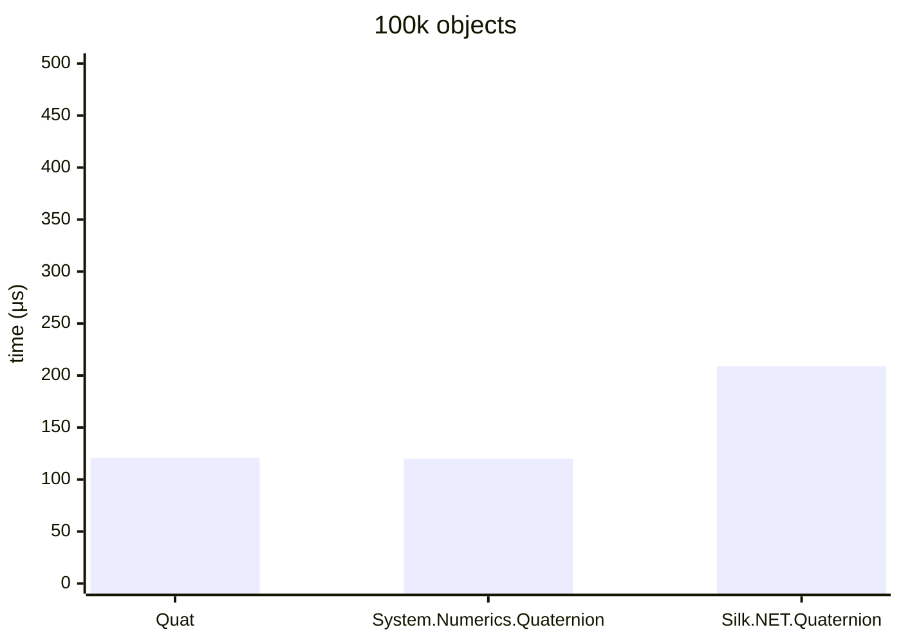
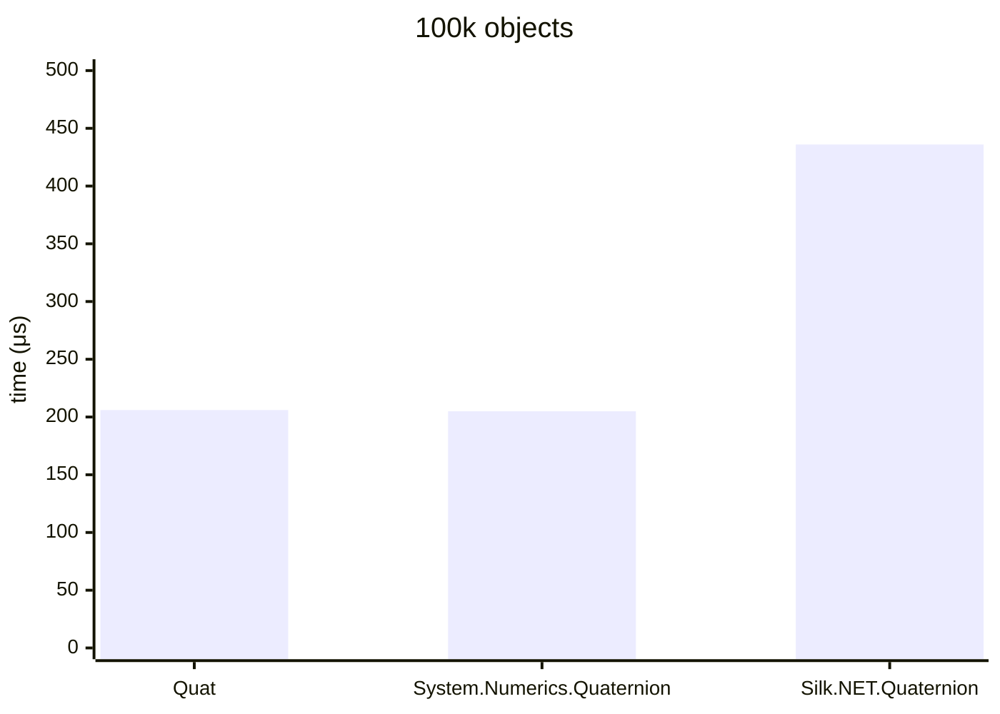
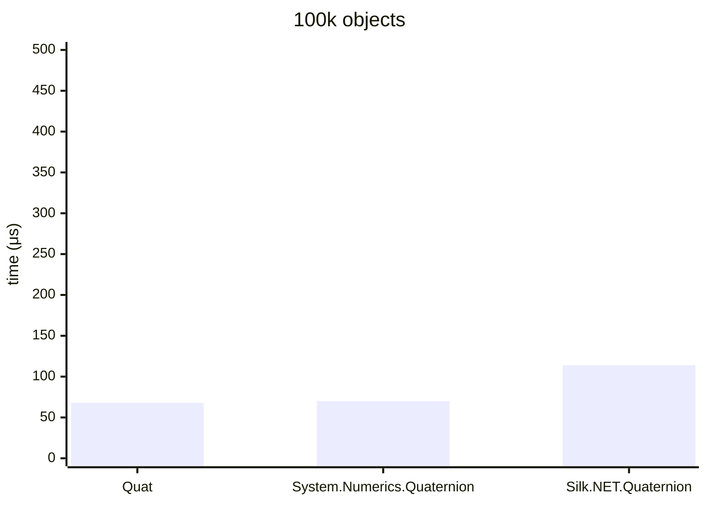
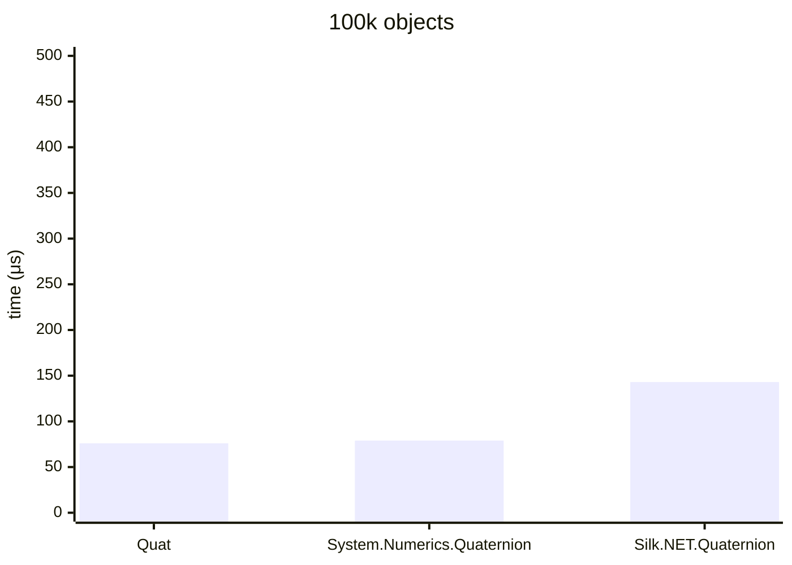
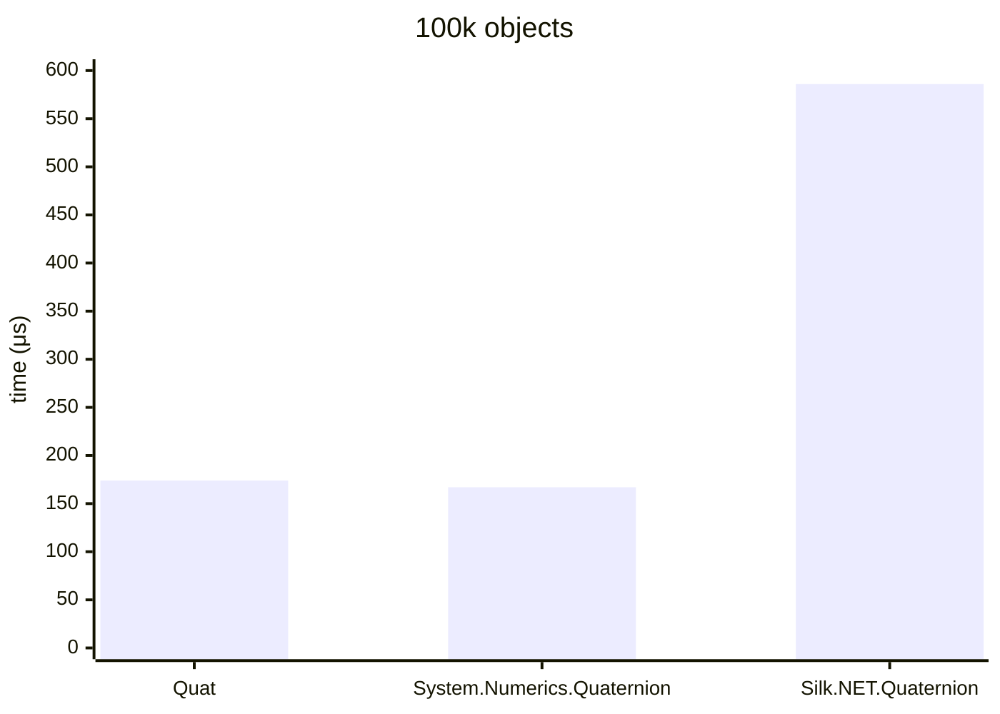
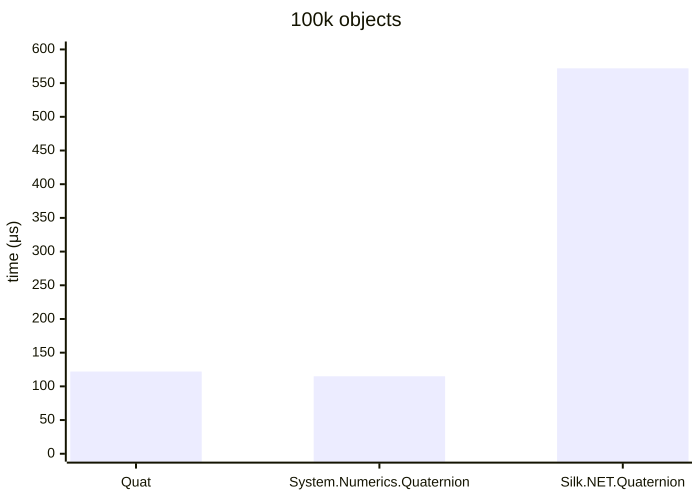

## .NET 11.0.0 (11.0.0, 11.0.26.53018), X64 RyuJIT x86-64-v4 (Job: Job-IHFIKV(Runtime=.NET 11.0))

```
BenchmarkDotNet v0.16.0-nightly.20261117.686, Windows 11 (10.0.26300.9974)
AMD Ryzen 9 7900X 4.69GHz, 1 CPU, 24 logical and 12 physical cores
```

## Multiply



### Quat&lt;float&gt;

<details>
<summary>asm</summary>

```assembly
; System.Numerics.Bench.StressQuat`1[[System.Single, System.Private.CoreLib]].Multiply()
       push      rbx
       sub       rsp,20
       mov       rax,[rcx+10]
       xor       edx,edx
M00_L00:
       mov       r8,rax
       mov       r10,[rcx+8]
       mov       r9,r10
       mov       r11d,[r9+8]
       cmp       edx,r11d
       jae       near ptr M00_L01
       mov       rbx,rdx
       shl       rbx,4
       vmovups   xmm0,[r9+rbx+10]
       lea       r9d,[rdx+1]
       cmp       r9d,r11d
       jae       near ptr M00_L01
       mov       r11d,r9d
       shl       r11,4
       vmovups   xmm1,[r10+r11+10]
       vmovaps   xmm2,xmm0
       vbroadcastss xmm2,xmm2
       vmovshdup xmm3,xmm0
       vunpckhps xmm0,xmm0,xmm0
       vbroadcastss xmm0,xmm0
       vpshufd   xmm4,xmm1,0B1
       vmulps    xmm0,xmm4,xmm0
       vmovaps   xmm4,xmm3
       vbroadcastss xmm4,xmm4
       vpshufd   xmm5,xmm1,4E
       vmulps    xmm4,xmm5,xmm4
       vpshufd   xmm5,xmm1,1B
       vmulps    xmm2,xmm5,xmm2
       vpermilpd xmm3,xmm3,1
       vbroadcastss xmm3,xmm3
       vmulps    xmm1,xmm3,xmm1
       vfmadd231ps xmm1,xmm2,[7FF915F54D00]
       vfmadd231ps xmm1,xmm4,[7FF915F54D10]
       vfmadd132ps xmm0,xmm1,[7FF915F54D20]
       cmp       edx,[r8+8]
       jae       short M00_L01
       vmovups   [r8+rbx+10],xmm0
       mov       edx,r9d
       cmp       edx,1869F
       jl        near ptr M00_L00
       add       rsp,20
       pop       rbx
       ret
M00_L01:
       call      Internal.Runtime.CompilerHelpers.ThrowHelpers.ThrowIndexOutOfRangeException()
       int       3
; Total bytes of code 215
```
</details>

### System.Numerics.Quaternion

<details>
<summary>asm</summary>

```assembly
; System.Numerics.Bench.StressQuaternion.Multiply()
       push      rbx
       sub       rsp,20
       mov       rax,[rcx+10]
       vmovups   xmm0,[7FF915F35AC0]
       vmovddup  xmm1,qword ptr [7FF915F35AD0]
       vmovups   xmm2,[7FF915F35AE0]
       xor       edx,edx
M00_L00:
       mov       r8,rax
       mov       r10,[rcx+8]
       mov       r9,r10
       mov       r11d,[r9+8]
       cmp       edx,r11d
       jae       near ptr M00_L01
       mov       rbx,rdx
       shl       rbx,4
       vmovups   xmm3,[r9+rbx+10]
       lea       r9d,[rdx+1]
       cmp       r9d,r11d
       jae       near ptr M00_L01
       mov       r11d,r9d
       shl       r11,4
       vmovups   xmm4,[r10+r11+10]
       vpermilps xmm5,xmm4,4E
       vmovshdup xmm16,xmm3
       vbroadcastss xmm16,xmm16
       vmulps    xmm5,xmm16,xmm5
       vpermilps xmm16,xmm4,1B
       vmovaps   xmm17,xmm3
       vbroadcastss xmm17,xmm17
       vmulps    xmm16,xmm17,xmm16
       vshufps   xmm17,xmm3,xmm3,0FF
       vbroadcastss xmm17,xmm17
       vmulps    xmm17,xmm17,xmm4
       vfmadd213ps xmm16,xmm1,xmm17
       vfmadd213ps xmm5,xmm0,xmm16
       cmp       edx,[r8+8]
       jae       short M00_L01
       vpermilps xmm4,xmm4,0B1
       vunpckhps xmm3,xmm3,xmm3
       vbroadcastss xmm3,xmm3
       vmulps    xmm3,xmm3,xmm4
       vfmadd213ps xmm3,xmm2,xmm5
       vmovups   [r8+rbx+10],xmm3
       mov       edx,r9d
       cmp       edx,1869F
       jl        near ptr M00_L00
       add       rsp,20
       pop       rbx
       ret
M00_L01:
       call      Internal.Runtime.CompilerHelpers.ThrowHelpers.ThrowIndexOutOfRangeException()
       int       3
; Total bytes of code 243
```
</details>

### Silk.NET.Quaternion&lt;float&gt;

<details>
<summary>asm</summary>

```assembly
; System.Numerics.Bench.StressQuaternion`1[[System.Single, System.Private.CoreLib]].Multiply()
       sub       rsp,28
       xor       eax,eax
M00_L00:
       mov       rdx,[rcx+10]
       mov       r8,[rcx+8]
       mov       r10,r8
       mov       r9d,[r10+8]
       cmp       eax,r9d
       jae       near ptr M00_L01
       mov       r11,rax
       shl       r11,4
       lea       r10,[r10+r11+10]
       vmovss    xmm0,dword ptr [r10]
       vmovss    xmm1,dword ptr [r10+4]
       vmovss    xmm2,dword ptr [r10+8]
       vmovss    xmm3,dword ptr [r10+0C]
       lea       r10d,[rax+1]
       cmp       r10d,r9d
       jae       near ptr M00_L01
       mov       r9d,r10d
       shl       r9,4
       lea       r8,[r8+r9+10]
       vmovss    xmm4,dword ptr [r8]
       vmovss    xmm5,dword ptr [r8+4]
       vmovss    xmm16,dword ptr [r8+8]
       vmovss    xmm17,dword ptr [r8+0C]
       vmulss    xmm18,xmm16,xmm1
       vmulss    xmm19,xmm2,xmm5
       vsubss    xmm18,xmm18,xmm19
       vmulss    xmm19,xmm2,xmm4
       vmulss    xmm20,xmm16,xmm0
       vsubss    xmm19,xmm19,xmm20
       vmulss    xmm20,xmm0,xmm5
       vmulss    xmm21,xmm1,xmm4
       vsubss    xmm20,xmm20,xmm21
       vmulss    xmm21,xmm0,xmm4
       vmulss    xmm22,xmm1,xmm5
       vaddss    xmm21,xmm22,xmm21
       vmulss    xmm22,xmm16,xmm2
       vaddss    xmm21,xmm22,xmm21
       vmulss    xmm0,xmm17,xmm0
       vmulss    xmm4,xmm4,xmm3
       vaddss    xmm0,xmm4,xmm0
       vaddss    xmm0,xmm18,xmm0
       vmulss    xmm1,xmm17,xmm1
       vmulss    xmm4,xmm5,xmm3
       vaddss    xmm1,xmm4,xmm1
       vaddss    xmm1,xmm19,xmm1
       vmulss    xmm2,xmm17,xmm2
       vmulss    xmm4,xmm16,xmm3
       vaddss    xmm2,xmm4,xmm2
       vaddss    xmm2,xmm20,xmm2
       vmulss    xmm3,xmm17,xmm3
       vsubss    xmm3,xmm3,xmm21
       cmp       eax,[rdx+8]
       jae       short M00_L01
       lea       rax,[rdx+r11+10]
       vmovss    dword ptr [rax],xmm0
       vmovss    dword ptr [rax+4],xmm1
       vmovss    dword ptr [rax+8],xmm2
       vmovss    dword ptr [rax+0C],xmm3
       mov       eax,r10d
       cmp       eax,1869F
       jl        near ptr M00_L00
       add       rsp,28
       ret
M00_L01:
       call      Internal.Runtime.CompilerHelpers.ThrowHelpers.ThrowIndexOutOfRangeException()
       int       3
; Total bytes of code 327
```
</details><br/>

## Divide



### Quat&lt;float&gt;

<details>
<summary>asm</summary>

```assembly
; System.Numerics.Bench.StressQuat`1[[System.Single, System.Private.CoreLib]].Divide()
       push      rbx
       sub       rsp,20
       mov       rax,[rcx+10]
       xor       edx,edx
M00_L00:
       mov       r8,rax
       mov       r10,[rcx+8]
       mov       r9,r10
       mov       r11d,[r9+8]
       cmp       edx,r11d
       jae       near ptr M00_L01
       mov       rbx,rdx
       shl       rbx,4
       vmovups   xmm0,[r9+rbx+10]
       lea       r9d,[rdx+1]
       cmp       r9d,r11d
       jae       near ptr M00_L01
       mov       r11d,r9d
       shl       r11,4
       vmovups   xmm1,[r10+r11+10]
       vmulps    xmm2,xmm1,[7FF915F95B50]
       vmulps    xmm1,xmm1,xmm1
       vpermilps xmm3,xmm1,0B1
       vaddps    xmm1,xmm3,xmm1
       vpermilps xmm3,xmm1,4E
       vaddps    xmm1,xmm3,xmm1
       vbroadcastss xmm1,xmm1
       vdivps    xmm2,xmm2,xmm1
       vcmpnleps xmm1,xmm1,[7FF915F95B60]
       vandps    xmm1,xmm1,xmm2
       vmovaps   xmm2,xmm0
       vbroadcastss xmm2,xmm2
       vmovshdup xmm3,xmm0
       vunpckhps xmm0,xmm0,xmm0
       vbroadcastss xmm0,xmm0
       vpshufd   xmm4,xmm1,0B1
       vmulps    xmm0,xmm4,xmm0
       vmovaps   xmm4,xmm3
       vbroadcastss xmm4,xmm4
       vpshufd   xmm5,xmm1,4E
       vmulps    xmm4,xmm5,xmm4
       vpshufd   xmm5,xmm1,1B
       vmulps    xmm2,xmm5,xmm2
       vpermilpd xmm3,xmm3,1
       vbroadcastss xmm3,xmm3
       vmulps    xmm1,xmm3,xmm1
       vfmadd231ps xmm1,xmm2,[7FF915F95B70]
       vfmadd231ps xmm1,xmm4,[7FF915F95B80]
       vfmadd132ps xmm0,xmm1,[7FF915F95B90]
       cmp       edx,[r8+8]
       jae       short M00_L01
       vmovups   [r8+rbx+10],xmm0
       mov       edx,r9d
       cmp       edx,1869F
       jl        near ptr M00_L00
       add       rsp,20
       pop       rbx
       ret
M00_L01:
       call      Internal.Runtime.CompilerHelpers.ThrowHelpers.ThrowIndexOutOfRangeException()
       int       3
; Total bytes of code 269
```
</details>

### System.Numerics.Quaternion

<details>
<summary>asm</summary>

```assembly
; System.Numerics.Bench.StressQuaternion.Divide()
       push      rbx
       sub       rsp,30
       vmovaps   [rsp+20],xmm6
       mov       rax,[rcx+10]
       vmovups   xmm0,[7FF915F52D10]
       vbroadcastss xmm1,dword ptr [7FF915F52D20]
       vmovups   xmm2,[7FF915F52D30]
       vmovddup  xmm3,qword ptr [7FF915F52D40]
       vmovups   xmm4,[7FF915F52D50]
       xor       edx,edx
M00_L00:
       mov       r8,rax
       mov       r10,[rcx+8]
       mov       r9,r10
       mov       r11d,[r9+8]
       cmp       edx,r11d
       jae       near ptr M00_L01
       mov       rbx,rdx
       shl       rbx,4
       vmovups   xmm5,[r9+rbx+10]
       lea       r9d,[rdx+1]
       cmp       r9d,r11d
       jae       near ptr M00_L01
       mov       r11d,r9d
       shl       r11,4
       vmovups   xmm16,[r10+r11+10]
       vmulps    xmm17,xmm16,xmm16
       vpermilps xmm18,xmm17,0B1
       vaddps    xmm17,xmm18,xmm17
       vpermilps xmm18,xmm17,4E
       vaddps    xmm6,xmm18,xmm17
       vmulps    xmm16,xmm16,xmm0
       vdivps    xmm16,xmm16,xmm6
       vcmpnleps xmm6,xmm6,xmm1
       vandps    xmm16,xmm16,xmm6
       vpermilps xmm17,xmm16,4E
       vmovshdup xmm18,xmm5
       vbroadcastss xmm18,xmm18
       vmulps    xmm17,xmm18,xmm17
       vpermilps xmm18,xmm16,1B
       vmovaps   xmm19,xmm5
       vbroadcastss xmm19,xmm19
       vmulps    xmm18,xmm19,xmm18
       vshufps   xmm19,xmm5,xmm5,0FF
       vbroadcastss xmm19,xmm19
       vmulps    xmm19,xmm19,xmm16
       vfmadd213ps xmm18,xmm3,xmm19
       vfmadd213ps xmm17,xmm2,xmm18
       cmp       edx,[r8+8]
       jae       short M00_L01
       vpermilps xmm16,xmm16,0B1
       vunpckhps xmm5,xmm5,xmm5
       vbroadcastss xmm5,xmm5
       vmulps    xmm5,xmm16,xmm5
       vfmadd213ps xmm5,xmm4,xmm17
       vmovups   [r8+rbx+10],xmm5
       mov       edx,r9d
       cmp       edx,1869F
       jl        near ptr M00_L00
       vmovaps   xmm6,[rsp+20]
       add       rsp,30
       pop       rbx
       ret
M00_L01:
       call      Internal.Runtime.CompilerHelpers.ThrowHelpers.ThrowIndexOutOfRangeException()
       int       3
; Total bytes of code 333
```
</details>

### Silk.NET.Quaternion&lt;float&gt;

<details>
<summary>asm</summary>

```assembly
; System.Numerics.Bench.StressQuaternion`1[[System.Single, System.Private.CoreLib]].Divide()
       sub       rsp,28
       vmovss    xmm0,dword ptr [7FF915F63158]
       xor       eax,eax
M00_L00:
       mov       rdx,[rcx+10]
       mov       r8,[rcx+8]
       mov       r10,r8
       mov       r9d,[r10+8]
       cmp       eax,r9d
       jae       near ptr M00_L01
       mov       r11,rax
       shl       r11,4
       lea       r10,[r10+r11+10]
       vmovss    xmm1,dword ptr [r10]
       vmovss    xmm2,dword ptr [r10+4]
       vmovss    xmm3,dword ptr [r10+8]
       vmovss    xmm4,dword ptr [r10+0C]
       lea       r10d,[rax+1]
       cmp       r10d,r9d
       jae       near ptr M00_L01
       mov       r9d,r10d
       shl       r9,4
       lea       r8,[r8+r9+10]
       vmovss    xmm5,dword ptr [r8]
       vmovss    xmm16,dword ptr [r8+4]
       vmovss    xmm17,dword ptr [r8+8]
       vmovss    xmm18,dword ptr [r8+0C]
       vmulss    xmm19,xmm5,xmm5
       vmulss    xmm20,xmm16,xmm16
       vaddss    xmm19,xmm20,xmm19
       vmulss    xmm20,xmm17,xmm17
       vaddss    xmm19,xmm20,xmm19
       vmulss    xmm20,xmm18,xmm18
       vaddss    xmm19,xmm20,xmm19
       vdivss    xmm19,xmm0,xmm19
       vmulss    xmm5,xmm19,xmm5
       vxorps    xmm5,xmm5,[7FF915F63160]
       vmulss    xmm16,xmm16,xmm19
       vxorps    xmm16,xmm16,[7FF915F63170]
       vmulss    xmm17,xmm17,xmm19
       vxorps    xmm17,xmm17,[7FF915F63180]
       vmulss    xmm18,xmm18,xmm19
       vmulss    xmm19,xmm17,xmm2
       vmulss    xmm20,xmm16,xmm3
       vsubss    xmm19,xmm19,xmm20
       vmulss    xmm20,xmm3,xmm5
       vmulss    xmm21,xmm17,xmm1
       vsubss    xmm20,xmm20,xmm21
       vmulss    xmm21,xmm16,xmm1
       vmulss    xmm22,xmm2,xmm5
       vsubss    xmm21,xmm21,xmm22
       vmulss    xmm22,xmm1,xmm5
       vmulss    xmm23,xmm16,xmm2
       vaddss    xmm22,xmm23,xmm22
       vmulss    xmm23,xmm17,xmm3
       vaddss    xmm22,xmm23,xmm22
       vmulss    xmm1,xmm18,xmm1
       vmulss    xmm5,xmm5,xmm4
       vaddss    xmm1,xmm5,xmm1
       vaddss    xmm1,xmm19,xmm1
       vmulss    xmm2,xmm18,xmm2
       vmulss    xmm5,xmm16,xmm4
       vaddss    xmm2,xmm5,xmm2
       vaddss    xmm2,xmm20,xmm2
       vmulss    xmm3,xmm18,xmm3
       vmulss    xmm5,xmm17,xmm4
       vaddss    xmm3,xmm5,xmm3
       vaddss    xmm3,xmm21,xmm3
       vmulss    xmm4,xmm18,xmm4
       vsubss    xmm4,xmm4,xmm22
       cmp       eax,[rdx+8]
       jae       short M00_L01
       lea       rax,[rdx+r11+10]
       vmovss    dword ptr [rax],xmm1
       vmovss    dword ptr [rax+4],xmm2
       vmovss    dword ptr [rax+8],xmm3
       vmovss    dword ptr [rax+0C],xmm4
       mov       eax,r10d
       cmp       eax,1869F
       jl        near ptr M00_L00
       add       rsp,28
       ret
M00_L01:
       call      Internal.Runtime.CompilerHelpers.ThrowHelpers.ThrowIndexOutOfRangeException()
       int       3
; Total bytes of code 438
```
</details></br>

## Conjugate



### Quat&lt;float&gt;

<details>
<summary>asm</summary>

```assembly
; System.Numerics.Bench.StressQuat`1[[System.Single, System.Private.CoreLib]].Conjugate()
       sub       rsp,28
       mov       rax,[rcx+10]
       xor       edx,edx
       nop       word ptr [rax+rax]
M00_L00:
       mov       r8,rax
       mov       r10,[rcx+8]
       cmp       edx,[r10+8]
       jae       short M00_L01
       mov       r9,rdx
       shl       r9,4
       vmovups   xmm0,[r10+r9+10]
       vmulps    xmm0,xmm0,[7FF915F93FE0]
       cmp       edx,[r8+8]
       jae       short M00_L01
       vmovups   [r8+r9+10],xmm0
       inc       edx
       cmp       edx,186A0
       jl        short M00_L00
       add       rsp,28
       ret
M00_L01:
       call      Internal.Runtime.CompilerHelpers.ThrowHelpers.ThrowIndexOutOfRangeException()
       int       3
; Total bytes of code 85
```
</details>

### System.Numerics.Quaternion

<details>
<summary>asm</summary>

```assembly
; System.Numerics.Bench.StressQuaternion.Conjugate()
       sub       rsp,28
       mov       rax,[rcx+10]
       vmovups   xmm0,[7FF915F32510]
       xor       edx,edx
M00_L00:
       mov       r8,rax
       mov       r10,[rcx+8]
       cmp       edx,[r10+8]
       jae       short M00_L01
       mov       r9,rdx
       shl       r9,4
       vmulps    xmm1,xmm0,[r10+r9+10]
       cmp       edx,[r8+8]
       jae       short M00_L01
       vmovups   [r8+r9+10],xmm1
       inc       edx
       cmp       edx,186A0
       jl        short M00_L00
       add       rsp,28
       ret
M00_L01:
       call      Internal.Runtime.CompilerHelpers.ThrowHelpers.ThrowIndexOutOfRangeException()
       int       3
; Total bytes of code 79
```
</details>

### Silk.NET.Quaternion&lt;float&gt;

<details>
<summary>asm</summary>

```assembly
; System.Numerics.Bench.StressQuaternion`1[[System.Single, System.Private.CoreLib]].Conjugate()
       sub       rsp,28
       xor       eax,eax
M00_L00:
       mov       rdx,[rcx+10]
       mov       r8,[rcx+8]
       cmp       eax,[r8+8]
       jae       short M00_L01
       mov       r10,rax
       shl       r10,4
       lea       r8,[r8+r10+10]
       vmovss    xmm0,dword ptr [r8]
       vmovss    xmm1,dword ptr [r8+4]
       vmovss    xmm2,dword ptr [r8+8]
       vmovss    xmm3,dword ptr [r8+0C]
       vxorps    xmm0,xmm0,[7FF915F92B40]
       vxorps    xmm1,xmm1,[7FF915F92B40]
       vxorps    xmm2,xmm2,[7FF915F92B40]
       cmp       eax,[rdx+8]
       jae       short M00_L01
       lea       rdx,[rdx+r10+10]
       vmovss    dword ptr [rdx],xmm0
       vmovss    dword ptr [rdx+4],xmm1
       vmovss    dword ptr [rdx+8],xmm2
       vmovss    dword ptr [rdx+0C],xmm3
       inc       eax
       cmp       eax,186A0
       jl        short M00_L00
       add       rsp,28
       ret
M00_L01:
       call      Internal.Runtime.CompilerHelpers.ThrowHelpers.ThrowIndexOutOfRangeException()
       int       3
; Total bytes of code 128
```
</details></br>

## Inverse



### Quat&lt;float&gt;

<details asm>
<summary>asm</summary>

```assembly
; System.Numerics.Bench.StressQuat`1[[System.Single, System.Private.CoreLib]].Inverse()
       sub       rsp,28
       mov       rax,[rcx+10]
       xor       edx,edx
M00_L00:
       mov       r8,rax
       mov       r10,[rcx+8]
       cmp       edx,[r10+8]
       jae       short M00_L01
       mov       r9,rdx
       shl       r9,4
       vmovups   xmm0,[r10+r9+10]
       vmulps    xmm1,xmm0,[7FF915FA3E80]
       vmulps    xmm0,xmm0,xmm0
       vpermilps xmm2,xmm0,0B1
       vaddps    xmm0,xmm2,xmm0
       vpermilps xmm2,xmm0,4E
       vaddps    xmm0,xmm2,xmm0
       vbroadcastss xmm0,xmm0
       cmp       edx,[r8+8]
       jae       short M00_L01
       vdivps    xmm1,xmm1,xmm0
       vcmpnleps xmm0,xmm0,[7FF915FA3E90]
       vandps    xmm0,xmm0,xmm1
       vmovups   [r8+r9+10],xmm0
       inc       edx
       cmp       edx,186A0
       jl        short M00_L00
       add       rsp,28
       ret
M00_L01:
       call      Internal.Runtime.CompilerHelpers.ThrowHelpers.ThrowIndexOutOfRangeException()
       int       3
; Total bytes of code 125
```
</details>

### System.Numerics.Quaternion

<details>
<summary>asm</summary>

```assembly
; System.Numerics.Bench.StressQuaternion.Inverse()
       sub       rsp,28
       mov       rax,[rcx+10]
       vmovups   xmm0,[7FF915F42110]
       vbroadcastss xmm1,dword ptr [7FF915F42120]
       xor       edx,edx
M00_L00:
       mov       r8,rax
       mov       r10,[rcx+8]
       cmp       edx,[r10+8]
       jae       short M00_L01
       mov       r9,rdx
       shl       r9,4
       vmovups   xmm2,[r10+r9+10]
       vmulps    xmm3,xmm2,xmm2
       vpermilps xmm4,xmm3,0B1
       vaddps    xmm3,xmm4,xmm3
       vpermilps xmm4,xmm3,4E
       vaddps    xmm3,xmm4,xmm3
       cmp       edx,[r8+8]
       jae       short M00_L01
       vmulps    xmm2,xmm0,xmm2
       vdivps    xmm2,xmm2,xmm3
       vcmpnleps xmm3,xmm3,xmm1
       vandps    xmm2,xmm3,xmm2
       vmovups   [r8+r9+10],xmm2
       inc       edx
       cmp       edx,186A0
       jl        short M00_L00
       add       rsp,28
       ret
M00_L01:
       call      Internal.Runtime.CompilerHelpers.ThrowHelpers.ThrowIndexOutOfRangeException()
       int       3
; Total bytes of code 129
```
</details>

### Silk.NET.Quaternion&lt;float&gt;

<details>
<summary>asm</summary>

```assembly
; System.Numerics.Bench.StressQuaternion`1[[System.Single, System.Private.CoreLib]].Inverse()
       sub       rsp,28
       vmovss    xmm0,dword ptr [7FF915F62C0C]
       xor       eax,eax
M00_L00:
       mov       rdx,[rcx+10]
       mov       r8,[rcx+8]
       cmp       eax,[r8+8]
       jae       near ptr M00_L01
       mov       r10,rax
       shl       r10,4
       lea       r8,[r8+r10+10]
       vmovss    xmm1,dword ptr [r8]
       vmovss    xmm2,dword ptr [r8+4]
       vmovss    xmm3,dword ptr [r8+8]
       vmovss    xmm4,dword ptr [r8+0C]
       vmulss    xmm5,xmm1,xmm1
       vmulss    xmm16,xmm2,xmm2
       vaddss    xmm5,xmm16,xmm5
       vmulss    xmm16,xmm3,xmm3
       vaddss    xmm5,xmm16,xmm5
       vmulss    xmm16,xmm4,xmm4
       vaddss    xmm5,xmm16,xmm5
       vdivss    xmm5,xmm0,xmm5
       vmulss    xmm1,xmm1,xmm5
       vxorps    xmm1,xmm1,[7FF915F62C10]
       vmulss    xmm2,xmm2,xmm5
       vxorps    xmm2,xmm2,[7FF915F62C20]
       vmulss    xmm3,xmm3,xmm5
       vxorps    xmm3,xmm3,[7FF915F62C30]
       vmulss    xmm4,xmm4,xmm5
       cmp       eax,[rdx+8]
       jae       short M00_L01
       lea       rdx,[rdx+r10+10]
       vmovss    dword ptr [rdx],xmm1
       vmovss    dword ptr [rdx+4],xmm2
       vmovss    dword ptr [rdx+8],xmm3
       vmovss    dword ptr [rdx+0C],xmm4
       inc       eax
       cmp       eax,186A0
       jl        near ptr M00_L00
       add       rsp,28
       ret
M00_L01:
       call      Internal.Runtime.CompilerHelpers.ThrowHelpers.ThrowIndexOutOfRangeException()
       int       3
; Total bytes of code 204
```
</details>

## Lerp



### Quat&lt;float&gt;

<details asm>
<summary>asm</summary>

```assembly
; System.Numerics.Bench.StressQuat`1[[System.Single, System.Private.CoreLib]].Lerp()
       push      rsi
       push      rbx
       sub       rsp,28
       mov       rax,[rcx+10]
       vbroadcastss xmm0,dword ptr [7FF915F94528]
       vbroadcastss xmm1,dword ptr [7FF915F9452C]
       xor       edx,edx
M00_L00:
       mov       r8,rax
       mov       r10,[rcx+8]
       mov       r9,r10
       mov       r11d,[r9+8]
       cmp       edx,r11d
       jae       near ptr M00_L01
       mov       rbx,rdx
       shl       rbx,4
       lea       r9,[r9+rbx+10]
       lea       esi,[rdx+1]
       cmp       esi,r11d
       jae       near ptr M00_L01
       mov       r11d,esi
       shl       r11,4
       vmovups   xmm2,[r10+r11+10]
       vmovups   xmm3,[r9]
       vxorps    xmm4,xmm4,xmm4
       vmulps    xmm5,xmm2,xmm3
       vpermilps xmm16,xmm5,0B1
       vaddps    xmm5,xmm16,xmm5
       vpermilps xmm16,xmm5,4E
       vaddps    xmm5,xmm16,xmm5
       vxorps    xmm16,xmm16,xmm16
       vpcmpnltd k1,xmm5,xmm16
       vxorps    xmm5,xmm1,xmm2
       vandps    xmm5{k1},xmm0,xmm2
       vfmadd213ps xmm4,xmm3,xmm5
       cmp       edx,[r8+8]
       jae       short M00_L01
       vmulps    xmm2,xmm4,xmm4
       vpermilps xmm3,xmm2,0B1
       vaddps    xmm2,xmm3,xmm2
       vpermilps xmm3,xmm2,4E
       vaddps    xmm2,xmm3,xmm2
       vsqrtps   xmm2,xmm2
       vdivps    xmm2,xmm4,xmm2
       vmovups   [r8+rbx+10],xmm2
       mov       edx,esi
       cmp       edx,1869F
       jl        near ptr M00_L00
       add       rsp,28
       pop       rbx
       pop       rsi
       ret
M00_L01:
       call      Internal.Runtime.CompilerHelpers.ThrowHelpers.ThrowIndexOutOfRangeException()
       int       3
; Total bytes of code 230
```
</details>

### System.Numerics.Quaternion

<details>
<summary>asm</summary>

```assembly
; System.Numerics.Bench.StressQuaternion.Lerp()
       push      rbx
       sub       rsp,20
       mov       rax,[rcx+10]
       vbroadcastss xmm0,dword ptr [7FF915F52DD4]
       xor       edx,edx
M00_L00:
       mov       r8,rax
       mov       r10,[rcx+8]
       mov       r9,r10
       mov       r11d,[r9+8]
       cmp       edx,r11d
       jae       near ptr M00_L01
       mov       rbx,rdx
       shl       rbx,4
       vmovups   xmm1,[r9+rbx+10]
       lea       r9d,[rdx+1]
       cmp       r9d,r11d
       jae       near ptr M00_L01
       mov       r11d,r9d
       shl       r11,4
       vmovups   xmm2,[r10+r11+10]
       vxorps    xmm3,xmm3,xmm3
       vmulps    xmm4,xmm2,xmm1
       vpermilps xmm5,xmm4,0B1
       vaddps    xmm4,xmm5,xmm4
       vpermilps xmm5,xmm4,4E
       vaddps    xmm4,xmm5,xmm4
       vxorps    xmm5,xmm5,xmm5
       vpcmpnltd k1,xmm4,xmm5
       vxorps    xmm4,xmm0,xmm2
       vpblendmd xmm2{k1},xmm4,xmm2
       vfmadd231ps xmm2,xmm3,xmm1
       cmp       edx,[r8+8]
       jae       short M00_L01
       vmulps    xmm1,xmm2,xmm2
       vpermilps xmm3,xmm1,0B1
       vaddps    xmm1,xmm3,xmm1
       vpermilps xmm3,xmm1,4E
       vaddps    xmm1,xmm3,xmm1
       vsqrtps   xmm1,xmm1
       vdivps    xmm1,xmm2,xmm1
       vmovups   [r8+rbx+10],xmm1
       mov       edx,r9d
       cmp       edx,1869F
       jl        near ptr M00_L00
       add       rsp,20
       pop       rbx
       ret
M00_L01:
       call      Internal.Runtime.CompilerHelpers.ThrowHelpers.ThrowIndexOutOfRangeException()
       int       3
; Total bytes of code 210
```
</details>

### Silk.NET.Quaternion&lt;float&gt;

<details>
<summary>asm</summary>

```assembly
; System.Numerics.Bench.StressQuaternion`1[[System.Single, System.Private.CoreLib]].Lerp()
       push      r14
       push      rdi
       push      rsi
       push      rbp
       push      rbx
       sub       rsp,60
       vmovaps   [rsp+50],xmm6
       mov       rbx,rcx
       vmovss    xmm6,dword ptr [7FF915F93590]
       xor       esi,esi
M00_L00:
       mov       rdi,[rbx+10]
       mov       rdx,[rbx+8]
       mov       r8,rdx
       mov       ecx,[r8+8]
       cmp       esi,ecx
       jae       short M00_L01
       mov       rbp,rsi
       shl       rbp,4
       vmovups   xmm3,[r8+rbp+10]
       vmovups   [rsp+30],xmm3
       lea       r14d,[rsi+1]
       cmp       r14d,ecx
       jae       short M00_L01
       mov       r8d,r14d
       shl       r8,4
       vmovups   xmm3,[rdx+r8+10]
       vmovups   [rsp+20],xmm3
       lea       rdx,[rsp+30]
       lea       r8,[rsp+20]
       vmovaps   xmm3,xmm6
       lea       rcx,[rsp+40]
       call      qword ptr [7FF915F04588]; Silk.NET.Maths.Quaternion`1[[System.Single, System.Private.CoreLib]].Lerp(Silk.NET.Maths.Quaternion`1<Single>, Silk.NET.Maths.Quaternion`1<Single>, Single)
       cmp       esi,[rdi+8]
       jae       short M00_L01
       vmovups   xmm0,[rsp+40]
       vmovups   [rdi+rbp+10],xmm0
       mov       esi,r14d
       cmp       esi,1869F
       jl        short M00_L00
       vmovaps   xmm6,[rsp+50]
       add       rsp,60
       pop       rbx
       pop       rbp
       pop       rsi
       pop       rdi
       pop       r14
       ret
M00_L01:
       call      Internal.Runtime.CompilerHelpers.ThrowHelpers.ThrowIndexOutOfRangeException()
       int       3
; Total bytes of code 173

; Silk.NET.Maths.Quaternion`1[[System.Single, System.Private.CoreLib]].Lerp(Silk.NET.Maths.Quaternion`1<Single>, Silk.NET.Maths.Quaternion`1<Single>, Single)
       vmovss    xmm0,dword ptr [r8]
       vmovss    xmm1,dword ptr [r8+4]
       vmovss    xmm2,dword ptr [r8+8]
       vmovss    xmm4,dword ptr [r8+0C]
       vmovss    xmm5,dword ptr [rdx]
       vmovss    xmm16,dword ptr [rdx+4]
       vmovss    xmm17,dword ptr [rdx+8]
       vmovss    xmm18,dword ptr [rdx+0C]
       vmovss    xmm19,dword ptr [7FF915F90274]
       vsubss    xmm20,xmm19,xmm3
       vmulss    xmm21,xmm5,xmm0
       vmulss    xmm22,xmm16,xmm1
       vaddss    xmm21,xmm22,xmm21
       vmulss    xmm22,xmm17,xmm2
       vaddss    xmm21,xmm22,xmm21
       vmulss    xmm22,xmm18,xmm4
       vaddss    xmm21,xmm22,xmm21
       vxorps    xmm22,xmm22,xmm22
       vucomiss  xmm21,xmm22
       jb        near ptr M01_L01
       vmulss    xmm5,xmm20,xmm5
       vmulss    xmm0,xmm3,xmm0
       vaddss    xmm0,xmm0,xmm5
       vmulss    xmm16,xmm20,xmm16
       vmulss    xmm1,xmm3,xmm1
       vaddss    xmm1,xmm16,xmm1
       vmulss    xmm17,xmm20,xmm17
       vmulss    xmm2,xmm3,xmm2
       vaddss    xmm2,xmm17,xmm2
       vmulss    xmm20,xmm20,xmm18
       vmulss    xmm3,xmm3,xmm4
       vaddss    xmm3,xmm20,xmm3
M01_L00:
       vmulss    xmm4,xmm0,xmm0
       vmulss    xmm5,xmm1,xmm1
       vaddss    xmm4,xmm5,xmm4
       vmulss    xmm5,xmm2,xmm2
       vaddss    xmm4,xmm5,xmm4
       vmulss    xmm5,xmm3,xmm3
       vaddss    xmm4,xmm5,xmm4
       vsqrtss   xmm4,xmm4,xmm4
       vdivss    xmm4,xmm19,xmm4
       vmulss    xmm0,xmm0,xmm4
       vmulss    xmm1,xmm1,xmm4
       vmulss    xmm2,xmm2,xmm4
       vmulss    xmm3,xmm3,xmm4
       vmovss    dword ptr [rcx],xmm0
       vmovss    dword ptr [rcx+4],xmm1
       vmovss    dword ptr [rcx+8],xmm2
       vmovss    dword ptr [rcx+0C],xmm3
       mov       rax,rcx
       ret
M01_L01:
       vmulss    xmm5,xmm20,xmm5
       vmulss    xmm0,xmm3,xmm0
       vsubss    xmm0,xmm5,xmm0
       vmulss    xmm5,xmm20,xmm16
       vmulss    xmm1,xmm3,xmm1
       vsubss    xmm1,xmm5,xmm1
       vmulss    xmm5,xmm20,xmm17
       vmulss    xmm2,xmm3,xmm2
       vsubss    xmm2,xmm5,xmm2
       vmulss    xmm5,xmm20,xmm18
       vmulss    xmm3,xmm3,xmm4
       vsubss    xmm3,xmm5,xmm3
       jmp       near ptr M01_L00
; Total bytes of code 324
```
</details>

## Slerp



### Quat&lt;float&gt;

<details asm>
<summary>asm</summary>

```assembly
; System.Numerics.Bench.StressQuat`1[[System.Single, System.Private.CoreLib]].Slerp()
       push      r15
       push      r14
       push      rdi
       push      rsi
       push      rbp
       push      rbx
       sub       rsp,0A8
       vzeroupper
       vmovaps   [rsp+90],xmm6
       vmovaps   [rsp+80],xmm7
       vmovaps   [rsp+70],xmm8
       vmovaps   [rsp+60],xmm9
       vmovaps   [rsp+50],xmm10
       vmovaps   [rsp+40],xmm11
       vmovaps   [rsp+30],xmm12
       mov       rbx,rcx
       mov       rsi,[rbx+10]
       vmovss    xmm6,dword ptr [7FF915F84684]
       vsubss    xmm7,xmm6,dword ptr [7FF9156EB1B0]
       xor       edi,edi
M00_L00:
       mov       rbp,rsi
       mov       rax,[rbx+8]
       mov       rcx,rax
       mov       edx,[rcx+8]
       cmp       edi,edx
       jae       near ptr M00_L05
       mov       r14,rdi
       shl       r14,4
       lea       rcx,[rcx+r14+10]
       lea       r15d,[rdi+1]
       cmp       r15d,edx
       jae       near ptr M00_L05
       mov       edx,r15d
       shl       rdx,4
       vmovups   xmm8,[rax+rdx+10]
       vmovups   xmm9,[rcx]
       vmulps    xmm0,xmm9,xmm8
       vpermilps xmm1,xmm0,0B1
       vaddps    xmm0,xmm1,xmm0
       vpermilps xmm1,xmm0,4E
       vaddps    xmm0,xmm1,xmm0
       vmovaps   xmm10,xmm6
       vmovd     eax,xmm0
       test      eax,eax
       jl        near ptr M00_L03
M00_L01:
       vucomiss  xmm0,xmm7
       jbe       near ptr M00_L04
       vxorps    xmm11,xmm11,xmm11
M00_L02:
       cmp       edi,[rbp+8]
       jae       near ptr M00_L05
       vbroadcastss xmm0,xmm11
       vmulps    xmm0,xmm9,xmm0
       vbroadcastss xmm1,xmm10
       vmulps    xmm1,xmm8,xmm1
       vaddps    xmm0,xmm1,xmm0
       vmovups   [rbp+r14+10],xmm0
       mov       edi,r15d
       cmp       edi,1869F
       jl        near ptr M00_L00
       vmovaps   xmm6,[rsp+90]
       vmovaps   xmm7,[rsp+80]
       vmovaps   xmm8,[rsp+70]
       vmovaps   xmm9,[rsp+60]
       vmovaps   xmm10,[rsp+50]
       vmovaps   xmm11,[rsp+40]
       vmovaps   xmm12,[rsp+30]
       add       rsp,0A8
       pop       rbx
       pop       rbp
       pop       rsi
       pop       rdi
       pop       r14
       pop       r15
       ret
M00_L03:
       vxorps    xmm0,xmm0,[7FF915F84690]
       vmovss    xmm10,dword ptr [7FF915F846A0]
       jmp       near ptr M00_L01
M00_L04:
       call      qword ptr [7FF915F145A0]; Precode of System.Single.Acos(Single)
       vmovss    dword ptr [rsp+2C],xmm0
       call      qword ptr [7FF915F145B8]; Precode of System.Single.Sin(Single)
       vdivss    xmm12,xmm6,xmm0
       vxorps    xmm0,xmm0,xmm0
       vmulss    xmm0,xmm0,dword ptr [rsp+2C]
       call      qword ptr [7FF915F145B8]; Precode of System.Single.Sin(Single)
       vmulss    xmm11,xmm12,xmm0
       vmovss    xmm0,dword ptr [rsp+2C]
       call      qword ptr [7FF915F145B8]; Precode of System.Single.Sin(Single)
       vmulss    xmm0,xmm12,xmm0
       vmulss    xmm10,xmm10,xmm0
       jmp       near ptr M00_L02
M00_L05:
       call      Internal.Runtime.CompilerHelpers.ThrowHelpers.ThrowIndexOutOfRangeException()
       int       3
; Total bytes of code 417
```
</details>

### System.Numerics.Quaternion

<details>
<summary>asm</summary>

```assembly
; System.Numerics.Bench.StressQuaternion.Slerp()
       push      r15
       push      r14
       push      rdi
       push      rsi
       push      rbp
       push      rbx
       sub       rsp,0A8
       vzeroupper
       vmovaps   [rsp+90],xmm6
       vmovaps   [rsp+80],xmm7
       vmovaps   [rsp+70],xmm8
       vmovaps   [rsp+60],xmm9
       vmovaps   [rsp+50],xmm10
       vmovaps   [rsp+40],xmm11
       vmovaps   [rsp+30],xmm12
       mov       rbx,rcx
       mov       rsi,[rbx+10]
       vmovss    xmm6,dword ptr [7FF915F32B00]
       vmovss    xmm7,dword ptr [7FF915F32B04]
       xor       edi,edi
M00_L00:
       mov       rbp,rsi
       mov       rax,[rbx+8]
       mov       rcx,rax
       mov       edx,[rcx+8]
       cmp       edi,edx
       jae       near ptr M00_L05
       mov       r14,rdi
       shl       r14,4
       vmovups   xmm8,[rcx+r14+10]
       lea       r15d,[rdi+1]
       cmp       r15d,edx
       jae       near ptr M00_L05
       mov       ecx,r15d
       shl       rcx,4
       vmovups   xmm9,[rax+rcx+10]
       vmulps    xmm0,xmm8,xmm9
       vpermilps xmm1,xmm0,0B1
       vaddps    xmm0,xmm1,xmm0
       vpermilps xmm1,xmm0,4E
       vaddps    xmm0,xmm1,xmm0
       vmovaps   xmm10,xmm6
       vmovd     eax,xmm0
       test      eax,eax
       jl        near ptr M00_L03
M00_L01:
       vucomiss  xmm0,xmm7
       jbe       near ptr M00_L04
       vxorps    xmm11,xmm11,xmm11
M00_L02:
       cmp       edi,[rbp+8]
       jae       near ptr M00_L05
       vbroadcastss xmm0,xmm11
       vmulps    xmm0,xmm8,xmm0
       vbroadcastss xmm1,xmm10
       vmulps    xmm1,xmm9,xmm1
       vaddps    xmm0,xmm1,xmm0
       vmovups   [rbp+r14+10],xmm0
       mov       edi,r15d
       cmp       edi,1869F
       jl        near ptr M00_L00
       vmovaps   xmm6,[rsp+90]
       vmovaps   xmm7,[rsp+80]
       vmovaps   xmm8,[rsp+70]
       vmovaps   xmm9,[rsp+60]
       vmovaps   xmm10,[rsp+50]
       vmovaps   xmm11,[rsp+40]
       vmovaps   xmm12,[rsp+30]
       add       rsp,0A8
       pop       rbx
       pop       rbp
       pop       rsi
       pop       rdi
       pop       r14
       pop       r15
       ret
M00_L03:
       vxorps    xmm0,xmm0,[7FF915F32B10]
       vmovss    xmm10,dword ptr [7FF915F32B20]
       jmp       near ptr M00_L01
M00_L04:
       call      qword ptr [7FF915EE7528]; Precode of System.Single.Acos(Single)
       vmovss    dword ptr [rsp+2C],xmm0
       call      qword ptr [7FF915EE7540]; Precode of System.Single.Sin(Single)
       vdivss    xmm12,xmm6,xmm0
       vxorps    xmm0,xmm0,xmm0
       vmulss    xmm0,xmm0,dword ptr [rsp+2C]
       call      qword ptr [7FF915EE7540]; Precode of System.Single.Sin(Single)
       vmulss    xmm11,xmm12,xmm0
       vmovss    xmm0,dword ptr [rsp+2C]
       call      qword ptr [7FF915EE7540]; Precode of System.Single.Sin(Single)
       vmulss    xmm0,xmm12,xmm0
       vmulss    xmm10,xmm10,xmm0
       jmp       near ptr M00_L02
M00_L05:
       call      Internal.Runtime.CompilerHelpers.ThrowHelpers.ThrowIndexOutOfRangeException()
       int       3
; Total bytes of code 415
```
</details>

### Silk.NET.Quaternion&lt;float&gt;

<details>
<summary>asm</summary>

```assembly
; System.Numerics.Bench.StressQuaternion`1[[System.Single, System.Private.CoreLib]].Slerp()
       push      r15
       push      r14
       push      r13
       push      rdi
       push      rsi
       push      rbp
       push      rbx
       sub       rsp,0E0
       vzeroupper
       vmovaps   [rsp+0D0],xmm6
       vmovaps   [rsp+0C0],xmm7
       vmovaps   [rsp+0B0],xmm8
       vmovaps   [rsp+0A0],xmm9
       vmovaps   [rsp+90],xmm10
       vmovaps   [rsp+80],xmm11
       vmovaps   [rsp+70],xmm12
       vmovaps   [rsp+60],xmm13
       vmovaps   [rsp+50],xmm14
       vmovaps   [rsp+40],xmm15
       xor       eax,eax
       mov       [rsp+30],rax
       mov       [rsp+28],rax
       mov       rbx,rcx
       xor       esi,esi
M00_L00:
       mov       rdi,[rbx+10]
       mov       rax,[rbx+8]
       mov       rcx,rax
       mov       edx,[rcx+8]
       cmp       esi,edx
       jae       near ptr M00_L45
       mov       rbp,rsi
       shl       rbp,4
       lea       rcx,[rcx+rbp+10]
       vmovss    xmm6,dword ptr [rcx]
       vmovss    xmm7,dword ptr [rcx+4]
       vmovss    xmm8,dword ptr [rcx+8]
       vmovss    xmm9,dword ptr [rcx+0C]
       lea       r14d,[rsi+1]
       cmp       r14d,edx
       jae       near ptr M00_L45
       mov       ecx,r14d
       shl       rcx,4
       lea       rax,[rax+rcx+10]
       vmovss    xmm10,dword ptr [rax]
       vmovss    xmm11,dword ptr [rax+4]
       vmovss    xmm12,dword ptr [rax+8]
       vmovss    xmm13,dword ptr [rax+0C]
       vmulss    xmm0,xmm10,xmm6
       vmulss    xmm1,xmm11,xmm7
       vaddss    xmm0,xmm1,xmm0
       vmulss    xmm1,xmm8,xmm12
       vaddss    xmm0,xmm1,xmm0
       vmulss    xmm1,xmm9,xmm13
       vaddss    xmm0,xmm1,xmm0
       xor       r15d,r15d
       vxorps    xmm1,xmm1,xmm1
       vucomiss  xmm0,xmm1
       jb        near ptr M00_L03
M00_L01:
       vucomiss  xmm0,dword ptr [7FF915F64C80]
       jbe       near ptr M00_L05
       vxorps    xmm14,xmm14,xmm14
       test      r15d,r15d
       jne       near ptr M00_L04
       vmovss    xmm15,dword ptr [7FF915F64C84]
M00_L02:
       vmulss    xmm0,xmm14,xmm6
       vmulss    xmm1,xmm15,xmm10
       vaddss    xmm6,xmm1,xmm0
       vmulss    xmm0,xmm14,xmm7
       vmulss    xmm1,xmm15,xmm11
       vaddss    xmm7,xmm1,xmm0
       vmovaps   xmm0,xmm14
       vmovaps   xmm1,xmm8
       call      qword ptr [7FF915EF4600]; Silk.NET.Maths.Scalar.Multiply[[System.Single, System.Private.CoreLib]](Single, Single)
       vmovaps   xmm8,xmm0
       vmovaps   xmm0,xmm15
       vmovaps   xmm1,xmm12
       call      qword ptr [7FF915EF4600]; Silk.NET.Maths.Scalar.Multiply[[System.Single, System.Private.CoreLib]](Single, Single)
       vmovaps   xmm1,xmm0
       vmovaps   xmm0,xmm8
       call      qword ptr [7FF915EF4630]; Silk.NET.Maths.Scalar.Add[[System.Single, System.Private.CoreLib]](Single, Single)
       vmovaps   xmm8,xmm0
       vmovaps   xmm0,xmm14
       vmovaps   xmm1,xmm9
       call      qword ptr [7FF915EF4600]; Silk.NET.Maths.Scalar.Multiply[[System.Single, System.Private.CoreLib]](Single, Single)
       vmovaps   xmm9,xmm0
       vmovaps   xmm0,xmm15
       vmovaps   xmm1,xmm13
       call      qword ptr [7FF915EF4600]; Silk.NET.Maths.Scalar.Multiply[[System.Single, System.Private.CoreLib]](Single, Single)
       vmovaps   xmm1,xmm0
       vmovaps   xmm0,xmm9
       call      qword ptr [7FF915EF4630]; Silk.NET.Maths.Scalar.Add[[System.Single, System.Private.CoreLib]](Single, Single)
       cmp       esi,[rdi+8]
       jae       near ptr M00_L45
       lea       rax,[rdi+rbp+10]
       vmovss    dword ptr [rax],xmm6
       vmovss    dword ptr [rax+4],xmm7
       vmovss    dword ptr [rax+8],xmm8
       vmovss    dword ptr [rax+0C],xmm0
       mov       esi,r14d
       cmp       esi,1869F
       jl        near ptr M00_L00
       vmovaps   xmm6,[rsp+0D0]
       vmovaps   xmm7,[rsp+0C0]
       vmovaps   xmm8,[rsp+0B0]
       vmovaps   xmm9,[rsp+0A0]
       vmovaps   xmm10,[rsp+90]
       vmovaps   xmm11,[rsp+80]
       vmovaps   xmm12,[rsp+70]
       vmovaps   xmm13,[rsp+60]
       vmovaps   xmm14,[rsp+50]
       vmovaps   xmm15,[rsp+40]
       add       rsp,0E0
       pop       rbx
       pop       rbp
       pop       rsi
       pop       rdi
       pop       r13
       pop       r14
       pop       r15
       ret
M00_L03:
       mov       r15d,1
       vxorps    xmm0,xmm0,[7FF915F64C90]
       jmp       near ptr M00_L01
M00_L04:
       vmovss    xmm15,dword ptr [7FF915F64CA0]
       jmp       near ptr M00_L02
M00_L05:
       call      00007FF9753D4470
       vmovss    dword ptr [rsp+3C],xmm0
       vmovaps   xmm1,xmm0
       xor       edx,edx
       mov       [rsp+30],edx
       vmovd     edx,xmm1
       and       edx,7FFFFFFF
       cmp       edx,7F800000
       jge       near ptr M00_L23
       vandps    xmm2,xmm1,[7FF915F64CB0]
       vcvtss2sd xmm2,xmm2,xmm2
       vmovsd    xmm3,qword ptr [7FF915F64CC0]
       vucomisd  xmm3,xmm2
       jb        near ptr M00_L08
       vucomisd  xmm2,qword ptr [7FF915F64CC8]
       jb        short M00_L06
       vcvtss2sd xmm2,xmm2,xmm0
       vmulsd    xmm1,xmm2,xmm2
       vmulsd    xmm3,xmm1,xmm2
       vmulsd    xmm4,xmm1,xmm1
       vmulsd    xmm5,xmm1,qword ptr [7FF915F64CD0]
       vaddsd    xmm5,xmm5,qword ptr [7FF915F64CD8]
       vmulsd    xmm4,xmm4,xmm5
       vmulsd    xmm1,xmm1,qword ptr [7FF915F64CE0]
       vaddsd    xmm1,xmm1,qword ptr [7FF915F64CE8]
       vaddsd    xmm1,xmm4,xmm1
       vmulsd    xmm1,xmm3,xmm1
       vaddsd    xmm14,xmm2,xmm1
       jmp       near ptr M00_L22
M00_L06:
       vucomisd  xmm2,qword ptr [7FF915F64CF0]
       jb        short M00_L07
       vcvtss2sd xmm2,xmm2,xmm0
       vmulsd    xmm1,xmm2,xmm2
       vmulsd    xmm1,xmm1,xmm2
       vmulsd    xmm1,xmm1,qword ptr [7FF915F64CF8]
       vaddsd    xmm14,xmm1,xmm2
       jmp       near ptr M00_L22
M00_L07:
       vcvtss2sd xmm14,xmm14,xmm0
       jmp       near ptr M00_L22
M00_L08:
       xor       r13d,r13d
       vmovd     edx,xmm1
       test      edx,edx
       jge       short M00_L09
       vxorps    xmm1,xmm0,[7FF915F64D00]
       mov       r13d,1
       vmovss    xmm0,dword ptr [rsp+3C]
M00_L09:
       vcvtss2sd xmm3,xmm3,xmm1
       vmovsd    xmm4,qword ptr [7FF915F64D10]
       vucomisd  xmm4,xmm3
       jbe       near ptr M00_L18
       vcvtss2sd xmm3,xmm3,xmm1
       vmulsd    xmm3,xmm3,qword ptr [7FF915F64D18]
       vaddsd    xmm3,xmm3,qword ptr [7FF915F64D20]
       vcmpordsd xmm4,xmm3,xmm3
       vandpd    xmm4,xmm4,xmm3
       mov       edx,7FFFFFFF
       vcvttsd2si eax,xmm4
       vucomisd  xmm3,qword ptr [7FF915F64D28]
       cmovb     edx,eax
       mov       [rsp+30],edx
       vxorps    xmm3,xmm3,xmm3
       vcvtsi2sd xmm3,xmm3,dword ptr [rsp+30]
       vcvtss2sd xmm1,xmm1,xmm1
       vmulsd    xmm4,xmm3,qword ptr [7FF915F64D30]
       vsubsd    xmm14,xmm1,xmm4
       vmulsd    xmm1,xmm3,qword ptr [7FF915F64D38]
       vsubsd    xmm1,xmm14,xmm1
       vmovq     rdx,xmm1
       add       rdx,rdx
       sar       rdx,35
       vmovq     rax,xmm2
       sar       rax,34
       sub       rax,rdx
       cmp       rax,0F
       jle       short M00_L10
       vmovaps   xmm1,xmm14
       vmulsd    xmm2,xmm3,qword ptr [7FF915F64D40]
       vsubsd    xmm14,xmm1,xmm2
       vsubsd    xmm1,xmm1,xmm14
       vsubsd    xmm1,xmm1,xmm2
       vmulsd    xmm2,xmm3,qword ptr [7FF915F64D48]
       vsubsd    xmm1,xmm2,xmm1
       vsubsd    xmm1,xmm14,xmm1
M00_L10:
       cmp       rdx,3F2
       jl        near ptr M00_L13
       test      byte ptr [rsp+30],1
       je        short M00_L11
       vmulsd    xmm1,xmm1,xmm1
       vmulsd    xmm2,xmm1,xmm1
       vmulsd    xmm3,xmm1,qword ptr [7FF915F64D50]
       vaddsd    xmm3,xmm3,qword ptr [7FF915F64D58]
       vmulsd    xmm3,xmm2,xmm3
       vmulsd    xmm4,xmm1,qword ptr [7FF915F64D60]
       vaddsd    xmm4,xmm4,qword ptr [7FF915F64D68]
       vaddsd    xmm3,xmm3,xmm4
       vmulsd    xmm2,xmm2,xmm3
       vmulsd    xmm1,xmm1,qword ptr [7FF915F64D70]
       vaddsd    xmm1,xmm1,qword ptr [7FF915F64D78]
       vaddsd    xmm14,xmm2,xmm1
       jmp       short M00_L12
M00_L11:
       vmulsd    xmm2,xmm1,xmm1
       vmulsd    xmm3,xmm2,xmm1
       vmulsd    xmm4,xmm2,xmm2
       vmulsd    xmm5,xmm2,qword ptr [7FF915F64D80]
       vaddsd    xmm5,xmm5,qword ptr [7FF915F64D88]
       vmulsd    xmm4,xmm4,xmm5
       vmulsd    xmm2,xmm2,qword ptr [7FF915F64D90]
       vaddsd    xmm2,xmm2,qword ptr [7FF915F64D98]
       vaddsd    xmm2,xmm4,xmm2
       vmulsd    xmm2,xmm3,xmm2
       vaddsd    xmm14,xmm1,xmm2
M00_L12:
       jmp       near ptr M00_L21
M00_L13:
       cmp       rdx,3DE
       jle       short M00_L16
       test      byte ptr [rsp+30],1
       je        short M00_L14
       vmulsd    xmm1,xmm1,xmm1
       vmulsd    xmm1,xmm1,qword ptr [7FF915F64DA0]
       vaddsd    xmm14,xmm1,qword ptr [7FF915F64DA8]
       jmp       short M00_L15
M00_L14:
       vmulsd    xmm2,xmm1,xmm1
       vmulsd    xmm2,xmm2,xmm1
       vmulsd    xmm2,xmm2,qword ptr [7FF915F64DB0]
       vaddsd    xmm14,xmm2,xmm1
M00_L15:
       jmp       near ptr M00_L21
M00_L16:
       test      byte ptr [rsp+30],1
       jne       short M00_L17
       vmovaps   xmm14,xmm1
       jmp       near ptr M00_L21
M00_L17:
       vmovsd    xmm14,qword ptr [7FF915F64DB8]
       jmp       near ptr M00_L21
M00_L18:
       vcvtss2sd xmm0,xmm0,xmm1
       lea       rdx,[rsp+30]
       call      qword ptr [7FF915EF7FD8]; Precode of Silk.NET.Maths.Scalar.<Sin_Ported>g__ReduceForLargeInput|84_2(Double, Int32 ByRef)
       test      byte ptr [rsp+30],1
       je        short M00_L19
       vmulsd    xmm0,xmm0,xmm0
       vmulsd    xmm1,xmm0,xmm0
       vmulsd    xmm2,xmm0,qword ptr [7FF915F64DC0]
       vaddsd    xmm2,xmm2,qword ptr [7FF915F64DC8]
       vmulsd    xmm2,xmm1,xmm2
       vmulsd    xmm3,xmm0,qword ptr [7FF915F64DD0]
       vaddsd    xmm3,xmm3,qword ptr [7FF915F64DD8]
       vaddsd    xmm2,xmm2,xmm3
       vmulsd    xmm1,xmm1,xmm2
       vmulsd    xmm0,xmm0,qword ptr [7FF915F64DE0]
       vaddsd    xmm0,xmm0,qword ptr [7FF915F64DE8]
       vaddsd    xmm14,xmm1,xmm0
       jmp       short M00_L20
M00_L19:
       vmulsd    xmm1,xmm0,xmm0
       vmulsd    xmm2,xmm1,xmm0
       vmulsd    xmm3,xmm1,xmm1
       vmulsd    xmm4,xmm1,qword ptr [7FF915F64DF0]
       vaddsd    xmm4,xmm4,qword ptr [7FF915F64DF8]
       vmulsd    xmm3,xmm3,xmm4
       vmulsd    xmm1,xmm1,qword ptr [7FF915F64E00]
       vaddsd    xmm1,xmm1,qword ptr [7FF915F64E08]
       vaddsd    xmm1,xmm3,xmm1
       vmulsd    xmm1,xmm2,xmm1
       vaddsd    xmm14,xmm0,xmm1
M00_L20:
       vmovss    xmm0,dword ptr [rsp+3C]
M00_L21:
       mov       edx,[rsp+30]
       sar       edx,1
       mov       [rsp+30],edx
       mov       edx,r13d
       and       edx,[rsp+30]
       mov       eax,[rsp+30]
       not       eax
       mov       [rsp+30],eax
       andn      eax,r13d,[rsp+30]
       or        edx,eax
       test      dl,1
       jne       short M00_L22
       vxorps    xmm14,xmm14,[7FF915F64E10]
M00_L22:
       vcvtsd2ss xmm1,xmm1,xmm14
       jmp       short M00_L24
M00_L23:
       vmovss    xmm1,dword ptr [7FF915F64E20]
M00_L24:
       vmovss    xmm2,dword ptr [7FF915F64C84]
       vdivss    xmm15,xmm2,xmm1
       vxorps    xmm1,xmm1,xmm1
       vmulss    xmm1,xmm0,xmm1
       xor       edx,edx
       mov       [rsp+28],edx
       vmovd     edx,xmm1
       and       edx,7FFFFFFF
       cmp       edx,7F800000
       jge       near ptr M00_L41
       vandps    xmm2,xmm1,[7FF915F64E30]
       vcvtss2sd xmm2,xmm2,xmm2
       vmovsd    xmm3,qword ptr [7FF915F64E40]
       vucomisd  xmm3,xmm2
       jb        near ptr M00_L27
       vucomisd  xmm2,qword ptr [7FF915F64E48]
       jb        short M00_L25
       vcvtss2sd xmm2,xmm2,xmm1
       vmulsd    xmm1,xmm2,xmm2
       vmulsd    xmm3,xmm1,xmm2
       vmulsd    xmm4,xmm1,xmm1
       vmulsd    xmm5,xmm1,qword ptr [7FF915F64E50]
       vaddsd    xmm5,xmm5,qword ptr [7FF915F64E58]
       vmulsd    xmm4,xmm4,xmm5
       vmulsd    xmm1,xmm1,qword ptr [7FF915F64E60]
       vaddsd    xmm1,xmm1,qword ptr [7FF915F64E68]
       vaddsd    xmm1,xmm4,xmm1
       vmulsd    xmm1,xmm3,xmm1
       vaddsd    xmm14,xmm2,xmm1
       jmp       near ptr M00_L40
M00_L25:
       vucomisd  xmm2,qword ptr [7FF915F64E70]
       jb        short M00_L26
       vcvtss2sd xmm1,xmm1,xmm1
       vmulsd    xmm2,xmm1,xmm1
       vmulsd    xmm2,xmm2,xmm1
       vmulsd    xmm2,xmm2,qword ptr [7FF915F64E68]
       vaddsd    xmm14,xmm2,xmm1
       jmp       near ptr M00_L40
M00_L26:
       vcvtss2sd xmm14,xmm14,xmm1
       jmp       near ptr M00_L40
M00_L27:
       xor       r13d,r13d
       vmovd     edx,xmm1
       test      edx,edx
       jge       short M00_L28
       vxorps    xmm1,xmm1,[7FF915F64E80]
       mov       r13d,1
M00_L28:
       vcvtss2sd xmm3,xmm3,xmm1
       vmovsd    xmm4,qword ptr [7FF915F64E90]
       vucomisd  xmm4,xmm3
       jbe       near ptr M00_L37
       vcvtss2sd xmm3,xmm3,xmm1
       vmulsd    xmm3,xmm3,qword ptr [7FF915F64E98]
       vaddsd    xmm3,xmm3,qword ptr [7FF915F64EA0]
       vcmpordsd xmm4,xmm3,xmm3
       vandpd    xmm4,xmm4,xmm3
       mov       edx,7FFFFFFF
       vcvttsd2si eax,xmm4
       vucomisd  xmm3,qword ptr [7FF915F64EA8]
       cmovb     edx,eax
       mov       [rsp+28],edx
       vxorps    xmm3,xmm3,xmm3
       vcvtsi2sd xmm3,xmm3,dword ptr [rsp+28]
       vcvtss2sd xmm1,xmm1,xmm1
       vmulsd    xmm4,xmm3,qword ptr [7FF915F64EB0]
       vsubsd    xmm14,xmm1,xmm4
       vmulsd    xmm1,xmm3,qword ptr [7FF915F64EB8]
       vsubsd    xmm1,xmm14,xmm1
       vmovq     rdx,xmm1
       add       rdx,rdx
       sar       rdx,35
       vmovq     rax,xmm2
       sar       rax,34
       sub       rax,rdx
       cmp       rax,0F
       jle       short M00_L29
       vmovaps   xmm1,xmm14
       vmulsd    xmm2,xmm3,qword ptr [7FF915F64EC0]
       vsubsd    xmm14,xmm1,xmm2
       vsubsd    xmm1,xmm1,xmm14
       vsubsd    xmm1,xmm1,xmm2
       vmulsd    xmm2,xmm3,qword ptr [7FF915F64EC8]
       vsubsd    xmm1,xmm2,xmm1
       vsubsd    xmm1,xmm14,xmm1
M00_L29:
       cmp       rdx,3F2
       jl        near ptr M00_L32
       test      byte ptr [rsp+28],1
       je        short M00_L30
       vmulsd    xmm1,xmm1,xmm1
       vmulsd    xmm2,xmm1,xmm1
       vmulsd    xmm3,xmm1,qword ptr [7FF915F64ED0]
       vaddsd    xmm3,xmm3,qword ptr [7FF915F64ED8]
       vmulsd    xmm3,xmm2,xmm3
       vmulsd    xmm4,xmm1,qword ptr [7FF915F64EE0]
       vaddsd    xmm4,xmm4,qword ptr [7FF915F64EE8]
       vaddsd    xmm3,xmm3,xmm4
       vmulsd    xmm2,xmm2,xmm3
       vmulsd    xmm1,xmm1,qword ptr [7FF915F64EF0]
       vaddsd    xmm1,xmm1,qword ptr [7FF915F64EF8]
       vaddsd    xmm14,xmm2,xmm1
       jmp       short M00_L31
M00_L30:
       vmulsd    xmm2,xmm1,xmm1
       vmulsd    xmm3,xmm2,xmm1
       vmulsd    xmm4,xmm2,xmm2
       vmulsd    xmm5,xmm2,qword ptr [7FF915F64E50]
       vaddsd    xmm5,xmm5,qword ptr [7FF915F64E58]
       vmulsd    xmm4,xmm4,xmm5
       vmulsd    xmm2,xmm2,qword ptr [7FF915F64E60]
       vaddsd    xmm2,xmm2,qword ptr [7FF915F64E68]
       vaddsd    xmm2,xmm4,xmm2
       vmulsd    xmm2,xmm3,xmm2
       vaddsd    xmm14,xmm1,xmm2
M00_L31:
       jmp       near ptr M00_L39
M00_L32:
       cmp       rdx,3DE
       jle       short M00_L35
       test      byte ptr [rsp+28],1
       je        short M00_L33
       vmulsd    xmm1,xmm1,xmm1
       vmulsd    xmm1,xmm1,qword ptr [7FF915F64F00]
       vaddsd    xmm14,xmm1,qword ptr [7FF915F64F08]
       jmp       short M00_L34
M00_L33:
       vmulsd    xmm2,xmm1,xmm1
       vmulsd    xmm2,xmm2,xmm1
       vmulsd    xmm2,xmm2,qword ptr [7FF915F64E68]
       vaddsd    xmm14,xmm2,xmm1
M00_L34:
       jmp       near ptr M00_L39
M00_L35:
       test      byte ptr [rsp+28],1
       jne       short M00_L36
       vmovaps   xmm14,xmm1
       jmp       near ptr M00_L39
M00_L36:
       vmovsd    xmm14,qword ptr [7FF915F64F10]
       jmp       near ptr M00_L39
M00_L37:
       vcvtss2sd xmm0,xmm0,xmm1
       lea       rdx,[rsp+28]
       call      qword ptr [7FF915EF7FD8]; Precode of Silk.NET.Maths.Scalar.<Sin_Ported>g__ReduceForLargeInput|84_2(Double, Int32 ByRef)
       test      byte ptr [rsp+28],1
       je        short M00_L38
       vmulsd    xmm0,xmm0,xmm0
       vmulsd    xmm1,xmm0,xmm0
       vmulsd    xmm2,xmm0,qword ptr [7FF915F64F18]
       vaddsd    xmm2,xmm2,qword ptr [7FF915F64F20]
       vmulsd    xmm2,xmm1,xmm2
       vmulsd    xmm3,xmm0,qword ptr [7FF915F64F28]
       vaddsd    xmm3,xmm3,qword ptr [7FF915F64F30]
       vaddsd    xmm2,xmm2,xmm3
       vmulsd    xmm1,xmm1,xmm2
       vmulsd    xmm0,xmm0,qword ptr [7FF915F64F38]
       vaddsd    xmm0,xmm0,qword ptr [7FF915F64F40]
       vaddsd    xmm14,xmm1,xmm0
       jmp       short M00_L39
M00_L38:
       vmulsd    xmm1,xmm0,xmm0
       vmulsd    xmm2,xmm1,xmm0
       vmulsd    xmm3,xmm1,xmm1
       vmulsd    xmm4,xmm1,qword ptr [7FF915F64E50]
       vaddsd    xmm4,xmm4,qword ptr [7FF915F64E58]
       vmulsd    xmm3,xmm3,xmm4
       vmulsd    xmm1,xmm1,qword ptr [7FF915F64E60]
       vaddsd    xmm1,xmm1,qword ptr [7FF915F64E68]
       vaddsd    xmm1,xmm3,xmm1
       vmulsd    xmm1,xmm2,xmm1
       vaddsd    xmm14,xmm0,xmm1
M00_L39:
       mov       eax,[rsp+28]
       sar       eax,1
       mov       [rsp+28],eax
       mov       eax,r13d
       and       eax,[rsp+28]
       mov       ecx,[rsp+28]
       not       ecx
       mov       [rsp+28],ecx
       andn      ecx,r13d,[rsp+28]
       or        eax,ecx
       test      al,1
       jne       short M00_L40
       vxorps    xmm14,xmm14,[7FF915F64F50]
M00_L40:
       vcvtsd2ss xmm1,xmm1,xmm14
       jmp       short M00_L42
M00_L41:
       vmovss    xmm1,dword ptr [7FF915F64E20]
M00_L42:
       vmulss    xmm14,xmm15,xmm1
       test      r15d,r15d
       jne       short M00_L43
       vmovss    xmm0,dword ptr [rsp+3C]
       call      qword ptr [7FF915EFC438]; Precode of Silk.NET.Maths.Scalar.Sin_Ported(Single)
       vmulss    xmm15,xmm15,xmm0
       jmp       short M00_L44
M00_L43:
       vmovss    xmm0,dword ptr [rsp+3C]
       call      qword ptr [7FF915EFC438]; Precode of Silk.NET.Maths.Scalar.Sin_Ported(Single)
       vmulss    xmm0,xmm15,xmm0
       vxorps    xmm15,xmm0,[7FF915F64F60]
M00_L44:
       jmp       near ptr M00_L02
M00_L45:
       call      Internal.Runtime.CompilerHelpers.ThrowHelpers.ThrowIndexOutOfRangeException()
       int       3
; Total bytes of code 2431

; Silk.NET.Maths.Scalar.Multiply[[System.Single, System.Private.CoreLib]](Single, Single)
       vmulss    xmm0,xmm0,xmm1
       ret
; Total bytes of code 5

; Silk.NET.Maths.Scalar.Add[[System.Single, System.Private.CoreLib]](Single, Single)
       vaddss    xmm0,xmm0,xmm1
       ret
; Total bytes of code 5
```
</details>
