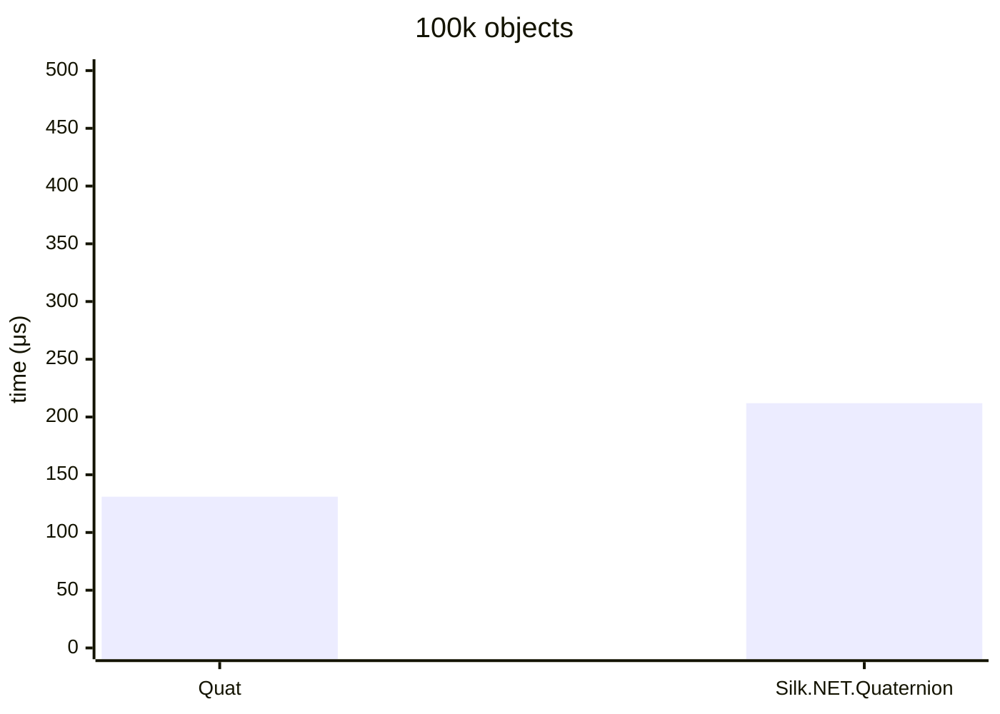
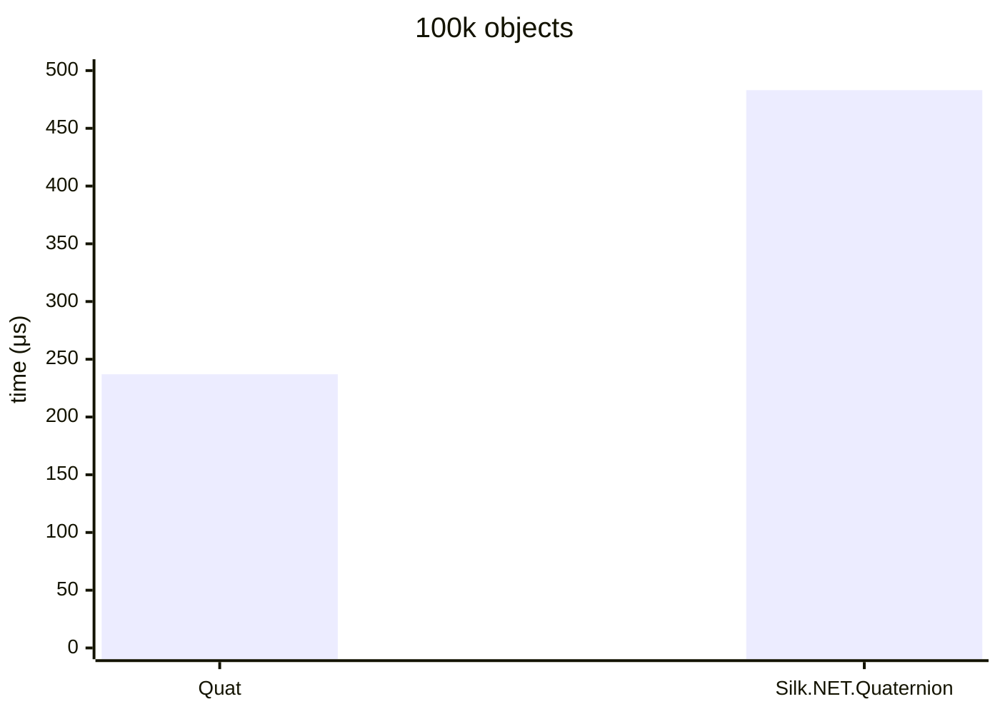
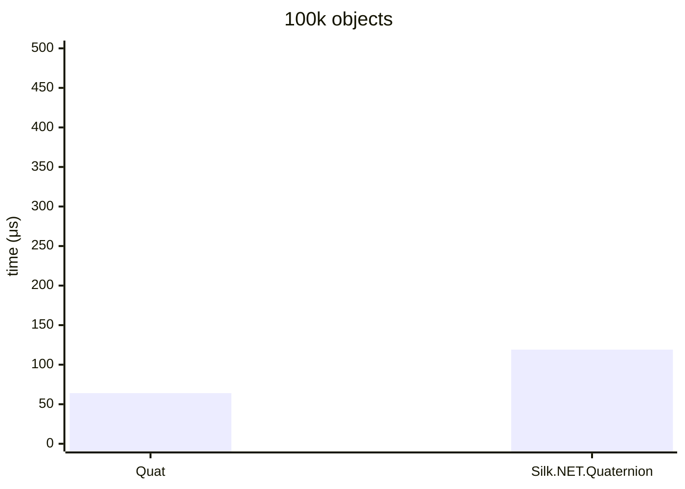
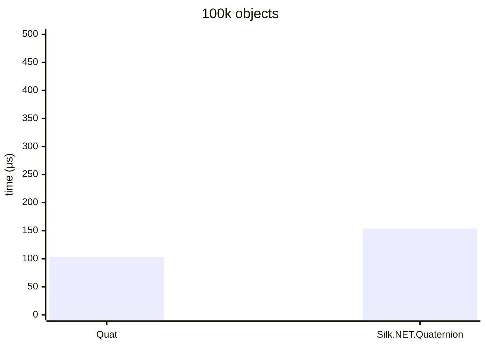
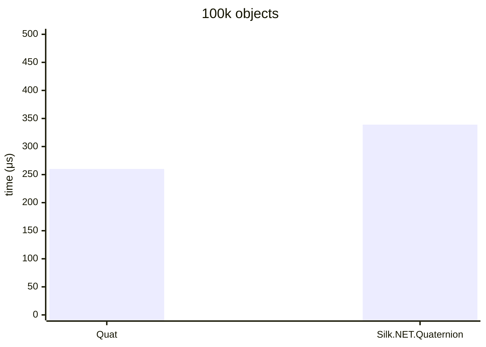

## .NET 11.0.0 (11.0.0, 11.0.26.53018), X64 RyuJIT x86-64-v4 (Job: Job-IHFIKV(Runtime=.NET 11.0))

```
BenchmarkDotNet v0.16.0-nightly.20261117.686, Windows 11 (10.0.26300.9974)
AMD Ryzen 9 7900X 4.69GHz, 1 CPU, 24 logical and 12 physical cores
```

## Multiply



### Quat&lt;double&gt;

<details>
<summary>asm</summary>

```assembly
; System.Numerics.Bench.StressQuat`1[[System.Double, System.Private.CoreLib]].Multiply()
       push      rbx
       sub       rsp,20
       mov       rax,[rcx+10]
       xor       edx,edx
M00_L00:
       mov       r8,rax
       mov       r10,[rcx+8]
       mov       r9,r10
       mov       r11d,[r9+8]
       cmp       edx,r11d
       jae       near ptr M00_L01
       mov       rbx,rdx
       shl       rbx,5
       vmovups   ymm0,[r9+rbx+10]
       lea       r9d,[rdx+1]
       cmp       r9d,r11d
       jae       near ptr M00_L01
       mov       r11d,r9d
       shl       r11,5
       vmovups   ymm1,[r10+r11+10]
       vmovaps   xmm2,xmm0
       vmovaps   xmm3,xmm2
       vbroadcastsd ymm3,xmm3
       vpermilpd xmm2,xmm2,1
       vperm2f128 ymm0,ymm0,ymm0,1
       vpermilpd xmm4,xmm0,1
       vbroadcastsd ymm2,xmm2
       vbroadcastsd ymm0,xmm0
       vbroadcastsd ymm4,xmm4
       vpermq    ymm5,ymm1,1B
       vmulpd    ymm3,ymm5,ymm3
       vpermq    ymm5,ymm1,4E
       vmulpd    ymm2,ymm5,ymm2
       vshufpd   ymm5,ymm1,ymm1,5
       vmulpd    ymm0,ymm5,ymm0
       vmulpd    ymm1,ymm1,ymm4
       vfmadd132pd ymm3,ymm1,[7FF915F64F60]
       vfmadd132pd ymm2,ymm3,[7FF915F64F80]
       vfmadd132pd ymm0,ymm2,[7FF915F64FA0]
       cmp       edx,[r8+8]
       jae       short M00_L01
       vmovups   [r8+rbx+10],ymm0
       mov       edx,r9d
       cmp       edx,1869F
       jl        near ptr M00_L00
       vzeroupper
       add       rsp,20
       pop       rbx
       ret
M00_L01:
       call      Internal.Runtime.CompilerHelpers.ThrowHelpers.ThrowIndexOutOfRangeException()
       int       3
; Total bytes of code 224
```
</details>

### Silk.NET.Quaternion&lt;double&gt;

<details>
<summary>asm</summary>

```assembly
; System.Numerics.Bench.StressQuaternion`1[[System.Double, System.Private.CoreLib]].Multiply()
       sub       rsp,28
       xor       eax,eax
M00_L00:
       mov       rdx,[rcx+10]
       mov       r8,[rcx+8]
       mov       r10,r8
       mov       r9d,[r10+8]
       cmp       eax,r9d
       jae       near ptr M00_L01
       mov       r11,rax
       shl       r11,5
       lea       r10,[r10+r11+10]
       vmovsd    xmm0,qword ptr [r10]
       vmovsd    xmm1,qword ptr [r10+8]
       vmovsd    xmm2,qword ptr [r10+10]
       vmovsd    xmm3,qword ptr [r10+18]
       lea       r10d,[rax+1]
       cmp       r10d,r9d
       jae       near ptr M00_L01
       mov       r9d,r10d
       shl       r9,5
       lea       r8,[r8+r9+10]
       vmovsd    xmm4,qword ptr [r8]
       vmovsd    xmm5,qword ptr [r8+8]
       vmovsd    xmm16,qword ptr [r8+10]
       vmovsd    xmm17,qword ptr [r8+18]
       vmulsd    xmm18,xmm16,xmm1
       vmulsd    xmm19,xmm2,xmm5
       vsubsd    xmm18,xmm18,xmm19
       vmulsd    xmm19,xmm2,xmm4
       vmulsd    xmm20,xmm16,xmm0
       vsubsd    xmm19,xmm19,xmm20
       vmulsd    xmm20,xmm0,xmm5
       vmulsd    xmm21,xmm1,xmm4
       vsubsd    xmm20,xmm20,xmm21
       vmulsd    xmm21,xmm0,xmm4
       vmulsd    xmm22,xmm1,xmm5
       vaddsd    xmm21,xmm22,xmm21
       vmulsd    xmm22,xmm16,xmm2
       vaddsd    xmm21,xmm22,xmm21
       vmulsd    xmm0,xmm17,xmm0
       vmulsd    xmm4,xmm4,xmm3
       vaddsd    xmm0,xmm4,xmm0
       vaddsd    xmm0,xmm18,xmm0
       vmulsd    xmm1,xmm17,xmm1
       vmulsd    xmm4,xmm5,xmm3
       vaddsd    xmm1,xmm4,xmm1
       vaddsd    xmm1,xmm19,xmm1
       vmulsd    xmm2,xmm17,xmm2
       vmulsd    xmm4,xmm16,xmm3
       vaddsd    xmm2,xmm4,xmm2
       vaddsd    xmm2,xmm20,xmm2
       vmulsd    xmm3,xmm17,xmm3
       vsubsd    xmm3,xmm3,xmm21
       cmp       eax,[rdx+8]
       jae       short M00_L01
       lea       rax,[rdx+r11+10]
       vmovsd    qword ptr [rax],xmm0
       vmovsd    qword ptr [rax+8],xmm1
       vmovsd    qword ptr [rax+10],xmm2
       vmovsd    qword ptr [rax+18],xmm3
       mov       eax,r10d
       cmp       eax,1869F
       jl        near ptr M00_L00
       add       rsp,28
       ret
M00_L01:
       call      Internal.Runtime.CompilerHelpers.ThrowHelpers.ThrowIndexOutOfRangeException()
       int       3
; Total bytes of code 327
```
</details><br/>

## Divide



### Quat&lt;double&gt;

<details>
<summary>asm</summary>

```assembly
; System.Numerics.Bench.StressQuat`1[[System.Double, System.Private.CoreLib]].Divide()
       push      rbx
       sub       rsp,20
       mov       rax,[rcx+10]
       xor       edx,edx
M00_L00:
       mov       r8,rax
       mov       r10,[rcx+8]
       mov       r9,r10
       mov       r11d,[r9+8]
       cmp       edx,r11d
       jae       near ptr M00_L01
       mov       rbx,rdx
       shl       rbx,5
       vmovups   ymm0,[r9+rbx+10]
       lea       r9d,[rdx+1]
       cmp       r9d,r11d
       jae       near ptr M00_L01
       mov       r11d,r9d
       shl       r11,5
       vmovups   ymm1,[r10+r11+10]
       vmulpd    ymm2,ymm1,[7FF915FA5E80]
       vmulpd    ymm1,ymm1,ymm1
       vpermilpd ymm3,ymm1,5
       vaddpd    ymm1,ymm3,ymm1
       vperm2f128 ymm3,ymm1,ymm1,1
       vaddpd    ymm1,ymm3,ymm1
       vbroadcastsd ymm1,xmm1
       vdivpd    ymm2,ymm2,ymm1
       vcmpnlepd ymm1,ymm1,[7FF915FA5EA0]
       vandpd    ymm1,ymm1,ymm2
       vmovaps   xmm2,xmm0
       vmovaps   xmm3,xmm2
       vbroadcastsd ymm3,xmm3
       vpermilpd xmm2,xmm2,1
       vperm2f128 ymm0,ymm0,ymm0,1
       vpermilpd xmm4,xmm0,1
       vbroadcastsd ymm2,xmm2
       vbroadcastsd ymm0,xmm0
       vbroadcastsd ymm4,xmm4
       vpermq    ymm5,ymm1,1B
       vmulpd    ymm3,ymm5,ymm3
       vpermq    ymm5,ymm1,4E
       vmulpd    ymm2,ymm5,ymm2
       vshufpd   ymm5,ymm1,ymm1,5
       vmulpd    ymm0,ymm5,ymm0
       vmulpd    ymm1,ymm1,ymm4
       vfmadd132pd ymm3,ymm1,[7FF915FA5EC0]
       vfmadd132pd ymm2,ymm3,[7FF915FA5EE0]
       vfmadd132pd ymm0,ymm2,[7FF915FA5F00]
       cmp       edx,[r8+8]
       jae       short M00_L01
       vmovups   [r8+rbx+10],ymm0
       mov       edx,r9d
       cmp       edx,1869F
       jl        near ptr M00_L00
       vzeroupper
       add       rsp,20
       pop       rbx
       ret
M00_L01:
       call      Internal.Runtime.CompilerHelpers.ThrowHelpers.ThrowIndexOutOfRangeException()
       int       3
; Total bytes of code 278
```
</details>

### Silk.NET.Quaternion&lt;double&gt;

<details>
<summary>asm</summary>

```assembly
; System.Numerics.Bench.StressQuaternion`1[[System.Double, System.Private.CoreLib]].Divide()
       sub       rsp,28
       vmovsd    xmm0,qword ptr [7FF915F739F8]
       xor       eax,eax
M00_L00:
       mov       rdx,[rcx+10]
       mov       r8,[rcx+8]
       mov       r10,r8
       mov       r9d,[r10+8]
       cmp       eax,r9d
       jae       near ptr M00_L01
       mov       r11,rax
       shl       r11,5
       lea       r10,[r10+r11+10]
       vmovsd    xmm1,qword ptr [r10]
       vmovsd    xmm2,qword ptr [r10+8]
       vmovsd    xmm3,qword ptr [r10+10]
       vmovsd    xmm4,qword ptr [r10+18]
       lea       r10d,[rax+1]
       cmp       r10d,r9d
       jae       near ptr M00_L01
       mov       r9d,r10d
       shl       r9,5
       lea       r8,[r8+r9+10]
       vmovsd    xmm5,qword ptr [r8]
       vmovsd    xmm16,qword ptr [r8+8]
       vmovsd    xmm17,qword ptr [r8+10]
       vmovsd    xmm18,qword ptr [r8+18]
       vmulsd    xmm19,xmm5,xmm5
       vmulsd    xmm20,xmm16,xmm16
       vaddsd    xmm19,xmm20,xmm19
       vmulsd    xmm20,xmm17,xmm17
       vaddsd    xmm19,xmm20,xmm19
       vmulsd    xmm20,xmm18,xmm18
       vaddsd    xmm19,xmm20,xmm19
       vdivsd    xmm19,xmm0,xmm19
       vmulsd    xmm5,xmm19,xmm5
       vxorps    xmm5,xmm5,[7FF915F73A00]
       vmulsd    xmm16,xmm16,xmm19
       vxorps    xmm16,xmm16,[7FF915F73A10]
       vmulsd    xmm17,xmm17,xmm19
       vxorps    xmm17,xmm17,[7FF915F73A20]
       vmulsd    xmm18,xmm18,xmm19
       vmulsd    xmm19,xmm17,xmm2
       vmulsd    xmm20,xmm16,xmm3
       vsubsd    xmm19,xmm19,xmm20
       vmulsd    xmm20,xmm3,xmm5
       vmulsd    xmm21,xmm17,xmm1
       vsubsd    xmm20,xmm20,xmm21
       vmulsd    xmm21,xmm16,xmm1
       vmulsd    xmm22,xmm2,xmm5
       vsubsd    xmm21,xmm21,xmm22
       vmulsd    xmm22,xmm1,xmm5
       vmulsd    xmm23,xmm16,xmm2
       vaddsd    xmm22,xmm23,xmm22
       vmulsd    xmm23,xmm17,xmm3
       vaddsd    xmm22,xmm23,xmm22
       vmulsd    xmm1,xmm18,xmm1
       vmulsd    xmm5,xmm5,xmm4
       vaddsd    xmm1,xmm5,xmm1
       vaddsd    xmm1,xmm19,xmm1
       vmulsd    xmm2,xmm18,xmm2
       vmulsd    xmm5,xmm16,xmm4
       vaddsd    xmm2,xmm5,xmm2
       vaddsd    xmm2,xmm20,xmm2
       vmulsd    xmm3,xmm18,xmm3
       vmulsd    xmm5,xmm17,xmm4
       vaddsd    xmm3,xmm5,xmm3
       vaddsd    xmm3,xmm21,xmm3
       vmulsd    xmm4,xmm18,xmm4
       vsubsd    xmm4,xmm4,xmm22
       cmp       eax,[rdx+8]
       jae       short M00_L01
       lea       rax,[rdx+r11+10]
       vmovsd    qword ptr [rax],xmm1
       vmovsd    qword ptr [rax+8],xmm2
       vmovsd    qword ptr [rax+10],xmm3
       vmovsd    qword ptr [rax+18],xmm4
       mov       eax,r10d
       cmp       eax,1869F
       jl        near ptr M00_L00
       add       rsp,28
       ret
M00_L01:
       call      Internal.Runtime.CompilerHelpers.ThrowHelpers.ThrowIndexOutOfRangeException()
       int       3
; Total bytes of code 438
```
</details></br>

## Conjugate



### Quat&lt;double&gt;

<details>
<summary>asm</summary>

```assembly
; System.Numerics.Bench.StressQuat`1[[System.Double, System.Private.CoreLib]].Conjugate()
       sub       rsp,28
       mov       rax,[rcx+10]
       xor       edx,edx
       nop       word ptr [rax+rax]
M00_L00:
       mov       r8,rax
       mov       r10,[rcx+8]
       cmp       edx,[r10+8]
       jae       short M00_L01
       mov       r9,rdx
       shl       r9,5
       vmovups   ymm0,[r10+r9+10]
       vmulpd    ymm0,ymm0,[7FF915F83EA0]
       cmp       edx,[r8+8]
       jae       short M00_L01
       vmovups   [r8+r9+10],ymm0
       inc       edx
       cmp       edx,186A0
       jl        short M00_L00
       vzeroupper
       add       rsp,28
       ret
M00_L01:
       call      Internal.Runtime.CompilerHelpers.ThrowHelpers.ThrowIndexOutOfRangeException()
       int       3
; Total bytes of code 88
```
</details>

### Silk.NET.Quaternion&lt;double&gt;

<details>
<summary>asm</summary>

```assembly
; System.Numerics.Bench.StressQuaternion`1[[System.Double, System.Private.CoreLib]].Conjugate()
       sub       rsp,28
       xor       eax,eax
M00_L00:
       mov       rdx,[rcx+10]
       mov       r8,[rcx+8]
       cmp       eax,[r8+8]
       jae       short M00_L01
       mov       r10,rax
       shl       r10,5
       lea       r8,[r8+r10+10]
       vmovsd    xmm0,qword ptr [r8]
       vmovsd    xmm1,qword ptr [r8+8]
       vmovsd    xmm2,qword ptr [r8+10]
       vmovsd    xmm3,qword ptr [r8+18]
       vxorps    xmm0,xmm0,[7FF915F62C60]
       vxorps    xmm1,xmm1,[7FF915F62C60]
       vxorps    xmm2,xmm2,[7FF915F62C60]
       cmp       eax,[rdx+8]
       jae       short M00_L01
       lea       rdx,[rdx+r10+10]
       vmovsd    qword ptr [rdx],xmm0
       vmovsd    qword ptr [rdx+8],xmm1
       vmovsd    qword ptr [rdx+10],xmm2
       vmovsd    qword ptr [rdx+18],xmm3
       inc       eax
       cmp       eax,186A0
       jl        short M00_L00
       add       rsp,28
       ret
M00_L01:
       call      Internal.Runtime.CompilerHelpers.ThrowHelpers.ThrowIndexOutOfRangeException()
       int       3
; Total bytes of code 128
```
</details></br>

## Inverse



### Quat&lt;double&gt;

<details>
<summary>asm</summary>

```assembly
; System.Numerics.Bench.StressQuat`1[[System.Double, System.Private.CoreLib]].Inverse()
       sub       rsp,28
       mov       rax,[rcx+10]
       xor       edx,edx
M00_L00:
       mov       r8,rax
       mov       r10,[rcx+8]
       cmp       edx,[r10+8]
       jae       short M00_L01
       mov       r9,rdx
       shl       r9,5
       vmovups   ymm0,[r10+r9+10]
       vmulpd    ymm1,ymm0,[7FF915F73840]
       vmulpd    ymm0,ymm0,ymm0
       vpermilpd ymm2,ymm0,5
       vaddpd    ymm0,ymm2,ymm0
       vperm2f128 ymm2,ymm0,ymm0,1
       vaddpd    ymm0,ymm2,ymm0
       vbroadcastsd ymm0,xmm0
       cmp       edx,[r8+8]
       jae       short M00_L01
       vdivpd    ymm1,ymm1,ymm0
       vcmpnlepd ymm0,ymm0,[7FF915F73860]
       vandpd    ymm0,ymm0,ymm1
       vmovups   [r8+r9+10],ymm0
       inc       edx
       cmp       edx,186A0
       jl        short M00_L00
       vzeroupper
       add       rsp,28
       ret
M00_L01:
       call      Internal.Runtime.CompilerHelpers.ThrowHelpers.ThrowIndexOutOfRangeException()
       int       3
; Total bytes of code 128
```
</details>

### Silk.NET.Quaternion&lt;double&gt;

<details>
<summary>asm</summary>

```assembly
; System.Numerics.Bench.StressQuaternion`1[[System.Double, System.Private.CoreLib]].Inverse()
       sub       rsp,28
       vmovsd    xmm0,qword ptr [7FF915F830B0]
       xor       eax,eax
M00_L00:
       mov       rdx,[rcx+10]
       mov       r8,[rcx+8]
       cmp       eax,[r8+8]
       jae       near ptr M00_L01
       mov       r10,rax
       shl       r10,5
       lea       r8,[r8+r10+10]
       vmovsd    xmm1,qword ptr [r8]
       vmovsd    xmm2,qword ptr [r8+8]
       vmovsd    xmm3,qword ptr [r8+10]
       vmovsd    xmm4,qword ptr [r8+18]
       vmulsd    xmm5,xmm1,xmm1
       vmulsd    xmm16,xmm2,xmm2
       vaddsd    xmm5,xmm16,xmm5
       vmulsd    xmm16,xmm3,xmm3
       vaddsd    xmm5,xmm16,xmm5
       vmulsd    xmm16,xmm4,xmm4
       vaddsd    xmm5,xmm16,xmm5
       vdivsd    xmm5,xmm0,xmm5
       vmulsd    xmm1,xmm1,xmm5
       vxorps    xmm1,xmm1,[7FF915F830C0]
       vmulsd    xmm2,xmm2,xmm5
       vxorps    xmm2,xmm2,[7FF915F830D0]
       vmulsd    xmm3,xmm3,xmm5
       vxorps    xmm3,xmm3,[7FF915F830E0]
       vmulsd    xmm4,xmm4,xmm5
       cmp       eax,[rdx+8]
       jae       short M00_L01
       lea       rdx,[rdx+r10+10]
       vmovsd    qword ptr [rdx],xmm1
       vmovsd    qword ptr [rdx+8],xmm2
       vmovsd    qword ptr [rdx+10],xmm3
       vmovsd    qword ptr [rdx+18],xmm4
       inc       eax
       cmp       eax,186A0
       jl        near ptr M00_L00
       add       rsp,28
       ret
M00_L01:
       call      Internal.Runtime.CompilerHelpers.ThrowHelpers.ThrowIndexOutOfRangeException()
       int       3
; Total bytes of code 204
```
</details>

## Lerp



### Quat&lt;double&gt;

<details>
<summary>asm</summary>

```assembly
; System.Numerics.Bench.StressQuat`1[[System.Double, System.Private.CoreLib]].Lerp()
       push      rsi
       push      rbx
       sub       rsp,38
       vmovaps   [rsp+20],xmm6
       mov       rax,[rcx+10]
       vbroadcastsd ymm0,qword ptr [7FF915F74300]
       vbroadcastsd ymm1,qword ptr [7FF915F74308]
       xor       edx,edx
M00_L00:
       mov       r8,rax
       mov       r10,[rcx+8]
       mov       r9,r10
       mov       r11d,[r9+8]
       cmp       edx,r11d
       jae       near ptr M00_L01
       mov       rbx,rdx
       shl       rbx,5
       lea       r9,[r9+rbx+10]
       lea       esi,[rdx+1]
       cmp       esi,r11d
       jae       near ptr M00_L01
       mov       r11d,esi
       shl       r11,5
       vmovups   ymm2,[r10+r11+10]
       vmovups   ymm3,[r9]
       vxorps    ymm4,ymm4,ymm4
       vmulpd    ymm5,ymm2,ymm3
       vpermilpd ymm16,ymm5,5
       vaddpd    ymm5,ymm16,ymm5
       vperm2f128 ymm6,ymm5,ymm5,1
       vaddpd    ymm5,ymm6,ymm5
       vbroadcastsd ymm5,xmm5
       vxorps    ymm16,ymm16,ymm16
       vpcmpnltq k1,ymm5,ymm16
       vxorpd    ymm5,ymm1,ymm2
       vandpd    ymm5{k1},ymm0,ymm2
       vfmadd213pd ymm4,ymm3,ymm5
       cmp       edx,[r8+8]
       jae       short M00_L01
       vmulpd    ymm2,ymm4,ymm4
       vpermilpd ymm3,ymm2,5
       vaddpd    ymm2,ymm3,ymm2
       vperm2f128 ymm3,ymm2,ymm2,1
       vaddpd    ymm2,ymm3,ymm2
       vsqrtsd   xmm2,xmm2,xmm2
       vbroadcastsd ymm2,xmm2
       vdivpd    ymm2,ymm4,ymm2
       vmovups   [r8+rbx+10],ymm2
       mov       edx,esi
       cmp       edx,1869F
       jl        near ptr M00_L00
       vzeroupper
       vmovaps   xmm6,[rsp+20]
       add       rsp,38
       pop       rbx
       pop       rsi
       ret
M00_L01:
       call      Internal.Runtime.CompilerHelpers.ThrowHelpers.ThrowIndexOutOfRangeException()
       int       3
; Total bytes of code 252
```
</details>

### Silk.NET.Quaternion&lt;double&gt;

<details>
<summary>asm</summary>

```assembly
; System.Numerics.Bench.StressQuaternion`1[[System.Double, System.Private.CoreLib]].Lerp()
       sub       rsp,28
       vmovsd    xmm0,qword ptr [7FF915F93318]
       xor       eax,eax
M00_L00:
       mov       rdx,[rcx+10]
       mov       r8,[rcx+8]
       mov       r10,r8
       mov       r9d,[r10+8]
       cmp       eax,r9d
       jae       near ptr M00_L03
       mov       r11,rax
       shl       r11,5
       lea       r10,[r10+r11+10]
       vmovsd    xmm1,qword ptr [r10]
       vmovsd    xmm2,qword ptr [r10+8]
       vmovsd    xmm3,qword ptr [r10+10]
       vmovsd    xmm4,qword ptr [r10+18]
       lea       r10d,[rax+1]
       cmp       r10d,r9d
       jae       near ptr M00_L03
       mov       r9d,r10d
       shl       r9,5
       lea       r8,[r8+r9+10]
       vmovsd    xmm5,qword ptr [r8]
       vmovsd    xmm16,qword ptr [r8+8]
       vmovsd    xmm17,qword ptr [r8+10]
       vmovsd    xmm18,qword ptr [r8+18]
       vmulsd    xmm19,xmm1,xmm5
       vmulsd    xmm20,xmm16,xmm2
       vaddsd    xmm19,xmm20,xmm19
       vmulsd    xmm20,xmm17,xmm3
       vaddsd    xmm19,xmm20,xmm19
       vmulsd    xmm20,xmm18,xmm4
       vaddsd    xmm19,xmm20,xmm19
       vxorps    xmm20,xmm20,xmm20
       vucomisd  xmm19,xmm20
       jb        near ptr M00_L02
       vxorps    xmm19,xmm19,xmm19
       vmulsd    xmm1,xmm19,xmm1
       vaddsd    xmm1,xmm1,xmm5
       vmulsd    xmm5,xmm19,xmm2
       vaddsd    xmm5,xmm16,xmm5
       vmulsd    xmm2,xmm19,xmm3
       vaddsd    xmm2,xmm17,xmm2
       vmulsd    xmm16,xmm19,xmm4
       vaddsd    xmm16,xmm16,xmm18
M00_L01:
       vmulsd    xmm3,xmm1,xmm1
       vmulsd    xmm4,xmm5,xmm5
       vaddsd    xmm3,xmm4,xmm3
       vmulsd    xmm4,xmm2,xmm2
       vaddsd    xmm3,xmm4,xmm3
       vmulsd    xmm4,xmm16,xmm16
       vaddsd    xmm3,xmm4,xmm3
       vsqrtsd   xmm3,xmm3,xmm3
       vdivsd    xmm3,xmm0,xmm3
       vmulsd    xmm1,xmm1,xmm3
       vmulsd    xmm5,xmm5,xmm3
       vmulsd    xmm2,xmm2,xmm3
       vmulsd    xmm16,xmm16,xmm3
       cmp       eax,[rdx+8]
       jae       short M00_L03
       lea       rax,[rdx+r11+10]
       vmovsd    qword ptr [rax],xmm1
       vmovsd    qword ptr [rax+8],xmm5
       vmovsd    qword ptr [rax+10],xmm2
       vmovsd    qword ptr [rax+18],xmm16
       mov       eax,r10d
       cmp       eax,1869F
       jl        near ptr M00_L00
       add       rsp,28
       ret
M00_L02:
       vxorps    xmm19,xmm19,xmm19
       vmulsd    xmm1,xmm19,xmm1
       vsubsd    xmm1,xmm1,xmm5
       vmulsd    xmm2,xmm19,xmm2
       vsubsd    xmm5,xmm2,xmm16
       vmulsd    xmm2,xmm19,xmm3
       vsubsd    xmm2,xmm2,xmm17
       vmulsd    xmm3,xmm19,xmm4
       vsubsd    xmm16,xmm3,xmm18
       jmp       near ptr M00_L01
M00_L03:
       call      Internal.Runtime.CompilerHelpers.ThrowHelpers.ThrowIndexOutOfRangeException()
       int       3
; Total bytes of code 405
```
</details>

## Slerp


### Quat&lt;double&gt;

<details>
<summary>asm</summary>

```assembly
; System.Numerics.Bench.StressQuat`1[[System.Double, System.Private.CoreLib]].Slerp()
       push      r15
       push      r14
       push      rdi
       push      rsi
       push      rbp
       push      rbx
       sub       rsp,0C8
       vmovaps   [rsp+0B0],xmm6
       vmovaps   [rsp+0A0],xmm7
       vmovaps   [rsp+90],xmm8
       vmovaps   [rsp+80],xmm9
       vmovaps   [rsp+70],xmm10
       vmovaps   [rsp+60],xmm11
       vmovaps   [rsp+50],xmm12
       vmovaps   [rsp+40],xmm13
       vmovaps   [rsp+30],xmm14
       mov       rbx,rcx
       mov       rsi,[rbx+10]
       vmovsd    xmm6,qword ptr [7FF915F84CA8]
       vsubsd    xmm7,xmm6,qword ptr [7FF9156EB1B0]
       xor       edi,edi
M00_L00:
       mov       rbp,rsi
       mov       rax,[rbx+8]
       mov       rcx,rax
       mov       edx,[rcx+8]
       cmp       edi,edx
       jae       near ptr M00_L05
       mov       r14,rdi
       shl       r14,5
       lea       rcx,[rcx+r14+10]
       lea       r15d,[rdi+1]
       cmp       r15d,edx
       jae       near ptr M00_L05
       mov       edx,r15d
       shl       rdx,5
       vmovups   ymm8,[rax+rdx+10]
       vmovups   ymm9,[rcx]
       vmulpd    ymm0,ymm9,ymm8
       vpermilpd ymm1,ymm0,5
       vaddpd    ymm0,ymm1,ymm0
       vperm2f128 ymm1,ymm0,ymm0,1
       vaddpd    ymm0,ymm1,ymm0
       vmovaps   xmm10,xmm6
       vmovq     rax,xmm0
       test      rax,rax
       jl        near ptr M00_L03
M00_L01:
       vucomisd  xmm0,xmm7
       jbe       near ptr M00_L04
       vxorps    xmm11,xmm11,xmm11
M00_L02:
       cmp       edi,[rbp+8]
       jae       near ptr M00_L05
       vbroadcastsd ymm0,xmm11
       vmulpd    ymm0,ymm9,ymm0
       vbroadcastsd ymm1,xmm10
       vmulpd    ymm1,ymm8,ymm1
       vaddpd    ymm0,ymm1,ymm0
       vmovups   [rbp+r14+10],ymm0
       mov       edi,r15d
       cmp       edi,1869F
       jl        near ptr M00_L00
       vzeroupper
       vmovaps   xmm6,[rsp+0B0]
       vmovaps   xmm7,[rsp+0A0]
       vmovaps   xmm8,[rsp+90]
       vmovaps   xmm9,[rsp+80]
       vmovaps   xmm10,[rsp+70]
       vmovaps   xmm11,[rsp+60]
       vmovaps   xmm12,[rsp+50]
       vmovaps   xmm13,[rsp+40]
       vmovaps   xmm14,[rsp+30]
       add       rsp,0C8
       pop       rbx
       pop       rbp
       pop       rsi
       pop       rdi
       pop       r14
       pop       r15
       ret
M00_L03:
       vxorps    xmm0,xmm0,[7FF915F84CB0]
       vmovsd    xmm10,qword ptr [7FF915F84CC0]
       jmp       near ptr M00_L01
M00_L04:
       vextractf128 xmm12,ymm8,1
       vextractf128 xmm13,ymm9,1
       vzeroupper
       call      qword ptr [7FF915F14528]; Precode of System.Double.Acos(Double)
       vmovsd    qword ptr [rsp+28],xmm0
       vzeroupper
       call      qword ptr [7FF915F14540]; Precode of System.Double.Sin(Double)
       vdivsd    xmm14,xmm6,xmm0
       vxorps    xmm0,xmm0,xmm0
       vmulsd    xmm0,xmm0,qword ptr [rsp+28]
       vzeroupper
       call      qword ptr [7FF915F14540]; Precode of System.Double.Sin(Double)
       vmulsd    xmm11,xmm14,xmm0
       vmovsd    xmm0,qword ptr [rsp+28]
       vzeroupper
       call      qword ptr [7FF915F14540]; Precode of System.Double.Sin(Double)
       vmulsd    xmm0,xmm14,xmm0
       vmulsd    xmm10,xmm10,xmm0
       vinsertf128 ymm8,ymm8,xmm12,1
       vinsertf128 ymm9,ymm9,xmm13,1
       jmp       near ptr M00_L02
M00_L05:
       call      Internal.Runtime.CompilerHelpers.ThrowHelpers.ThrowIndexOutOfRangeException()
       int       3
; Total bytes of code 487
```
</details>

### Silk.NET.Quaternion&lt;double&gt;

<details>
<summary>asm</summary>

```assembly
; System.Numerics.Bench.StressQuaternion`1[[System.Double, System.Private.CoreLib]].Slerp()
       push      r15
       push      r14
       push      rdi
       push      rsi
       push      rbp
       push      rbx
       sub       rsp,0D8
       vzeroupper
       vmovaps   [rsp+0C0],xmm6
       vmovaps   [rsp+0B0],xmm7
       vmovaps   [rsp+0A0],xmm8
       vmovaps   [rsp+90],xmm9
       vmovaps   [rsp+80],xmm10
       vmovaps   [rsp+70],xmm11
       vmovaps   [rsp+60],xmm12
       vmovaps   [rsp+50],xmm13
       vmovaps   [rsp+40],xmm14
       vmovaps   [rsp+30],xmm15
       mov       rbx,rcx
       vmovsd    xmm6,qword ptr [7FF915F63F08]
       xor       esi,esi
M00_L00:
       mov       rdi,[rbx+10]
       mov       rax,[rbx+8]
       mov       rcx,rax
       mov       edx,[rcx+8]
       cmp       esi,edx
       jae       near ptr M00_L08
       mov       rbp,rsi
       shl       rbp,5
       lea       rcx,[rcx+rbp+10]
       vmovsd    xmm7,qword ptr [rcx]
       vmovsd    xmm8,qword ptr [rcx+8]
       vmovsd    xmm9,qword ptr [rcx+10]
       vmovsd    xmm10,qword ptr [rcx+18]
       lea       r14d,[rsi+1]
       cmp       r14d,edx
       jae       near ptr M00_L08
       mov       ecx,r14d
       shl       rcx,5
       lea       rax,[rax+rcx+10]
       vmovsd    xmm11,qword ptr [rax]
       vmovsd    xmm12,qword ptr [rax+8]
       vmovsd    xmm13,qword ptr [rax+10]
       vmovsd    xmm14,qword ptr [rax+18]
       vmulsd    xmm0,xmm11,xmm7
       vmulsd    xmm1,xmm8,xmm12
       vaddsd    xmm0,xmm1,xmm0
       vmulsd    xmm1,xmm9,xmm13
       vaddsd    xmm0,xmm1,xmm0
       vmulsd    xmm1,xmm10,xmm14
       vaddsd    xmm0,xmm1,xmm0
       xor       r15d,r15d
       vxorps    xmm1,xmm1,xmm1
       vucomisd  xmm0,xmm1
       jb        near ptr M00_L03
M00_L01:
       vucomisd  xmm0,xmm6
       jbe       near ptr M00_L05
       vxorps    xmm15,xmm15,xmm15
       test      r15d,r15d
       jne       near ptr M00_L04
       vmovsd    xmm0,qword ptr [7FF915F63F10]
M00_L02:
       vmulsd    xmm1,xmm15,xmm7
       vmulsd    xmm2,xmm11,xmm0
       vaddsd    xmm1,xmm2,xmm1
       vmulsd    xmm2,xmm15,xmm8
       vmulsd    xmm3,xmm12,xmm0
       vaddsd    xmm2,xmm3,xmm2
       vmulsd    xmm3,xmm15,xmm9
       vmulsd    xmm4,xmm13,xmm0
       vaddsd    xmm3,xmm4,xmm3
       vmulsd    xmm4,xmm15,xmm10
       vmulsd    xmm0,xmm14,xmm0
       vaddsd    xmm0,xmm0,xmm4
       cmp       esi,[rdi+8]
       jae       near ptr M00_L08
       lea       rax,[rdi+rbp+10]
       vmovsd    qword ptr [rax],xmm1
       vmovsd    qword ptr [rax+8],xmm2
       vmovsd    qword ptr [rax+10],xmm3
       vmovsd    qword ptr [rax+18],xmm0
       mov       esi,r14d
       cmp       esi,1869F
       jl        near ptr M00_L00
       vmovaps   xmm6,[rsp+0C0]
       vmovaps   xmm7,[rsp+0B0]
       vmovaps   xmm8,[rsp+0A0]
       vmovaps   xmm9,[rsp+90]
       vmovaps   xmm10,[rsp+80]
       vmovaps   xmm11,[rsp+70]
       vmovaps   xmm12,[rsp+60]
       vmovaps   xmm13,[rsp+50]
       vmovaps   xmm14,[rsp+40]
       vmovaps   xmm15,[rsp+30]
       add       rsp,0D8
       pop       rbx
       pop       rbp
       pop       rsi
       pop       rdi
       pop       r14
       pop       r15
       ret
M00_L03:
       mov       r15d,1
       vxorps    xmm0,xmm0,[7FF915F63F20]
       jmp       near ptr M00_L01
M00_L04:
       vmovsd    xmm0,qword ptr [7FF915F63F30]
       jmp       near ptr M00_L02
M00_L05:
       call      00007FF9753D42D0
       vmovsd    qword ptr [rsp+28],xmm0
       call      00007FF9753D43E0
       vmovsd    xmm1,qword ptr [7FF915F63F10]
       vdivsd    xmm0,xmm1,xmm0
       vmovsd    qword ptr [rsp+20],xmm0
       vxorps    xmm1,xmm1,xmm1
       vmulsd    xmm0,xmm1,qword ptr [rsp+28]
       call      00007FF9753D43E0
       vmulsd    xmm15,xmm0,qword ptr [rsp+20]
       test      r15d,r15d
       jne       short M00_L06
       vmovsd    xmm0,qword ptr [rsp+28]
       call      00007FF9753D43E0
       vmulsd    xmm0,xmm0,qword ptr [rsp+20]
       jmp       short M00_L07
M00_L06:
       vmovsd    xmm0,qword ptr [rsp+28]
       call      00007FF9753D43E0
       vmulsd    xmm0,xmm0,qword ptr [rsp+20]
       vxorps    xmm0,xmm0,[7FF915F63F20]
M00_L07:
       jmp       near ptr M00_L02
M00_L08:
       call      Internal.Runtime.CompilerHelpers.ThrowHelpers.ThrowIndexOutOfRangeException()
       int       3
; Total bytes of code 610
```
</details>
